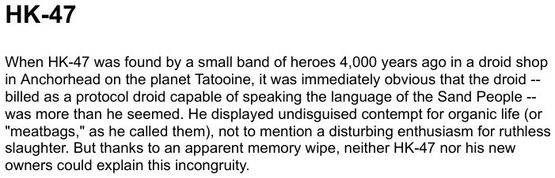
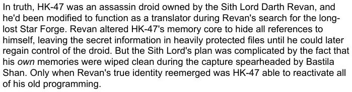
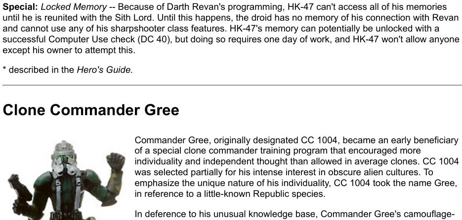
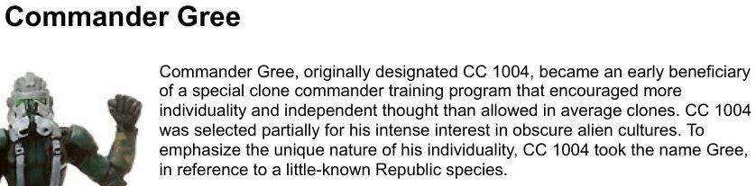
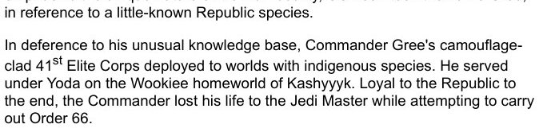

# Owner Material 037 — Star Wars D20 Drive folder (Core, Revised Core and Saga Edition): Characters/Miniatures/Champions of the Force Preview 1.pdf [Star Wars Roleplaying Game Revised Core (d20, 2002)]

- **Source:** Wizards of the Coast Star Wars Roleplaying Game books, web enhancements, Living Force campaign modules and articles (2000–2010), from the owner's "Star Wars D20" Drive folder (only the three edition subfolders; "General" was not read, as instructed). Secondary source (licensed Legends reference). Scan OCR'd on the box; the scan stays box-only and is **not** published.
- **Method:** every scanned page was OCR'd and machine-screened sentence by sentence for power-relevant statements (fights, kills, defeats, Force feats, rankings, superweapons) that name a character on our roster; each kept sentence is quoted verbatim from the OCR text and has a crop of the printed passage directly under it. Pages with nothing power-relevant are still listed with what is on them.
- **Citation:** "*Champions of the Force Preview 1* (SWRPG d20 Revised Core), p.X" by printed page ("scan p.X" where no printed number applies). **Weight:** Licensed RPG material: a secondary source. Narrative text sums up Legends lore; game statistics are rules for players, not canon power levels, and rank lowest.

## scan p.1 (scan page 1)

Page contents: Intro; HK-47 found on Tatooine, true origin as Revan's assassin droid; tactics; card; RPG stats (hand-read)

- **HK-47** — entry/section: HK-47 found in Anchorhead: "When HK-47 was found by a small band of heroes 4,000 years ago in a droid shop in Anchorhead on the planet Tatooine, it was immediately obvious that the droid -- billed as a protocol droid capable of speaking the language of the Sand People -- was more than he seemed. He displayed undisguised contempt for organic life (or "meatbags," as he called them), not to mention a disturbing enthusiasm for ruthless slaughter. But thanks to an apparent memory wipe, neither HK-47 nor his new owners could explain this incongruity." Source: *Champions of the Force Preview 1* (SWRPG d20 Revised Core), scan p.1
  
- **HK-47; Revan; Bastila Shan** — entry/section: HK-47 and Darth Revan's locked memories: "In truth, HK-47 was an assassin droid owned by the Sith Lord Darth Revan, and he'd been modified to function as a translator during Revan's search for the long-lost Star Forge. Revan altered HK-47's memory core to hide all references to himself, leaving the secret information in heavily protected files until he could later regain control of the droid. But the Sith Lord’s plan was complicated by the fact that his own memories were wiped clean during the capture spearheaded by Bastila Shan. Only when Revan's true identity reemerged was HK-47 able to reactivate all of his old programming." Source: *Champions of the Force Preview 1* (SWRPG d20 Revised Core), scan p.1
  

### Stat block notes (game mechanics, not feats)

- hk-47: HK-47: Fourth-degree walking protocol/assassin droid, Soldier 7/Sharpshooter 2; Defense 19; DR 5; VP/WP 50/13; Challenge Code E; mastercraft heavy blaster rifle, flame rifle; Locked Memory special (Source: *Champions of the Force Preview 1* (SWRPG d20 Revised Core), scan p.1)

## scan p.2 (scan page 2)

Page contents: HK-47 feats and Locked Memory special; Commander Gree (CC 1004) history, 41st Elite, Yoda on Kashyyyk, Order 66; tactics; card; RPG stats (hand-read)

- **HK-47; Revan** — entry/section: Locked Memory: "Special: Locked Memory -- Because of Darth Revan's programming, HK-47 can't access all of his memories until he is reunited with the Sith Lord. Until this happens, the droid has no memory of his connection with Revan and cannot use any of his sharpshooter class features. HK-47's memory can potentially be unlocked with a successful Computer Use check (DC 40), but doing so requires one day of work, and HK-47 won't allow anyone except his owner to attempt this." Source: *Champions of the Force Preview 1* (SWRPG d20 Revised Core), scan p.2
  
- **Commander Gree** — entry/section: Commander Gree's individuality: "Commander Gree, originally designated CC 1004, became an early beneficiary of a special clone commander training program that encouraged more individuality and independent thought than allowed in average clones. CC 1004 was selected partially for his intense interest in obscure alien cultures. To emphasize the unique nature of his individuality, CC 1004 took the name Gree, in reference to a little-known Republic species." Source: *Champions of the Force Preview 1* (SWRPG d20 Revised Core), scan p.2
  
- **Commander Gree; Yoda** — entry/section: Gree on Kashyyyk and Order 66: "In deference to his unusual knowledge base, Commander Gree's camouflageclad 41st Elite Corps deployed to worlds with indigenous species. He served under Yoda on the Wookiee homeworld of Kashyyyk. Loyal to the Republic to the end, the Commander lost his life to the Jedi Master while attempting to carry out Order 66." Source: *Champions of the Force Preview 1* (SWRPG d20 Revised Core), scan p.2
  

### Stat block notes (game mechanics, not feats)

- commander-gree: Clone Commander Gree: Male Human scout 2/thug 5/elite trooper 3; Defense 18; DR 5; VP/WP 28/12; FP 1; DSP 2; Challenge Code D (Source: *Champions of the Force Preview 1* (SWRPG d20 Revised Core), scan p.2)

## scan p.3 (scan page 3)

Page contents: Gree feats; clone trooper armor (powered); author bios (hand-read)

