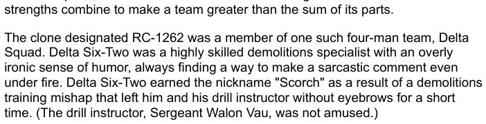
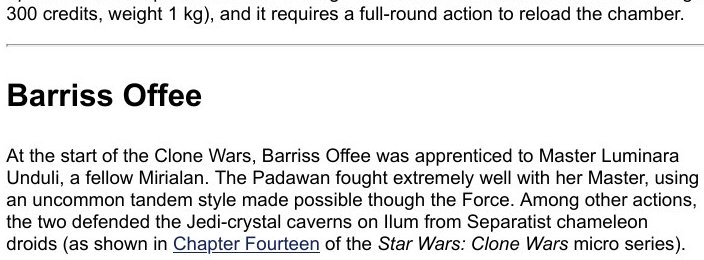
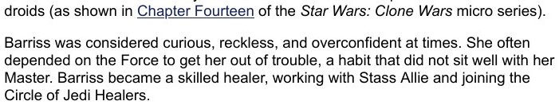
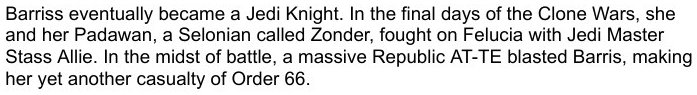

# Owner Material 037 — Star Wars D20 Drive folder (Core, Revised Core and Saga Edition): Characters/Miniatures/Champions of the Force Preview 2.pdf [Star Wars Roleplaying Game Revised Core (d20, 2002)]

- **Source:** Wizards of the Coast Star Wars Roleplaying Game books, web enhancements, Living Force campaign modules and articles (2000–2010), from the owner's "Star Wars D20" Drive folder (only the three edition subfolders; "General" was not read, as instructed). Secondary source (licensed Legends reference). Scan OCR'd on the box; the scan stays box-only and is **not** published.
- **Method:** every scanned page was OCR'd and machine-screened sentence by sentence for power-relevant statements (fights, kills, defeats, Force feats, rankings, superweapons) that name a character on our roster; each kept sentence is quoted verbatim from the OCR text and has a crop of the printed passage directly under it. Pages with nothing power-relevant are still listed with what is on them.
- **Citation:** "*Champions of the Force Preview 2* (SWRPG d20 Revised Core), p.X" by printed page ("scan p.X" where no printed number applies). **Weight:** Licensed RPG material: a secondary source. Narrative text sums up Legends lore; game statistics are rules for players, not canon power levels, and rank lowest.

## scan p.1 (scan page 1)

Page contents: Intro; Republic Commandos and Delta Squad; Scorch's nickname (Walon Vau); tactics; card; RPG stats (hand-read)

- **Scorch (Delta Six-Two)** — entry/section: How Delta Six-Two became Scorch: "The clone designated RC-1262 was a member of one such four-man team, Delta Squad. Delta Six-Two was a highly skilled demolitions specialist with an overly ironic sense of humor, always finding a way to make a sarcastic comment even under fire. Delta Six-Two earned the nickname "Scorch" as a result of a demolitions training mishap that left him and his drill instructor without eyebrows for a short time. (The drill instructor, Sergeant Walon Vau, was not amused.)" Source: *Champions of the Force Preview 2* (SWRPG d20 Revised Core), scan p.1
  

### Stat block notes (game mechanics, not feats)

- scorch: Delta Six-Two ("Scorch"): Male Human thug 5/soldier 3; Defense 17; DR 5; VP/WP 24/12; Challenge Code D; Katarn-class armor, DC-17m (Source: *Champions of the Force Preview 2* (SWRPG d20 Revised Core), scan p.1)

## scan p.2 (scan page 2)

Page contents: Katarn-class armor; DC-17m attachments; Barriss Offee history (Luminara, Ilum, healer, Zonder, Felucia, Order 66); tactics; card (hand-read)

- **Barriss Offee; Luminara Unduli** — entry/section: Barriss and Luminara's tandem style: "At the start of the Clone Wars, Barriss Offee was apprenticed to Master Luminara Unduli, a fellow Mirialan. The Padawan fought extremely well with her Master, using an uncommon tandem style made possible though the Force. Among other actions, the two defended the Jedi-crystal caverns on Ilum from Separatist chameleon droids (as shown in Chapter Fourteen of the Star Wars: Clone Wars micro series)." Source: *Champions of the Force Preview 2* (SWRPG d20 Revised Core), scan p.2
  
- **Barriss Offee; Stass Allie** — entry/section: Barriss the healer: "Barriss was considered curious, reckless, and overconfident at times. She often depended on the Force to get her out of trouble, a habit that did not sit well with her Master. Barriss became a skilled healer, working with Stass Allie and joining the Circle of Jedi Healers." Source: *Champions of the Force Preview 2* (SWRPG d20 Revised Core), scan p.2
  
- **Barriss Offee; Stass Allie** — entry/section: Barriss's death in Order 66: "Barriss eventually became a Jedi Knight. In the final days of the Clone Wars, she and her Padawan, a Selonian called Zonder, fought on Felucia with Jedi Master Stass Allie. In the midst of battle, a massive Republic AT-TE blasted Barris, making her yet another casualty of Order 66." Source: *Champions of the Force Preview 2* (SWRPG d20 Revised Core), scan p.2
  

## scan p.3 (scan page 3)

Page contents: Barriss card abilities and RPG stats (Jedi Guardian 7/Jedi Healer 1); author bios (hand-read)

### Stat block notes (game mechanics, not feats)

- barriss-offee: Barriss Offee: Female Mirialan (near-Human) Jedi Guardian 7/Jedi Healer 1; Defense 20; VP/WP 56/12; FP 5; DSP 0; Rep +3; Challenge Code D; Force skills Heal Another +7, Battlemind +6 (Source: *Champions of the Force Preview 2* (SWRPG d20 Revised Core), scan p.3)
