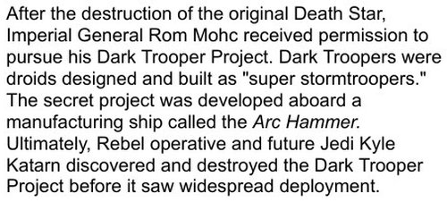

# Owner Material 037 — Star Wars D20 Drive folder (Core, Revised Core and Saga Edition): Characters/Miniatures/Champions of the Force Preview 4.pdf [Star Wars Roleplaying Game Revised Core (d20, 2002)]

- **Source:** Wizards of the Coast Star Wars Roleplaying Game books, web enhancements, Living Force campaign modules and articles (2000–2010), from the owner's "Star Wars D20" Drive folder (only the three edition subfolders; "General" was not read, as instructed). Secondary source (licensed Legends reference). Scan OCR'd on the box; the scan stays box-only and is **not** published.
- **Method:** every scanned page was OCR'd and machine-screened sentence by sentence for power-relevant statements (fights, kills, defeats, Force feats, rankings, superweapons) that name a character on our roster; each kept sentence is quoted verbatim from the OCR text and has a crop of the printed passage directly under it. Pages with nothing power-relevant are still listed with what is on them.
- **Citation:** "*Champions of the Force Preview 4* (SWRPG d20 Revised Core), p.X" by printed page ("scan p.X" where no printed number applies). **Weight:** Licensed RPG material: a secondary source. Narrative text sums up Legends lore; game statistics are rules for players, not canon power levels, and rank lowest.

## scan p.1 (scan page 1)

Page contents: Intro; Dark Trooper Project (General Rom Mohc, Arc Hammer, Kyle Katarn); Phase I; tactics; card; RPG stats (soldier 4) (hand-read)

- **Kyle Katarn** — entry/section: Kyle Katarn destroys the Dark Trooper Project: "After the destruction of the original Death Star, Imperial General Rom Mohc received permission to pursue his Dark Trooper Project. Dark Troopers were droids designed and built as "super stormtroopers." The secret project was developed aboard a manufacturing ship called the Arc Hammer. Ultimately, Rebel operative and future Jedi Kyle Katarn discovered and destroyed the Dark Trooper Project before it saw widespread deployment." Source: *Champions of the Force Preview 4* (SWRPG d20 Revised Core), scan p.1
  

### Stat block notes (game mechanics, not feats)

- Dark Trooper Phase I: Super stormtrooper droid, soldier 4; Challenge Code C (Source: *Champions of the Force Preview 4* (SWRPG d20 Revised Core), scan p.1)

## scan p.2 (scan page 2)

Page contents: Phase I feats; Sith Trooper Commander background, tactics, card, RPG stats (thug 3/diplomat 2/officer 5) (hand-read)

### Stat block notes (game mechanics, not feats)

- Sith Trooper Commander: Male Human thug 3/diplomat 2/officer 5; Challenge Code D (Source: *Champions of the Force Preview 4* (SWRPG d20 Revised Core), scan p.2)

## scan p.3 (scan page 3)

Page contents: Author bio (Sarli); copyright (checked against page image) (hand-read)

