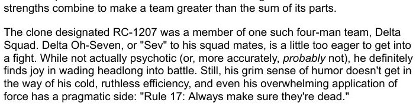
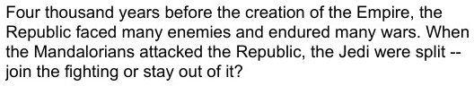
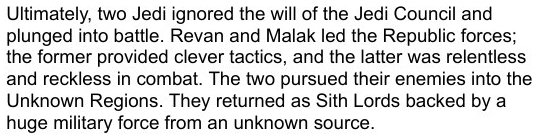
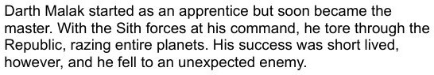
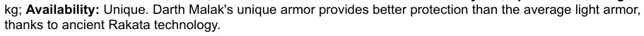

# Owner Material 037 — Star Wars D20 Drive folder (Core, Revised Core and Saga Edition): Characters/Miniatures/Champions of the Force Preview 5.pdf [Star Wars Roleplaying Game Revised Core (d20, 2002)]

- **Source:** Wizards of the Coast Star Wars Roleplaying Game books, web enhancements, Living Force campaign modules and articles (2000–2010), from the owner's "Star Wars D20" Drive folder (only the three edition subfolders; "General" was not read, as instructed). Secondary source (licensed Legends reference). Scan OCR'd on the box; the scan stays box-only and is **not** published.
- **Method:** every scanned page was OCR'd and machine-screened sentence by sentence for power-relevant statements (fights, kills, defeats, Force feats, rankings, superweapons) that name a character on our roster; each kept sentence is quoted verbatim from the OCR text and has a crop of the printed passage directly under it. Pages with nothing power-relevant are still listed with what is on them.
- **Citation:** "*Champions of the Force Preview 5* (SWRPG d20 Revised Core), p.X" by printed page ("scan p.X" where no printed number applies). **Weight:** Licensed RPG material: a secondary source. Narrative text sums up Legends lore; game statistics are rules for players, not canon power levels, and rank lowest.

## scan p.1 (scan page 1)

Page contents: Intro and spoiler warning; Delta Oh-Seven 'Sev' (RC-1207), Rule 17; tactics; card; RPG stats (hand-read)

- **Sev (Delta Oh-Seven)** — entry/section: Sev of Delta Squad: "The clone designated RC-1207 was a member of one such four-man team, Delta Squad. Delta Oh-Seven, or "Sev" to his squad mates, is a little too eager to get into a fight. While not actually psychotic (or, more accurately, probably not), he definitely finds joy in wading headlong into battle. Still, his grim sense of humor doesn't get in the way of his cold, ruthless efficiency, and even his overwhelming application of force has a pragmatic side: "Rule 17: Always make sure they're dead."" Source: *Champions of the Force Preview 5* (SWRPG d20 Revised Core), scan p.1
  

### Stat block notes (game mechanics, not feats)

- sev: Delta Oh-Seven ("Sev"): Male Human thug 5/soldier 3; Defense 17; DR 5; VP/WP 24/12; Challenge Code D; DC-17m sniper (Source: *Champions of the Force Preview 5* (SWRPG d20 Revised Core), scan p.1)

## scan p.2 (scan page 2)

Page contents: Katarn-class armor; DC-17m; Darth Malak history (Mandalorian Wars with Revan, Sith Lords, fall); tactics; card (Cost 52) (hand-read)

- **Darth Malak** — entry/section: The Jedi split over the Mandalorian Wars: "Four thousand years before the creation of the Empire, the Republic faced many enemies and endured many wars. When the Mandalorians attacked the Republic, the Jedi were split -- join the fighting or stay out of it?" Source: *Champions of the Force Preview 5* (SWRPG d20 Revised Core), scan p.2
  
- **Darth Malak; Revan** — entry/section: Revan and Malak return as Sith Lords: "Ultimately, two Jedi ignored the will of the Jedi Council and plunged into battle. Revan and Malak led the Republic forces; the former provided clever tactics, and the latter was relentless and reckless in combat. The two pursued their enemies into the Unknown Regions. They returned as Sith Lords backed by a huge military force from an unknown source." Source: *Champions of the Force Preview 5* (SWRPG d20 Revised Core), scan p.2
  
- **Darth Malak** — entry/section: Malak becomes the master: "Darth Malak started as an apprentice but soon became the master. With the Sith forces at his command, he tore through the Republic, razing entire planets. His success was short lived, however, and he fell to an unexpected enemy." Source: *Champions of the Force Preview 5* (SWRPG d20 Revised Core), scan p.2
  

## scan p.3 (scan page 3)

Page contents: Malak card abilities; RPG stats (Jedi guardian 11/Sith Lord 9); Malak's armor; author bios (hand-read)

- **Darth Malak** — entry/section: Darth Malak's Armor: "Darth Malak's unique armor provides better protection than the average light armor, thanks to ancient Rakata technology." Source: *Champions of the Force Preview 5* (SWRPG d20 Revised Core), scan p.3
  

### Stat block notes (game mechanics, not feats)

- darth-malak: Darth Malak: Male Human Jedi guardian 11/Sith Lord 9; Defense 26; DR 5; VP/WP 158/16; FP 11; DSP 30; Rep +6; Challenge Code H; lightsaber, ancient mastercraft Sith sword, Darth Malak's Armor (Rakata technology); Force Lightning +24, Fear +20 (Source: *Champions of the Force Preview 5* (SWRPG d20 Revised Core), scan p.3)
