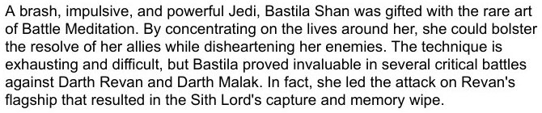
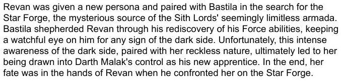
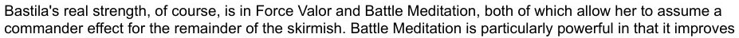
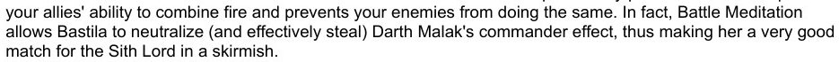

# Owner Material 037 — Star Wars D20 Drive folder (Core, Revised Core and Saga Edition): Characters/Miniatures/Champions of the Force Preview 6.pdf [Star Wars Roleplaying Game Revised Core (d20, 2002)]

- **Source:** Wizards of the Coast Star Wars Roleplaying Game books, web enhancements, Living Force campaign modules and articles (2000–2010), from the owner's "Star Wars D20" Drive folder (only the three edition subfolders; "General" was not read, as instructed). Secondary source (licensed Legends reference). Scan OCR'd on the box; the scan stays box-only and is **not** published.
- **Method:** every scanned page was OCR'd and machine-screened sentence by sentence for power-relevant statements (fights, kills, defeats, Force feats, rankings, superweapons) that name a character on our roster; each kept sentence is quoted verbatim from the OCR text and has a crop of the printed passage directly under it. Pages with nothing power-relevant are still listed with what is on them.
- **Citation:** "*Champions of the Force Preview 6* (SWRPG d20 Revised Core), p.X" by printed page ("scan p.X" where no printed number applies). **Weight:** Licensed RPG material: a secondary source. Narrative text sums up Legends lore; game statistics are rules for players, not canon power levels, and rank lowest.

## scan p.1 (scan page 1)

Page contents: Intro and spoiler warning; Bastila's Battle Meditation, capture of Revan, Star Forge, fall to Malak; tactics; card; RPG stats begin (hand-read)

- **Bastila Shan; Revan; Darth Malak** — entry/section: Bastila's Battle Meditation and Revan's capture: "A brash, impulsive, and powerful Jedi, Bastila Shan was gifted with the rare art of Battle Meditation. By concentrating on the lives around her, she could bolster the resolve of her allies while disheartening her enemies. The technique is exhausting and difficult, but Bastila proved invaluable in several critical battles against Darth Revan and Darth Malak. In fact, she led the attack on Revan's flagship that resulted in the Sith Lord's capture and memory wipe." Source: *Champions of the Force Preview 6* (SWRPG d20 Revised Core), scan p.1
  
- **Bastila Shan; Revan; Darth Malak** — entry/section: Bastila, Revan and the Star Forge: "Revan was given a new persona and paired with Bastila in the search for the Star Forge, the mysterious source of the Sith Lords' seemingly limitless armada. Bastila shepherded Revan through his rediscovery of his Force abilities, keeping a watchful eye on him for any sign of the dark side. Unfortunately, this intense awareness of the dark side, paired with her reckless nature, ultimately led to her being drawn into Darth Malak's control as his new apprentice. In the end, her fate was in the hands of Revan when he confronted her on the Star Forge." Source: *Champions of the Force Preview 6* (SWRPG d20 Revised Core), scan p.1
  
- **Bastila Shan** — entry/section: Bastila Shan: "She also has Lightsaber Sweep and Lightsaber Deflect, again nicely fitting this second-tier niche." Source: *Champions of the Force Preview 6* (SWRPG d20 Revised Core), scan p.1
  
- **Bastila Shan** — entry/section: Bastila Shan: "Bastila's real strength, of course, is in Force Valor and Battle Meditation, both of which allow her to assume a commander effect for the remainder of the skirmish." Source: *Champions of the Force Preview 6* (SWRPG d20 Revised Core), scan p.1
  
- **Bastila Shan; Darth Malak** — entry/section: Bastila Shan: "In fact, Battle Meditation allows Bastila to neutralize (and effectively steal) Darth Malak's commander effect, thus making her a very good match for the Sith Lord in a skirmish." Source: *Champions of the Force Preview 6* (SWRPG d20 Revised Core), scan p.1
  

### Stat block notes (game mechanics, not feats)

- bastila-shan: Bastila Shan: Female Human Jedi consular 12/Jedi investigator 5 (Jedi sentinel archetype); Defense 25; VP/WP 97/12; SV Fort +12, Ref +13, Will +13; FP 6; DSP 2; Rep +6; Challenge Code G; double-bladed lightsaber; Inspire +26, Battle Influence +13; Battle Meditation feat; contacts Master Vandar, Revan (Source: *Champions of the Force Preview 6* (SWRPG d20 Revised Core), scan p.1)

## scan p.2 (scan page 2)

Page contents: Bastila stats end (from image: SV Fort +12, Ref +13, Will +13; FP 6; DSP 2; Rep +6; Challenge Code G), skills, Force skills, feats; Crab Droid (Muckrackers, Utapau) description, tactics, card, RPG stats (hand-read)

### Stat block notes (game mechanics, not feats)

- Crab droid: Walking battle droid, Soldier 5; Challenge Code C (Source: *Champions of the Force Preview 6* (SWRPG d20 Revised Core), scan p.2)

## scan p.3 (scan page 3)

Page contents: Crab droid weak-points note, skills, feats; author bios (hand-read)

