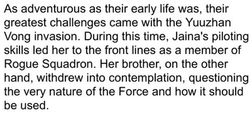
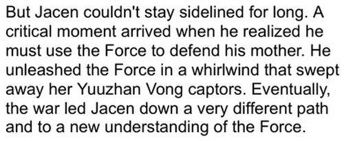
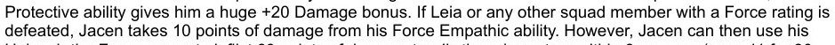

# Owner Material 037 — Star Wars D20 Drive folder (Core, Revised Core and Saga Edition): Characters/Miniatures/Champions of the Force Preview 7.pdf [Star Wars Roleplaying Game Revised Core (d20, 2002)]

- **Source:** Wizards of the Coast Star Wars Roleplaying Game books, web enhancements, Living Force campaign modules and articles (2000–2010), from the owner's "Star Wars D20" Drive folder (only the three edition subfolders; "General" was not read, as instructed). Secondary source (licensed Legends reference). Scan OCR'd on the box; the scan stays box-only and is **not** published.
- **Method:** every scanned page was OCR'd and machine-screened sentence by sentence for power-relevant statements (fights, kills, defeats, Force feats, rankings, superweapons) that name a character on our roster; each kept sentence is quoted verbatim from the OCR text and has a crop of the printed passage directly under it. Pages with nothing power-relevant are still listed with what is on them.
- **Citation:** "*Champions of the Force Preview 7* (SWRPG d20 Revised Core), p.X" by printed page ("scan p.X" where no printed number applies). **Weight:** Licensed RPG material: a secondary source. Narrative text sums up Legends lore; game statistics are rules for players, not canon power levels, and rank lowest.

## scan p.1 (scan page 1)

Page contents: Intro; Jacen and Jaina history (Jedi Academy, Yuuzhan Vong war, Rogue Squadron, Jacen's Force whirlwind); squad tactics with Leia/Han; Jacen card (hand-read)

- **Jacen Solo (Darth Caedus); Jaina Solo; Han Solo; Leia Organa Solo; Luke Skywalker** — entry/section: The Solo twins: "Jacen and Jaina Solo are the highly talented twins of Han and Leia Organa Solo. The twins' inherited abilities and Force talents enabled them to survive many adventures in their early years. When they were deemed old enough, they attended Luke Skywalker's Jedi Academy." Source: *Champions of the Force Preview 7* (SWRPG d20 Revised Core), scan p.1
  
- **Jacen Solo (Darth Caedus); Jaina Solo** — entry/section: The twins in the Yuuzhan Vong war: "As adventurous as their early life was, their greatest challenges came with the Yuuzhan Vong invasion. During this time, Jaina's piloting skills led her to the front lines as a member of Rogue Squadron. Her brother, on the other hand, withdrew into contemplation, questioning the very nature of the Force and how it should be used." Source: *Champions of the Force Preview 7* (SWRPG d20 Revised Core), scan p.1
  
- **Jacen Solo (Darth Caedus); Leia Organa Solo** — entry/section: Jacen unleashes the Force to save Leia: "But Jacen couldn't stay sidelined for long. A critical moment arrived when he realized he must use the Force to defend his mother. He unleashed the Force in a whirlwind that swept away her Yuuzhan Vong captors. Eventually, the war led Jacen down a very different path and to a new understanding of the Force." Source: *Champions of the Force Preview 7* (SWRPG d20 Revised Core), scan p.1
  
- **Jacen Solo (Darth Caedus); Jaina Solo; Leia Organa Solo** — entry/section: Jacen and Jaina Solo: "If Leia or any other squad member with a Force rating is defeated, Jacen takes 10 points of damage from his Force Empathic ability." Source: *Champions of the Force Preview 7* (SWRPG d20 Revised Core), scan p.1
  

## scan p.2 (scan page 2)

Page contents: Jaina card; Jacen and Jaina RPG stats; Jedi Sentinel archetype and tactics (hand-read)

### Stat block notes (game mechanics, not feats)

- darth-caedus: Jacen Solo: Male Human Jedi guardian 9; Defense 18; VP/WP 59/13; FP 6; Rep 3; Challenge Code D; Empathy +10, Friendship +8; Animal Affinity; Force Whirlwind (Source: *Champions of the Force Preview 7* (SWRPG d20 Revised Core), scan p.2)
- jaina-solo: Jaina Solo: Female Human Jedi guardian 6/soldier 1/Jedi ace 2; Defense 20; VP/WP 60/13; FP 4; DSP 1; Rep 3; Challenge Code D; XJ X-wing, astromech 'Sparky'; Pilot +15 (Source: *Champions of the Force Preview 7* (SWRPG d20 Revised Core), scan p.2)

## scan p.3 (scan page 3)

Page contents: Sentinel tactics, card, RPG stats; author bios (hand-read)

### Stat block notes (game mechanics, not feats)

- Jedi sentinel: Female Miraluka Jedi consular 4/Jedi investigator 4; Challenge Code D (Source: *Champions of the Force Preview 7* (SWRPG d20 Revised Core), scan p.3)
