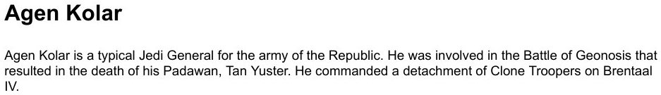
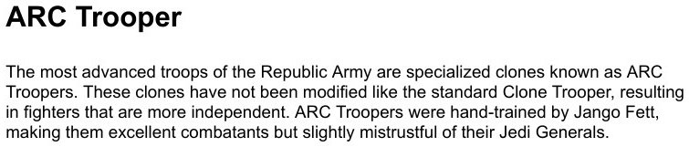

# Owner Material 037 — Star Wars D20 Drive folder (Core, Revised Core and Saga Edition): Characters/Miniatures/Grand Army of the Republic.pdf [Star Wars Roleplaying Game Revised Core (d20, 2002)]

- **Source:** Wizards of the Coast Star Wars Roleplaying Game books, web enhancements, Living Force campaign modules and articles (2000–2010), from the owner's "Star Wars D20" Drive folder (only the three edition subfolders; "General" was not read, as instructed). Secondary source (licensed Legends reference). Scan OCR'd on the box; the scan stays box-only and is **not** published.
- **Method:** every scanned page was OCR'd and machine-screened sentence by sentence for power-relevant statements (fights, kills, defeats, Force feats, rankings, superweapons) that name a character on our roster; each kept sentence is quoted verbatim from the OCR text and has a crop of the printed passage directly under it. Pages with nothing power-relevant are still listed with what is on them.
- **Citation:** "*Grand Army of the Republic* (SWRPG d20 Revised Core), p.X" by printed page ("scan p.X" where no printed number applies). **Weight:** Licensed RPG material: a secondary source. Narrative text sums up Legends lore; game statistics are rules for players, not canon power levels, and rank lowest.

## scan p.1 (scan page 1)

Page contents: Intro; 12-encounter table CC C-H (from image); Republic Devotion; Clone Trooper (Thug 5, CC B; full line from image); Clone Trooper Grenadier (Thug 5, CC B) (hand-read)

## scan p.2 (scan page 2)

Page contents: Grenadier gear; Clone Trooper Sergeant (Noble 1/Soldier 1/Thug 5; from image: Defense 16, VP/WP 13/12, Cha 13, CC C); Clone Trooper Commander (Noble 2/Soldier 2/Thug 5, CC D); Aerial Clone Trooper Captain (+Officer 1, Aratech Hover Pack, CC D) (hand-read)

## scan p.3 (scan page 3)

Page contents: ARC Trooper (Scout 2/Thug 5/Elite Trooper 2, trained by Jango Fett, CC D); Agen Kolar (Zabrak Jedi Guardian 9/Jedi Master 3, CC F); new equipment: Aratech Hover Pack (hand-read)

- **Agen Kolar** — entry/section: Agen Kolar, Jedi General: "Agen Kolar is a typical Jedi General for the army of the Republic. He was involved in the Battle of Geonosis that resulted in the death of his Padawan, Tan Yuster. He commanded a detachment of Clone Troopers on Brentaal IV." Source: *Grand Army of the Republic* (SWRPG d20 Revised Core), scan p.3
  
- **Jango Fett** — entry/section: ARC Troopers trained by Jango Fett: "The most advanced troops of the Republic Army are specialized clones known as ARC Troopers. These clones have not been modified like the standard Clone Trooper, resulting in fighters that are more independent. ARC Troopers were hand-trained by Jango Fett, making them excellent combatants but slightly mistrustful of their Jedi Generals." Source: *Grand Army of the Republic* (SWRPG d20 Revised Core), scan p.3
  

### Stat block notes (game mechanics, not feats)

- agen-kolar: Agen Kolar: Male Zabrak Jedi Guardian 9/Jedi Master 3; Defense 20; VP/WP 104/16; Atk +15/+10/+5 melee (4d8, lightsaber); Force Secret (Heal Self, Battlemind); FP 7; DSP 0; Rep +5; Challenge Code F; Heal Self +13 (Source: *Grand Army of the Republic* (SWRPG d20 Revised Core), scan p.3)

## scan p.4 (scan page 4)

Page contents: Copyright line only (hand-read)

