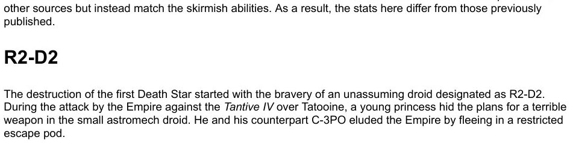
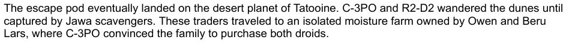
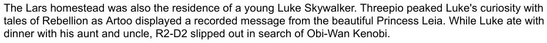
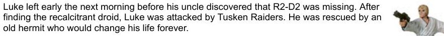
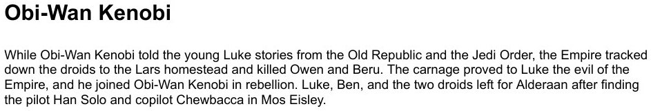
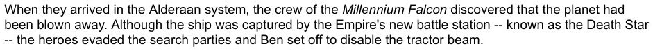
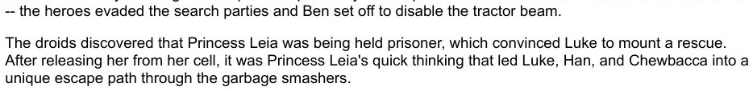
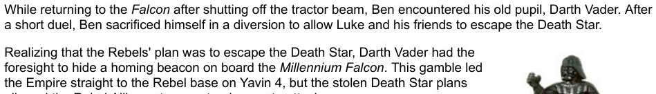
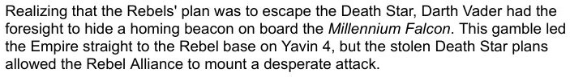
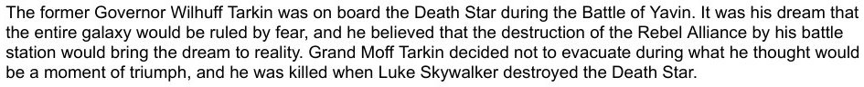

# Owner Material 037 — Star Wars D20 Drive folder (Core, Revised Core and Saga Edition): Characters/Miniatures/Icons of New Hope.pdf [Star Wars Roleplaying Game Revised Core (d20, 2002)]

- **Source:** Wizards of the Coast Star Wars Roleplaying Game books, web enhancements, Living Force campaign modules and articles (2000–2010), from the owner's "Star Wars D20" Drive folder (only the three edition subfolders; "General" was not read, as instructed). Secondary source (licensed Legends reference). Scan OCR'd on the box; the scan stays box-only and is **not** published.
- **Method:** every scanned page was OCR'd and machine-screened sentence by sentence for power-relevant statements (fights, kills, defeats, Force feats, rankings, superweapons) that name a character on our roster; each kept sentence is quoted verbatim from the OCR text and has a crop of the printed passage directly under it. Pages with nothing power-relevant are still listed with what is on them.
- **Citation:** "*Icons of New Hope* (SWRPG d20 Revised Core), p.X" by printed page ("scan p.X" where no printed number applies). **Weight:** Licensed RPG material: a secondary source. Narrative text sums up Legends lore; game statistics are rules for players, not canon power levels, and rank lowest.

## scan p.1 (scan page 1)

Page contents: Intro; R2-D2 (Tantive IV escape; Override via Computer Use; stats Expert 4/Scout 3, CC C); C-3PO (Lars purchase; Diplomat 3/Noble 5, CC C) (hand-read)

- **R2-D2; C-3PO; Leia Organa Solo** — entry/section: R2-D2 and the Death Star plans: "The destruction of the first Death Star started with the bravery of an unassuming droid designated as R2-D2. During the attack by the Empire against the Tantive IV over Tatooine, a young princess hid the plans for a terrible weapon in the small astromech droid. He and his counterpart C-3PO eluded the Empire by fleeing in a restricted escape pod." Source: *Icons of New Hope* (SWRPG d20 Revised Core), scan p.1
  
- **C-3PO; R2-D2** — entry/section: The droids reach the Lars farm: "The escape pod eventually landed on the desert planet of Tatooine. C-3PO and R2-D2 wandered the dunes until captured by Jawa scavengers. These traders traveled to an isolated moisture farm owned by Owen and Beru Lars, where C-3PO convinced the family to purchase both droids." Source: *Icons of New Hope* (SWRPG d20 Revised Core), scan p.1
  

### Stat block notes (game mechanics, not feats)

- r2-d2: R2-D2: Tracked astromech droid, Expert 4/Scout 3; Defense 17; VP/WP 18/14; droid quirk (courage), heart +2; Astrogate +18, Repair +17, Pilot +15; Challenge Code C (Source: *Icons of New Hope* (SWRPG d20 Revised Core), scan p.1)
- c-3po: C-3PO: Walking protocol droid, Diplomat 3/Noble 5; Defense 15; VP/WP 23/13; droid quirk (faithful); Diplomacy +17, Knowledge (Alderaan) +16; Challenge Code C (Source: *Icons of New Hope* (SWRPG d20 Revised Core), scan p.1)

## scan p.2 (scan page 2)

Page contents: C-3PO feats; Luke Skywalker, Rebel (Fringer 4, CC C, from image); Obi-Wan Kenobi (Jedi Guardian 7/Jedi Master 3/Jedi Investigator 1, CC E); Princess Leia narrative (Death Star rescue) (hand-read)

- **Luke Skywalker; R2-D2; C-3PO; Leia Organa Solo** — entry/section: Luke at the Lars homestead: "The Lars homestead was also the residence of a young Luke Skywalker. Threepio peaked Luke's curiosity with tales of Rebellion as Artoo displayed a recorded message from the beautiful Princess Leia. While Luke ate with dinner with his aunt and uncle, R2-D2 slipped out in search of Obi-Wan Kenobi." Source: *Icons of New Hope* (SWRPG d20 Revised Core), scan p.2
  
- **Luke Skywalker; Obi-Wan Kenobi** — entry/section: Luke rescued by an old hermit: "Luke left early the next morning before his uncle discovered that R2-D2 was missing. After finding the recalcitrant droid, Luke was attacked by Tusken Raiders. He was rescued by an old hermit who would change his life forever." Source: *Icons of New Hope* (SWRPG d20 Revised Core), scan p.2
  
- **Obi-Wan Kenobi; Luke Skywalker; Han Solo; Chewbacca** — entry/section: Luke joins Obi-Wan: "While Obi-Wan Kenobi told the young Luke stories from the Old Republic and the Jedi Order, the Empire tracked down the droids to the Lars homestead and killed Owen and Beru. The carnage proved to Luke the evil of the Empire, and he joined Obi-Wan Kenobi in rebellion. Luke, Ben, and the two droids left for Alderaan after finding the pilot Han Solo and copilot Chewbacca in Mos Eisley." Source: *Icons of New Hope* (SWRPG d20 Revised Core), scan p.2
  
- **Leia Organa Solo; Luke Skywalker; Obi-Wan Kenobi** — entry/section: Arrival at Alderaan: "When they arrived in the Alderaan system, the crew of the Millennium Falcon discovered that the planet had been blown away. Although the ship was captured by the Empire's new battle station -- known as the Death Star -- the heroes evaded the search parties and Ben set off to disable the tractor beam." Source: *Icons of New Hope* (SWRPG d20 Revised Core), scan p.2
  
- **Leia Organa Solo; Luke Skywalker; Han Solo; Chewbacca** — entry/section: Leia's rescue: "The droids discovered that Princess Leia was being held prisoner, which convinced Luke to mount a rescue. After releasing her from her cell, it was Princess Leia's quick thinking that led Luke, Han, and Chewbacca into a unique escape path through the garbage smashers." Source: *Icons of New Hope* (SWRPG d20 Revised Core), scan p.2
  

### Stat block notes (game mechanics, not feats)

- luke-skywalker: Luke Skywalker, Rebel: Male Human Fringer 4; Defense 17; VP/WP 26/13; Atk +7 ranged (3d8 or DC 18 stun, blaster rifle); SV Fort +5, Ref +5, Will +2; FP 4; DSP 0; Rep +0; Str 15, Dex 16, Con 13, Int 14, Wis 13, Cha 12; Challenge Code C; Pilot +13 (from page image) (Source: *Icons of New Hope* (SWRPG d20 Revised Core), scan p.2)
- obi-wan-kenobi: Obi-Wan Kenobi: Male Human Jedi Guardian 7/Jedi Master 3/Jedi Investigator 1; Defense 19; VP/WP 83/14; FP 5; DSP 0; Rep +4; Challenge Code E (Source: *Icons of New Hope* (SWRPG d20 Revised Core), scan p.2)

## scan p.3 (scan page 3)

Page contents: Leia stats (Noble 4/Soldier 2, CC D, from image); Darth Vader, Dark Jedi (Fringer 1/Jedi Guardian 10/Sith Lord 1, CC F); Grand Moff Tarkin (Soldier 2/Noble 2, CC C) (hand-read)

- **Darth Vader (Anakin Skywalker); Obi-Wan Kenobi** — entry/section: Ben and Vader duel: "While returning to the Falcon after shutting off the tractor beam, Ben encountered his old pupil, Darth Vader. After a short duel, Ben sacrificed himself in a diversion to allow Luke and his friends to escape the Death Star." Source: *Icons of New Hope* (SWRPG d20 Revised Core), scan p.3
  
- **Darth Vader (Anakin Skywalker)** — entry/section: Vader's homing beacon: "Realizing that the Rebels' plan was to escape the Death Star, Darth Vader had the foresight to hide a homing beacon on board the Millennium Falcon. This gamble led the Empire straight to the Rebel base on Yavin 4, but the stolen Death Star plans allowed the Rebel Alliance to mount a desperate attack." Source: *Icons of New Hope* (SWRPG d20 Revised Core), scan p.3
  
- **Grand Moff Tarkin; Luke Skywalker** — entry/section: Tarkin's dream and death: "The former Governor Wilhuff Tarkin was on board the Death Star during the Battle of Yavin. It was his dream that the entire galaxy would be ruled by fear, and he believed that the destruction of the Rebel Alliance by his battle station would bring the dream to reality. Grand Moff Tarkin decided not to evacuate during what he thought would be a moment of triumph, and he was killed when Luke Skywalker destroyed the Death Star." Source: *Icons of New Hope* (SWRPG d20 Revised Core), scan p.3
  

### Stat block notes (game mechanics, not feats)

- leia-organa: Princess Leia, Senator: Female Human Noble 4/Soldier 2; Defense 15; VP/WP 33/13; Atk +7 ranged (3d4 or DC 12 stun, sporting blaster); FP 5; DSP 0; Rep +3; Challenge Code D; consular ship Tantive IV; Diplomacy +12 (from page image) (Source: *Icons of New Hope* (SWRPG d20 Revised Core), scan p.3)
- darth-vader: Darth Vader, Dark Jedi: Male Human Fringer 1/Jedi Guardian 10/Sith Lord 1; Defense 22; DR 6; VP/WP 117/18; FP 7; DSP 16; Rep +4; Challenge Code F; Force Grip +13 (Source: *Icons of New Hope* (SWRPG d20 Revised Core), scan p.3)
- grand-moff-tarkin: Grand Moff Tarkin: Male Human Soldier 2/Noble 2; Defense 14; VP/WP 27/13; FP 2; DSP 5; Rep +2; Cha 19; Intimidate +13; Challenge Code C (Source: *Icons of New Hope* (SWRPG d20 Revised Core), scan p.3)

## scan p.4 (scan page 4)

Page contents: Tarkin skills end, feats (hand-read)

