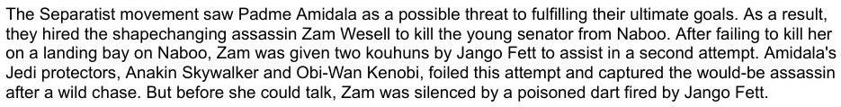
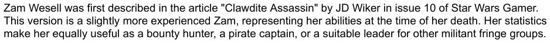

# Owner Material 037 — Star Wars D20 Drive folder (Core, Revised Core and Saga Edition): Characters/Miniatures/Scum and Villainy.pdf [Star Wars Roleplaying Game Revised Core (d20, 2002)]

- **Source:** Wizards of the Coast Star Wars Roleplaying Game books, web enhancements, Living Force campaign modules and articles (2000–2010), from the owner's "Star Wars D20" Drive folder (only the three edition subfolders; "General" was not read, as instructed). Secondary source (licensed Legends reference). Scan OCR'd on the box; the scan stays box-only and is **not** published.
- **Method:** every scanned page was OCR'd and machine-screened sentence by sentence for power-relevant statements (fights, kills, defeats, Force feats, rankings, superweapons) that name a character on our roster; each kept sentence is quoted verbatim from the OCR text and has a crop of the printed passage directly under it. Pages with nothing power-relevant are still listed with what is on them.
- **Citation:** "*Scum and Villainy* (SWRPG d20 Revised Core), p.X" by printed page ("scan p.X" where no printed number applies). **Weight:** Licensed RPG material: a secondary source. Narrative text sums up Legends lore; game statistics are rules for players, not canon power levels, and rank lowest.

## scan p.1 (scan page 1)

Page contents: Intro; 12-encounter table CC B-G (columns Gran Raider/Klatooinian Enforcer; Devaronian Bounty Hunter/Quarren Raider; Aqualish Spy; Zam Wesell, who appears only in the two G rows); Zam Wesell narrative, Star Wars Gamer 10 source note, stats (Clawdite Soldier 3/Scoundrel 5/Bounty Hunter 4, CC F) (hand-read)

- **Zam Wesell; Padmé Amidala; Jango Fett; Darth Vader (Anakin Skywalker); Obi-Wan Kenobi** — entry/section: Zam Wesell's attempts on Amidala: "The Separatist movement saw Padme Amidala as a possible threat to fulfilling their ultimate goals. As a result, they hired the shapechanging assassin Zam Wesell to kill the young senator from Naboo. After failing to kill her on a landing bay on Naboo, Zam was given two kouhuns by Jango Fett to assist in a second attempt. Amidala's Jedi protectors, Anakin Skywalker and Obi-Wan Kenobi, foiled this attempt and captured the would-be assassin after a wild chase. But before she could talk, Zam was silenced by a poisoned dart fired by Jango Fett." Source: *Scum and Villainy* (SWRPG d20 Revised Core), scan p.1
  
- **Zam Wesell** — entry/section: Zam Wesell at the time of her death: "Zam Wesell was first described in the article "Clawdite Assassin" by JD Wiker in issue 10 of Star Wars Gamer. This version is a slightly more experienced Zam, representing her abilities at the time of her death. Her statistics make her equally useful as a bounty hunter, a pirate captain, or a suitable leader for other militant fringe groups." Source: *Scum and Villainy* (SWRPG d20 Revised Core), scan p.1
  

### Stat block notes (game mechanics, not feats)

- zam-wesell: Zam Wesell: Female Clawdite Soldier 3/Scoundrel 5/Bounty Hunter 4; Defense 20; DR 3; VP/WP 73/13; Shapeshift, sneak attack +2d6; FP 3; DSP 4; Rep +8; Challenge Code F; Disguise +15; ASN-121 assassin droid, ancient Mabari emblem (Source: *Scum and Villainy* (SWRPG d20 Revised Core), scan p.1)

## scan p.2 (scan page 2)

Page contents: Aqualish Spy (Ualaq; Scout 3/Scoundrel 3, CC D); Devaronian Bounty Hunter (Scout 4, CC C); Gran Raider (Thug 1, CC A); Klatooinian Enforcer intro (hand-read)

## scan p.3 (scan page 3)

Page contents: Klatooinian Enforcer (Soldier 1, CC A); Quarren Raider (Soldier 3/Scoundrel 1, CC C) (hand-read)

