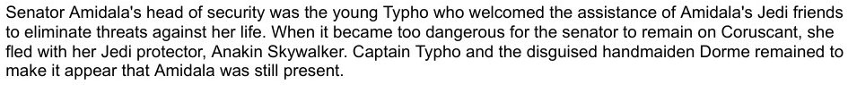
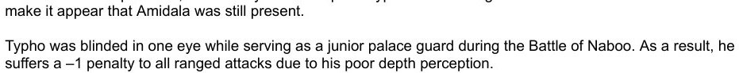

# Owner Material 037 — Star Wars D20 Drive folder (Core, Revised Core and Saga Edition): Characters/Miniatures/Soldiers of Fortune.pdf [Star Wars Roleplaying Game Revised Core (d20, 2002)]

- **Source:** Wizards of the Coast Star Wars Roleplaying Game books, web enhancements, Living Force campaign modules and articles (2000–2010), from the owner's "Star Wars D20" Drive folder (only the three edition subfolders; "General" was not read, as instructed). Secondary source (licensed Legends reference). Scan OCR'd on the box; the scan stays box-only and is **not** published.
- **Method:** every scanned page was OCR'd and machine-screened sentence by sentence for power-relevant statements (fights, kills, defeats, Force feats, rankings, superweapons) that name a character on our roster; each kept sentence is quoted verbatim from the OCR text and has a crop of the printed passage directly under it. Pages with nothing power-relevant are still listed with what is on them.
- **Citation:** "*Soldiers of Fortune* (SWRPG d20 Revised Core), p.X" by printed page ("scan p.X" where no printed number applies). **Weight:** Licensed RPG material: a secondary source. Narrative text sums up Legends lore; game statistics are rules for players, not canon power levels, and rank lowest.

## scan p.1 (scan page 1)

Page contents: Intro; 20-encounter table CC B-G (columns Naboo/Nikto Soldier; Weequay/Rodian Mercenary; Wookiee Commando; Captain Typho/Ishi Tib Scout; from image); Captain Typho narrative (hand-read)

- **Captain Typho; Padmé Amidala; Darth Vader (Anakin Skywalker)** — entry/section: Captain Typho, Amidala's head of security: "Senator Amidala's head of security was the young Typho who welcomed the assistance of Amidala's Jedi friends to eliminate threats against her life. When it became too dangerous for the senator to remain on Coruscant, she fled with her Jedi protector, Anakin Skywalker. Captain Typho and the disguised handmaiden Dorme remained to make it appear that Amidala was still present." Source: *Soldiers of Fortune* (SWRPG d20 Revised Core), scan p.1
  
- **Captain Typho** — entry/section: Typho's lost eye: "Typho was blinded in one eye while serving as a junior palace guard during the Battle of Naboo. As a result, he suffers a —1 penalty to all ranged attacks due to his poor depth perception." Source: *Soldiers of Fortune* (SWRPG d20 Revised Core), scan p.1
  

## scan p.2 (scan page 2)

Page contents: Captain Typho stats (Soldier 4/Bodyguard 2, CC D); Naboo Soldier (Thug 1, CC A); Wookiee Commando (Scout 3/Soldier 1; from image: Defense 16, VP/WP 25/11, Atk +4 melee 2d10+1 vibro-ax, CC C) (hand-read)

### Stat block notes (game mechanics, not feats)

- captain-typho: Captain Typho: Male Human Soldier 4/Bodyguard 2; Defense 17; DR 4; VP/WP 46/13; harm's way; -1 ranged penalty from losing an eye; FP 1; DSP 0; Rep +1; Challenge Code D; modified SoroSuub S-5 heavy blaster pistol, Naboo N-1 starfighter (Source: *Soldiers of Fortune* (SWRPG d20 Revised Core), scan p.2)

## scan p.3 (scan page 3)

Page contents: Nikto Soldier (Kajain'sa'Nikto Thug 1, CC A); Ishi Tib Scout (Scout 6, CC D); Weequay Mercenary (Thug 4, quay orb, CC B); Rodian Mercenary intro (hand-read)

## scan p.4 (scan page 4)

Page contents: Rodian Mercenary (Soldier 1/Thug 3, CC B); new feat Deft Opportunist (from D&D Miniatures Handbook; Dex 15, Combat Reflexes; +4 on attacks of opportunity) (hand-read)

