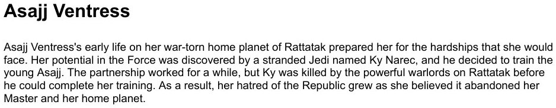
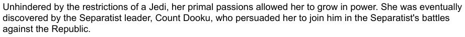
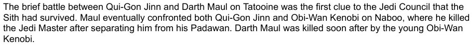
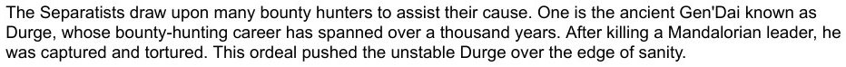
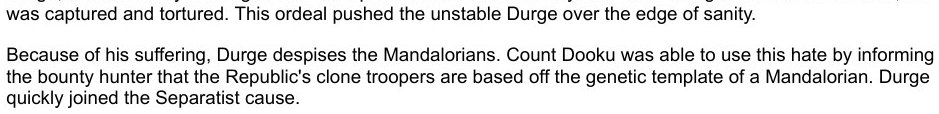
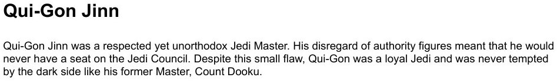
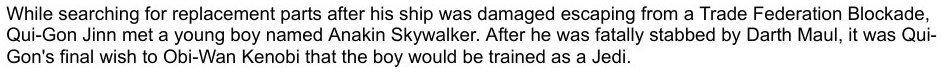

# Owner Material 037 — Star Wars D20 Drive folder (Core, Revised Core and Saga Edition): Characters/Miniatures/The Force Is With Them (Mostly).pdf [Star Wars Roleplaying Game Revised Core (d20, 2002)]

- **Source:** Wizards of the Coast Star Wars Roleplaying Game books, web enhancements, Living Force campaign modules and articles (2000–2010), from the owner's "Star Wars D20" Drive folder (only the three edition subfolders; "General" was not read, as instructed). Secondary source (licensed Legends reference). Scan OCR'd on the box; the scan stays box-only and is **not** published.
- **Method:** every scanned page was OCR'd and machine-screened sentence by sentence for power-relevant statements (fights, kills, defeats, Force feats, rankings, superweapons) that name a character on our roster; each kept sentence is quoted verbatim from the OCR text and has a crop of the printed passage directly under it. Pages with nothing power-relevant are still listed with what is on them.
- **Citation:** "*The Force Is With Them (Mostly)* (SWRPG d20 Revised Core), p.X" by printed page ("scan p.X" where no printed number applies). **Weight:** Licensed RPG material: a secondary source. Narrative text sums up Legends lore; game statistics are rules for players, not canon power levels, and rank lowest.

## scan p.1 (scan page 1)

Page contents: Intro; Asajj Ventress (Rattatak, Ky Narec, Dooku; Jedi Guardian 5/Dark Side Marauder 5/Officer 1, CC E); Dark Side Acolyte (Soldier 2/Dark Side Marauder 4, CC D from image) (hand-read)

- **Asajj Ventress; Ky Narec** — entry/section: Asajj Ventress and Ky Narec: "Asajj Ventress's early life on her war-torn home planet of Rattatak prepared her for the hardships that she would face. Her potential in the Force was discovered by a stranded Jedi named Ky Narec, and he decided to train the young Asajj. The partnership worked for a while, but Ky was killed by the powerful warlords on Rattatak before he could complete her training. As a result, her hatred of the Republic grew as she believed it abandoned her Master and her home planet." Source: *The Force Is With Them (Mostly)* (SWRPG d20 Revised Core), scan p.1
  
- **Asajj Ventress; Count Dooku** — entry/section: Ventress joins Dooku: "Unhindered by the restrictions of a Jedi, her primal passions allowed her to grow in power. She was eventually discovered by the Separatist leader, Count Dooku, who persuaded her to join him in the Separatist's battles against the Republic." Source: *The Force Is With Them (Mostly)* (SWRPG d20 Revised Core), scan p.1
  

### Stat block notes (game mechanics, not feats)

- asajj-ventress: Asajj Ventress: Female Human Jedi Guardian 5/Dark Side Marauder 5/Officer 1; Defense 22; VP/WP 86/14; FP 4; DSP 7; Rep +7; Challenge Code E; separable double lightsaber (Source: *The Force Is With Them (Mostly)* (SWRPG d20 Revised Core), scan p.1)

## scan p.2 (scan page 2)

Page contents: Acolyte feats; Darth Maul (Tatooine, Naboo; Soldier 1/Dark Side Marauder 3/Sith Warrior 6/Sith Lord 2, CC F); Durge (Gen'Dai physiology rules, armor; Soldier 7/Bounty Hunter 3, CC E) (hand-read)

- **Darth Maul; Qui-Gon Jinn; Obi-Wan Kenobi** — entry/section: Darth Maul on Tatooine and Naboo: "The brief battle between Qui-Gon Jinn and Darth Maul on Tatooine was the first clue to the Jedi Council that the Sith had survived. Maul eventually confronted both Qui-Gon Jinn and Obi-Wan Kenobi on Naboo, where he killed the Jedi Master after separating him from his Padawan. Darth Maul was killed soon after by the young Obi-Wan Kenobi." Source: *The Force Is With Them (Mostly)* (SWRPG d20 Revised Core), scan p.2
  
- **Durge** — entry/section: Durge, ancient Gen'Dai: "The Separatists draw upon many bounty hunters to assist their cause. One is the ancient Gen'Dai known as Durge, whose bounty-hunting career has spanned over a thousand years. After killing a Mandalorian leader, he was captured and tortured. This ordeal pushed the unstable Durge over the edge of sanity." Source: *The Force Is With Them (Mostly)* (SWRPG d20 Revised Core), scan p.2
  
- **Durge; Count Dooku** — entry/section: Durge's hatred of Mandalorians: "Because of his suffering, Durge despises the Mandalorians. Count Dooku was able to use this hate by informing the bounty hunter that the Republic's clone troopers are based off the genetic template of a Mandalorian. Durge quickly joined the Separatist cause." Source: *The Force Is With Them (Mostly)* (SWRPG d20 Revised Core), scan p.2
  

### Stat block notes (game mechanics, not feats)

- darth-maul: Darth Maul: Male Zabrak Soldier 1/Dark Side Marauder 3/Sith Warrior 6/Sith Lord 2; Defense 25; VP/WP 120/16; FP 6; DSP 14; Rep +7; Challenge Code F; double-bladed lightsaber, lanvarok, 3 Dark Eye probe droids, Sith Infiltrator (Scimitar); Tumble +15 (Source: *The Force Is With Them (Mostly)* (SWRPG d20 Revised Core), scan p.2)
- durge: Durge: Male Gen'Dai Soldier 7/Bounty Hunter 3; Defense 20; DR 7; Fly 40 m; VP/WP 90/16; healing hibernation, amazing physiology (dies only at -30 wounds); FP 2; DSP 9; Rep +4; Challenge Code E; forearm energy shields (+2 Defense vs lightsabers) (Source: *The Force Is With Them (Mostly)* (SWRPG d20 Revised Core), scan p.2)

## scan p.3 (scan page 3)

Page contents: Durge skills/feats; Rodian Jedi Guardian (Jedi Guardian 4, CC C from image); Qui-Gon Jinn (Jedi Guardian 10/Jedi Master 5, CC F) (hand-read)

- **Qui-Gon Jinn; Count Dooku** — entry/section: Qui-Gon, unorthodox Jedi Master: "Qui-Gon Jinn was a respected yet unorthodox Jedi Master. His disregard of authority figures meant that he would never have a seat on the Jedi Council. Despite this small flaw, Qui-Gon was a loyal Jedi and was never tempted by the dark side like his former Master, Count Dooku." Source: *The Force Is With Them (Mostly)* (SWRPG d20 Revised Core), scan p.3
  
- **Qui-Gon Jinn; Darth Vader (Anakin Skywalker); Darth Maul; Obi-Wan Kenobi** — entry/section: Qui-Gon meets Anakin: "While searching for replacement parts after his ship was damaged escaping from a Trade Federation Blockade, Qui-Gon Jinn met a young boy named Anakin Skywalker. After he was fatally stabbed by Darth Maul, it was Qui-Gon's final wish to Obi-Wan Kenobi that the boy would be trained as a Jedi." Source: *The Force Is With Them (Mostly)* (SWRPG d20 Revised Core), scan p.3
  

### Stat block notes (game mechanics, not feats)

- qui-gon-jinn: Qui-Gon Jinn: Male Human Jedi Guardian 10/Jedi Master 5; Defense 22; VP/WP 97/12; FP 11; DSP 0; Rep +6; Challenge Code F; Affect Mind +19, See Force +19 (Source: *The Force Is With Them (Mostly)* (SWRPG d20 Revised Core), scan p.3)
