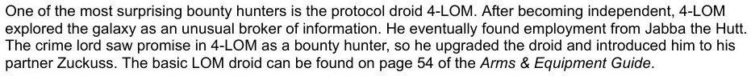
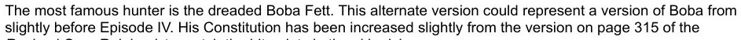
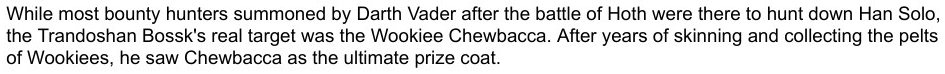
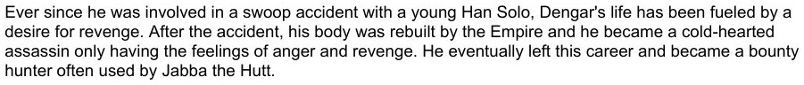
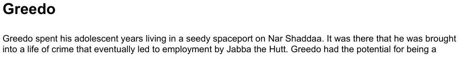
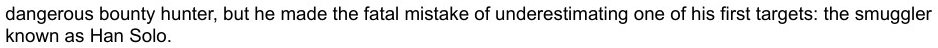
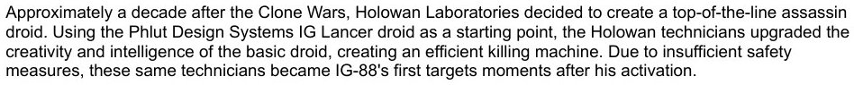
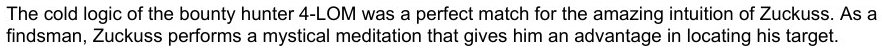

# Owner Material 037 — Star Wars D20 Drive folder (Core, Revised Core and Saga Edition): Characters/Miniatures/We Don't Need That Scum.pdf [Star Wars Roleplaying Game Revised Core (d20, 2002)]

- **Source:** Wizards of the Coast Star Wars Roleplaying Game books, web enhancements, Living Force campaign modules and articles (2000–2010), from the owner's "Star Wars D20" Drive folder (only the three edition subfolders; "General" was not read, as instructed). Secondary source (licensed Legends reference). Scan OCR'd on the box; the scan stays box-only and is **not** published.
- **Method:** every scanned page was OCR'd and machine-screened sentence by sentence for power-relevant statements (fights, kills, defeats, Force feats, rankings, superweapons) that name a character on our roster; each kept sentence is quoted verbatim from the OCR text and has a crop of the printed passage directly under it. Pages with nothing power-relevant are still listed with what is on them.
- **Citation:** "*We Don't Need That Scum* (SWRPG d20 Revised Core), p.X" by printed page ("scan p.X" where no printed number applies). **Weight:** Licensed RPG material: a secondary source. Narrative text sums up Legends lore; game statistics are rules for players, not canon power levels, and rank lowest.

## scan p.1 (scan page 1)

Page contents: Intro (stats match skirmish game, lower levels); 4-LOM (Diplomat 3/Scoundrel 5/Soldier 2/Bounty Hunter 1, CC E); Boba Fett (Soldier 6/Scoundrel 1/Bounty Hunter 3, CC E, Con raised vs RCR p315) (hand-read)

- **4-LOM; Jabba the Hutt; Zuckuss** — entry/section: 4-LOM becomes a bounty hunter: "One of the most surprising bounty hunters is the protocol droid 4-LOM. After becoming independent, 4-LOM explored the galaxy as an unusual broker of information. He eventually found employment from Jabba the Hutt. The crime lord saw promise in 4-LOM as a bounty hunter, so he upgraded the droid and introduced him to his partner Zuckuss." Source: *We Don't Need That Scum* (SWRPG d20 Revised Core), scan p.1
  
- **Boba Fett** — entry/section: Boba Fett, the dreaded hunter: "The most famous hunter is the dreaded Boba Fett. This alternate version could represent a version of Boba from slightly before Episode IV." Source: *We Don't Need That Scum* (SWRPG d20 Revised Core), scan p.1
  

### Stat block notes (game mechanics, not feats)

- 4-lom: 4-LOM: Modified walking protocol droid, Diplomat 3/Scoundrel 5/Soldier 2/Bounty Hunter 1; Defense 18; VP/WP 55/15; FP 0; DSP 5; Rep +4; Challenge Code E; Gather Information +18 (Source: *We Don't Need That Scum* (SWRPG d20 Revised Core), scan p.1)
- boba-fett: Boba Fett: Male Human Soldier 6/Scoundrel 1/Bounty Hunter 3; Defense 20; DR 4; VP/WP 90/16; FP 2; DSP 7; Rep +4; Challenge Code E; Slave 1 (Source: *We Don't Need That Scum* (SWRPG d20 Revised Core), scan p.1)

## scan p.2 (scan page 2)

Page contents: Boba skills/feats; Bossk (Scout 1/Soldier 3, CC C, early career, Hound's Tooth); Dengar (Soldier 2/Scoundrel 4, CC D, Punishing One); Greedo intro (hand-read)

- **Bossk; Darth Vader (Anakin Skywalker); Han Solo; Chewbacca** — entry/section: Bossk hunts Chewbacca: "While most bounty hunters summoned by Darth Vader after the battle of Hoth were there to hunt down Han Solo, the Trandoshan Bossk's real target was the Wookiee Chewbacca. After years of skinning and collecting the pelts of Wookiees, he saw Chewbacca as the ultimate prize coat." Source: *We Don't Need That Scum* (SWRPG d20 Revised Core), scan p.2
  
- **Dengar; Han Solo; Jabba the Hutt** — entry/section: Dengar's revenge: "Ever since he was involved in a swoop accident with a young Han Solo, Dengar's life has been fueled by a desire for revenge. After the accident, his body was rebuilt by the Empire and he became a cold-hearted assassin only having the feelings of anger and revenge. He eventually left this career and became a bounty hunter often used by Jabba the Hutt." Source: *We Don't Need That Scum* (SWRPG d20 Revised Core), scan p.2
  
- **Greedo; Jabba the Hutt; Han Solo** — entry/section: Greedo's fatal mistake (part 1 of 2, continues next page): "Greedo spent his adolescent years living in a seedy spaceport on Nar Shaddaa. It was there that he was brought into a life of crime that eventually led to employment by Jabba the Hutt. Greedo had the potential for being a" Source: *We Don't Need That Scum* (SWRPG d20 Revised Core), scan p.2
  

### Stat block notes (game mechanics, not feats)

- bossk: Bossk: Scout 1/Soldier 3; Defense 17; VP/WP 32/15; FP 1; DSP 2; Rep +1; Challenge Code C; Relby-v10, Hound's Tooth (Source: *We Don't Need That Scum* (SWRPG d20 Revised Core), scan p.2)
- dengar: Dengar: Male Human Soldier 2/Scoundrel 4; Defense 17; DR 4; VP/WP 30/11; FP 1; DSP 2; Rep +2; Challenge Code D; Punishing One (Source: *We Don't Need That Scum* (SWRPG d20 Revised Core), scan p.2)

## scan p.3 (scan page 3)

Page contents: Greedo (Scoundrel 4, CC C); IG-88 (Holowan Laboratories, Scout 4/Soldier 3/Bounty Hunter 1, CC E, IG-2000); Zuckuss (Gand ammonia breather oxygen rules; Force Adept 2/Scout 3/Findsman 5/Bounty Hunter 1, CC E) (hand-read)

- **Greedo; Jabba the Hutt; Han Solo** — entry/section: Greedo's fatal mistake (part 2 of 2, continued from previous page): "dangerous bounty hunter, but he made the fatal mistake of underestimating one of his first targets: the smuggler known as Han Solo." Source: *We Don't Need That Scum* (SWRPG d20 Revised Core), scan p.3
  
- **IG-88** — entry/section: IG-88's creation: "Approximately a decade after the Clone Wars, Holowan Laboratories decided to create a top-of-the-line assassin droid. Using the Phlut Design Systems IG Lancer droid as a starting point, the Holowan technicians upgraded the creativity and intelligence of the basic droid, creating an efficient killing machine. Due to insufficient safety measures, these same technicians became IG-88's first targets moments after his activation." Source: *We Don't Need That Scum* (SWRPG d20 Revised Core), scan p.3
  
- **Zuckuss; 4-LOM** — entry/section: Zuckuss the findsman: "The cold logic of the bounty hunter 4-LOM was a perfect match for the amazing intuition of Zuckuss. As a findsman, Zuckuss performs a mystical meditation that gives him an advantage in locating his target." Source: *We Don't Need That Scum* (SWRPG d20 Revised Core), scan p.3
  

### Stat block notes (game mechanics, not feats)

- greedo: Greedo: Male Rodian Scoundrel 4; Defense 15; VP/WP 19/11; FP 0; DSP 1; Rep +1; Challenge Code C (Source: *We Don't Need That Scum* (SWRPG d20 Revised Core), scan p.3)
- ig-88: IG-88: IG-series experimental walking assassin droid Scout 4/Soldier 3/Bounty Hunter 1; Defense 19; DR 7; VP/WP 68/17; FP 0; DSP 9; Rep +3; Challenge Code E; IG-2000 (Source: *We Don't Need That Scum* (SWRPG d20 Revised Core), scan p.3)
- zuckuss: Zuckuss: Male Force Adept 2/Scout 3/Findsman 5/Bounty Hunter 1; Defense 23; DR 4; VP/WP 87/17; FP 3; DSP 2; Rep +2; Challenge Code E; Farseeing +12; Mist Hunter (Source: *We Don't Need That Scum* (SWRPG d20 Revised Core), scan p.3)

## scan p.4 (scan page 4)

Page contents: Zuckuss gear/skills (Mist Hunter); Weapons: Mennotor DAS-430 (cost 1,200, 1d6, 8 m, 8 shots); Neural Inhibitor Dart (DC 15 poison, 1d6 Dex/paralysis, 10 cr); Relby-v10 micro grenade launcher (cost 3,000, 30 m, 8 shots) (hand-read)

