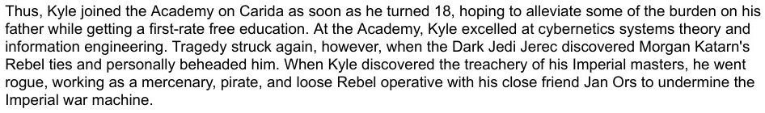
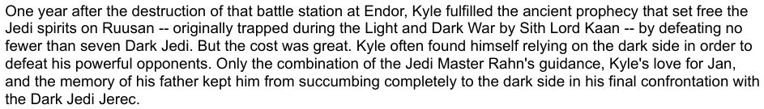
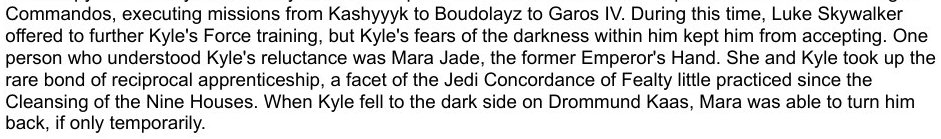
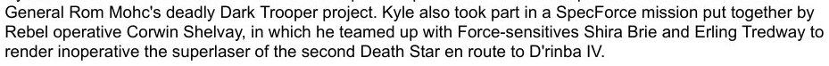
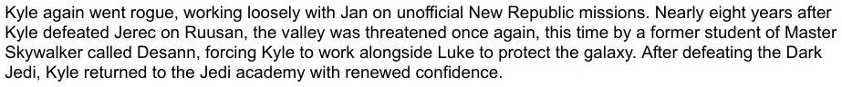
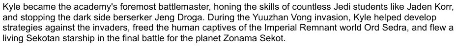
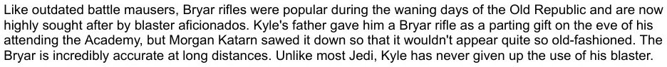
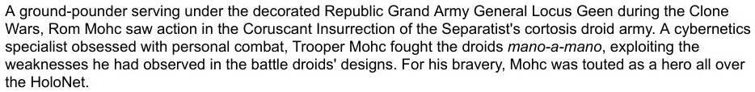
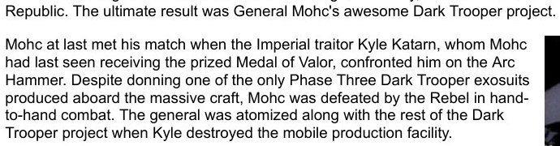

# Owner Material 037 — Star Wars D20 Drive folder (Core, Revised Core and Saga Edition): Characters/The Dark Forces Saga/The Dark Forces Saga, Part 1.pdf [Star Wars Roleplaying Game Revised Core (d20, 2002)]

- **Source:** Wizards of the Coast Star Wars Roleplaying Game books, web enhancements, Living Force campaign modules and articles (2000–2010), from the owner's "Star Wars D20" Drive folder (only the three edition subfolders; "General" was not read, as instructed). Secondary source (licensed Legends reference). Scan OCR'd on the box; the scan stays box-only and is **not** published.
- **Method:** every scanned page was OCR'd and machine-screened sentence by sentence for power-relevant statements (fights, kills, defeats, Force feats, rankings, superweapons) that name a character on our roster; each kept sentence is quoted verbatim from the OCR text and has a crop of the printed passage directly under it. Pages with nothing power-relevant are still listed with what is on them.
- **Citation:** "*The Dark Forces Saga, Part 1* (SWRPG d20 Revised Core), p.X" by printed page ("scan p.X" where no printed number applies). **Weight:** Licensed RPG material: a secondary source. Narrative text sums up Legends lore; game statistics are rules for players, not canon power levels, and rank lowest.

## scan p.1 (scan page 1)

Page contents: Intro on Dark Forces (1994) and Kyle's games; Kyle Katarn, Jedi Knight: Sulon upbringing, mother's death, Carida, Jerec kills Morgan, Death Star plans, Dark Trooper project, Ruusan/Valley prophecy, Mara Jade reciprocal apprenticeship, Drommund Kaas (hand-read)

- **Kyle Katarn** — entry/section: Kyle Katarn and the Jedi prophecy: "No one said fulfilling a Jedi prophecy is easy -- just ask the Skywalkers. For Kyle Katarn, it stole his innocence, took his parents, and nearly plunged him into the dark side." Source: *The Dark Forces Saga, Part 1* (SWRPG d20 Revised Core), scan p.1
  
- **Kyle Katarn; Jerec; Morgan Katarn; Jan Ors** — entry/section: Kyle goes rogue: "Thus, Kyle joined the Academy on Carida as soon as he turned 18, hoping to alleviate some of the burden on his father while getting a first-rate free education. At the Academy, Kyle excelled at cybernetics systems theory and information engineering. Tragedy struck again, however, when the Dark Jedi Jerec discovered Morgan Katarn's Rebel ties and personally beheaded him. When Kyle discovered the treachery of his Imperial masters, he went rogue, working as a mercenary, pirate, and loose Rebel operative with his close friend Jan Ors to undermine the Imperial war machine." Source: *The Dark Forces Saga, Part 1* (SWRPG d20 Revised Core), scan p.1
  
- **Kyle Katarn; Jerec; Qu Rahn; Jan Ors; Morgan Katarn; Lord Kaan** — entry/section: Kyle on Ruusan: "One year after the destruction of that battle station at Endor, Kyle fulfilled the ancient prophecy that set free the Jedi spirits on Ruusan -- originally trapped during the Light and Dark War by Sith Lord Kaan -- by defeating no fewer than seven Dark Jedi. But the cost was great. Kyle often found himself relying on the dark side in order to defeat his powerful opponents. Only the combination of the Jedi Master Rahn's guidance, Kyle's love for Jan, and the memory of his father kept him from succumbing completely to the dark side in his final confrontation with the Dark Jedi Jerec." Source: *The Dark Forces Saga, Part 1* (SWRPG d20 Revised Core), scan p.1
  
- **Kyle Katarn; Mara Jade Skywalker; Luke Skywalker** — entry/section: Kyle and Mara Jade: "During this time, Luke Skywalker offered to further Kyle's Force training, but Kyle's fears of the darkness within him kept him from accepting. One person who understood Kyle's reluctance was Mara Jade, the former Emperor's Hand. She and Kyle took up the rare bond of reciprocal apprenticeship, a facet of the Jedi Concordance of Fealty little practiced since the Cleansing of the Nine Houses. When Kyle fell to the dark side on Drommund Kaas, Mara was able to turn him back, if only temporarily." Source: *The Dark Forces Saga, Part 1* (SWRPG d20 Revised Core), scan p.1
  
- **Kyle Katarn; Lumiya** — entry/section: Kyle Katarn, Jedi Knight: "Kyle also took part in a SpecForce mission put together by Rebel operative Corwin Shelvay, in which he teamed up with Force-sensitives Shira Brie and Erling Tredway to render inoperative the superlaser of the second Death Star en route to D'rinba IV." Source: *The Dark Forces Saga, Part 1* (SWRPG d20 Revised Core), scan p.1
  

## scan p.2 (scan page 2)

Page contents: Kyle exiles himself, Desann, battlemaster (Jaden Korr, Jeng Droga), Yuuzhan Vong war, Cloak of the Sith; Kyle Katarn (NJO) stats; Bryar pistol (3d4/3d6, 20/50 m); Rom Mohc, Soldier for the Empire: Clone Wars hero (hand-read)

- **Kyle Katarn; Luke Skywalker; Desann** — entry/section: Kyle and Desann: "Nearly eight years after Kyle defeated Jerec on Ruusan, the valley was threatened once again, this time by a former student of Master Skywalker called Desann, forcing Kyle to work alongside Luke to protect the galaxy. After defeating the Dark Jedi, Kyle returned to the Jedi academy with renewed confidence." Source: *The Dark Forces Saga, Part 1* (SWRPG d20 Revised Core), scan p.2
  
- **Kyle Katarn; Jaden Korr; Jeng Droga** — entry/section: Kyle the battlemaster: "Kyle became the academy's foremost battlemaster, honing the skills of countless Jedi students like Jaden Korr, and stopping the dark side berserker Jeng Droga. During the Yuuzhan Vong invasion, Kyle helped develop strategies against the invaders, freed the human captives of the Imperial Remnant world Ord Sedra, and flew a living Sekotan starship in the final battle for the planet Zonama Sekot." Source: *The Dark Forces Saga, Part 1* (SWRPG d20 Revised Core), scan p.2
  
- **Kyle Katarn; Morgan Katarn** — entry/section: Kyle's Bryar: "Like outdated battle mausers, Bryar rifles were popular during the waning days of the Old Republic and are now highly sought after by blaster aficionados. Kyle's father gave him a Bryar rifle as a parting gift on the eve of his attending the Academy, but Morgan Katarn sawed it down so that it wouldn't appear quite so old-fashioned. The Bryar is incredibly accurate at long distances. Unlike most Jedi, Kyle has never given up the use of his blaster." Source: *The Dark Forces Saga, Part 1* (SWRPG d20 Revised Core), scan p.2
  
- **General Rom Mohc** — entry/section: Rom Mohc in the Clone Wars: "A ground-pounder serving under the decorated Republic Grand Army General Locus Geen during the Clone Wars, Rom Mohc saw action in the Coruscant Insurrection of the Separatist's cortosis droid army. A cybernetics specialist obsessed with personal combat, Trooper Mohc fought the droids mano-a-mano, exploiting the weaknesses he had observed in the battle droids' designs. For his bravery, Mohc was touted as a hero all over the HoloNet." Source: *The Dark Forces Saga, Part 1* (SWRPG d20 Revised Core), scan p.2
  
- **Kyle Katarn** — entry/section: Kyle Katarn, Jedi Knight: "While in Imperial Remnant space, Kyle heard a rumor that the Sith had possibly survived all these years after Endor." Source: *The Dark Forces Saga, Part 1* (SWRPG d20 Revised Core), scan p.2
  

### Stat block notes (game mechanics, not feats)

- kyle-katarn: Kyle Katarn (NJO): Male Human Scoundrel 4/Soldier 4/Jedi Guardian 7/Jedi Weapon Master 3; Defense 26; VP/WP 139/18; FP 7; DSP 0; Rep +8; Battlemind +16; Bryar pistol, lightsaber (Source: *The Dark Forces Saga, Part 1* (SWRPG d20 Revised Core), scan p.2)

## scan p.3 (scan page 3)

Page contents: Rom Mohc trophy room, Dark Trooper project, death on Arc Hammer; Rom Mohc (A New Hope) stats (Noble 1/Soldier 5/Officer 4) (hand-read)

- **General Rom Mohc; Kyle Katarn** — entry/section: Mohc meets his match: "Mohc at last met his match when the Imperial traitor Kyle Katarn, whom Mohc had last seen receiving the prized Medal of Valor, confronted him on the Arc Hammer. Despite donning one of the only Phase Three Dark Trooper exosuits produced aboard the massive craft, Mohc was defeated by the Rebel in handto-hand combat. The general was atomized along with the rest of the Dark Trooper project when Kyle destroyed the mobile production facility." Source: *The Dark Forces Saga, Part 1* (SWRPG d20 Revised Core), scan p.3
  

### Stat block notes (game mechanics, not feats)

- rom-mohc: Rom Mohc (A New Hope): Male Human Noble 1/Soldier 5/Officer 4; Defense 17; VP/WP 59/17; FP 2; DSP 7; Rep 7; Phase Three Dark Trooper exosuit, Arc Hammer (Source: *The Dark Forces Saga, Part 1* (SWRPG d20 Revised Core), scan p.3)
