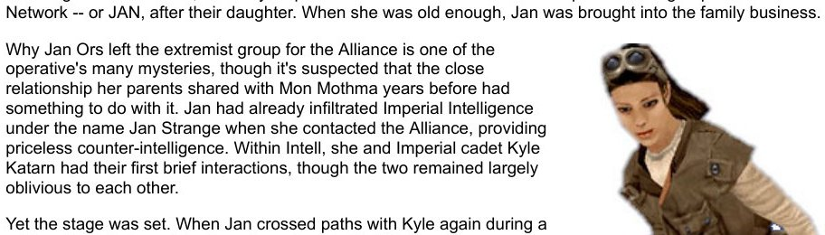
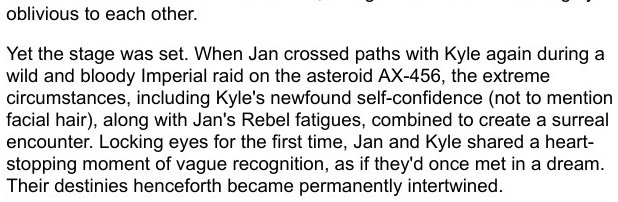
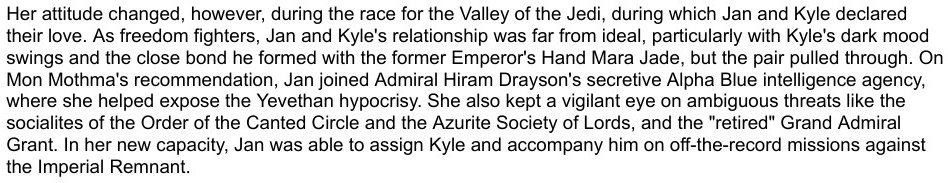
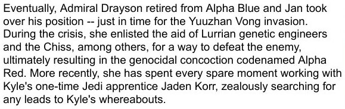
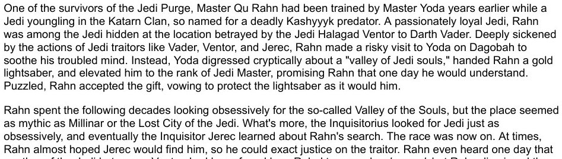
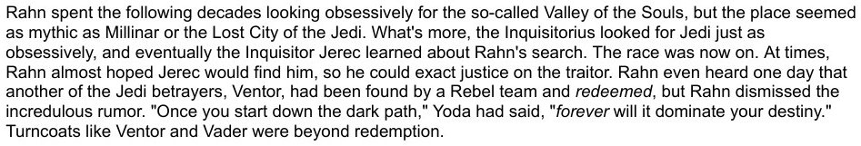
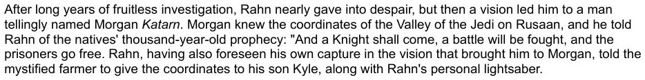
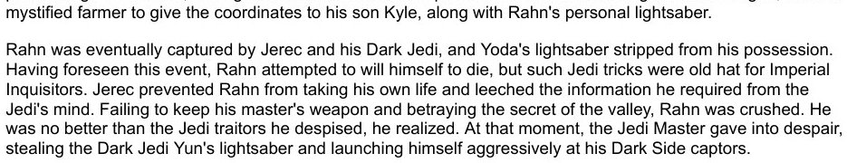
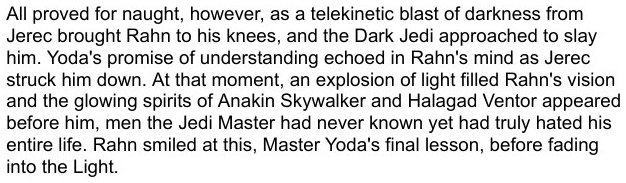
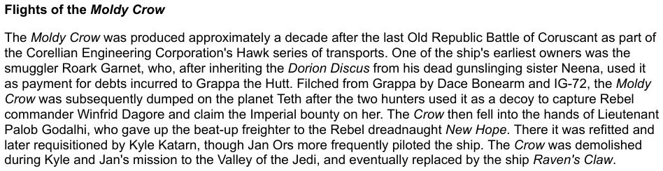

# Owner Material 037 — Star Wars D20 Drive folder (Core, Revised Core and Saga Edition): Characters/The Dark Forces Saga/The Dark Forces Saga, Part 2.pdf [Star Wars Roleplaying Game Revised Core (d20, 2002)]

- **Source:** Wizards of the Coast Star Wars Roleplaying Game books, web enhancements, Living Force campaign modules and articles (2000–2010), from the owner's "Star Wars D20" Drive folder (only the three edition subfolders; "General" was not read, as instructed). Secondary source (licensed Legends reference). Scan OCR'd on the box; the scan stays box-only and is **not** published.
- **Method:** every scanned page was OCR'd and machine-screened sentence by sentence for power-relevant statements (fights, kills, defeats, Force feats, rankings, superweapons) that name a character on our roster; each kept sentence is quoted verbatim from the OCR text and has a crop of the printed passage directly under it. Pages with nothing power-relevant are still listed with what is on them.
- **Citation:** "*The Dark Forces Saga, Part 2* (SWRPG d20 Revised Core), p.X" by printed page ("scan p.X" where no printed number applies). **Weight:** Licensed RPG material: a secondary source. Narrative text sums up Legends lore; game statistics are rules for players, not canon power levels, and rank lowest.

## scan p.1 (scan page 1)

Page contents: Intro; Jan Ors, Rebel Agent: Alderaanian parents, Justice Action Network, Jan Strange in Imperial Intelligence, AX-456, Moldy Crow missions, love for Kyle, Alpha Blue, Alpha Red, search for Kyle with Jaden Korr; Jan Ors (NJO) stats begin (hand-read)

- **Jan Ors; Mon Mothma; Kyle Katarn** — entry/section: Jan Ors infiltrates Imperial Intelligence: "Why Jan Ors left the extremist group for the Alliance is one of the operative's many mysteries, though it's suspected that the close relationship her parents shared with Mon Mothma years before had something to do with it. Jan had already infiltrated Imperial Intelligence under the name Jan Strange when she contacted the Alliance, providing priceless counter-intelligence. Within Intell, she and Imperial cadet Kyle Katarn had their first brief interactions, though the two remained largely oblivious to each other." Source: *The Dark Forces Saga, Part 2* (SWRPG d20 Revised Core), scan p.1
  
- **Jan Ors; Kyle Katarn** — entry/section: Jan and Kyle lock eyes: "Yet the stage was set. When Jan crossed paths with Kyle again during a wild and bloody Imperial raid on the asteroid AX-456, the extreme circumstances, including Kyle's newfound self-confidence (not to mention facial hair), along with Jan's Rebel fatigues, combined to create a surreal encounter. Locking eyes for the first time, Jan and Kyle shared a heartstopping moment of vague recognition, as if they'd once met in a dream. Their destinies henceforth became permanently intertwined." Source: *The Dark Forces Saga, Part 2* (SWRPG d20 Revised Core), scan p.1
  
- **Jan Ors; Kyle Katarn; Mara Jade Skywalker; Mon Mothma; Admiral Hiram Drayson** — entry/section: Jan and Kyle declare their love: "Her attitude changed, however, during the race for the Valley of the Jedi, during which Jan and Kyle declared their love. As freedom fighters, Jan and Kyle's relationship was far from ideal, particularly with Kyle's dark mood swings and the close bond he formed with the former Emperor's Hand Mara Jade, but the pair pulled through. On Mon Mothma's recommendation, Jan joined Admiral Hiram Drayson's secretive Alpha Blue intelligence agency, where she helped expose the Yevethan hypocrisy. She also kept a vigilant eye on ambiguous threats like the socialites of the Order of the Canted Circle and the Azurite Society of Lords, and the "retired" Grand Admiral Grant. In her new capacity, Jan was able to assign Kyle and accompany him on off-the-record missions against the Imperial Remnant." Source: *The Dark Forces Saga, Part 2* (SWRPG d20 Revised Core), scan p.1
  
- **Jan Ors; Admiral Hiram Drayson; Jaden Korr; Kyle Katarn** — entry/section: Jan heads Alpha Blue: "Eventually, Admiral Drayson retired from Alpha Blue and Jan took over his position -- just in time for the Yuuzhan Vong invasion. During the crisis, she enlisted the aid of Lurrian genetic engineers and the Chiss, among others, for a way to defeat the enemy, ultimately resulting in the genocidal concoction codenamed Alpha Red. More recently, she has spent every spare moment working with Kyle's one-time Jedi apprentice Jaden Korr, zealously searching for any leads to Kyle's whereabouts." Source: *The Dark Forces Saga, Part 2* (SWRPG d20 Revised Core), scan p.1
  

### Stat block notes (game mechanics, not feats)

- jan-ors: Jan Ors (NJO): Human Female Scout 5/Soldier 5/Officer 5; Def 21; VP/WP 101/16; SV Fort +11, Ref +10, Will +8; FP 5; DSP 1; Rep 9; Str 12, Dex 16, Con 13, Int 13, Wis 13, Cha 15; skill mastery (Disguise) (Source: *The Dark Forces Saga, Part 2* (SWRPG d20 Revised Core), scan p.1)

## scan p.2 (scan page 2)

Page contents: Jan stats end; Adventure Seed: Jedi Search (Daye Azur-Jamin, Force-strong Yuuzhan Vong); Qu Rahn, Jedi Master: Katarn Clan, Yoda's gold lightsaber, Valley search, Morgan Katarn, capture and death at Jerec's hands, vision of Anakin and Ventor; Qu Rahn stats (hand-read)

- **Qu Rahn; Yoda; Halagad Ventor; Darth Vader (Anakin Skywalker); Jerec** — entry/section: Rahn and Yoda's gold lightsaber: "One of the survivors of the Jedi Purge, Master Qu Rahn had been trained by Master Yoda years earlier while a Jedi youngling in the Katarn Clan, so named for a deadly Kashyyyk predator. A passionately loyal Jedi, Rahn was among the Jedi hidden at the location betrayed by the Jedi Halagad Ventor to Darth Vader. Deeply sickened by the actions of Jedi traitors like Vader, Ventor, and Jerec, Rahn made a risky visit to Yoda on Dagobah to soothe his troubled mind. Instead, Yoda digressed cryptically about a "valley of Jedi souls," handed Rahn a gold lightsaber, and elevated him to the rank of Jedi Master, promising Rahn that one day he would understand. Puzzled, Rahn accepted the gift, vowing to protect the lightsaber as it would him." Source: *The Dark Forces Saga, Part 2* (SWRPG d20 Revised Core), scan p.2
  
- **Qu Rahn; Jerec; Halagad Ventor; Yoda** — entry/section: Rahn's obsessive search: "Rahn spent the following decades looking obsessively for the so-called Valley of the Souls, but the place seemed as mythic as Millinar or the Lost City of the Jedi. What's more, the Inquisitorius looked for Jedi just as obsessively, and eventually the Inquisitor Jerec learned about Rahn's search. The race was now on. At times, Rahn almost hoped Jerec would find him, so he could exact justice on the traitor. Rahn even heard one day that another of the Jedi betrayers, Ventor, had been found by a Rebel team and redeemed, but Rahn dismissed the incredulous rumor. "Once you start down the dark path," Yoda had said, "forever will it dominate your destiny.” Turncoats like Ventor and Vader were beyond redemption." Source: *The Dark Forces Saga, Part 2* (SWRPG d20 Revised Core), scan p.2
  
- **Qu Rahn; Morgan Katarn; Kyle Katarn** — entry/section: Rahn and the prophecy: "After long years of fruitless investigation, Rahn nearly gave into despair, but then a vision led him to a man tellingly named Morgan Katarn. Morgan knew the coordinates of the Valley of the Jedi on Rusaan, and he told Rahn of the natives' thousand-year-old prophecy: "And a Knight shall come, a battle will be fought, and the prisoners go free. Rahn, having also foreseen his own capture in the vision that brought him to Morgan, told the mystified farmer to give the coordinates to his son Kyle, along with Rahn's personal lightsaber." Source: *The Dark Forces Saga, Part 2* (SWRPG d20 Revised Core), scan p.2
  
- **Qu Rahn; Jerec; Yun (Dark Jedi)** — entry/section: Rahn's capture: "Rahn was eventually captured by Jerec and his Dark Jedi, and Yoda's lightsaber stripped from his possession. Having foreseen this event, Rahn attempted to will himself to die, but such Jedi tricks were old hat for Imperial Inquisitors. Jerec prevented Rahn from taking his own life and leeched the information he required from the Jedi's mind. Failing to keep his master's weapon and betraying the secret of the valley, Rahn was crushed. He was no better than the Jedi traitors he despised, he realized. At that moment, the Jedi Master gave into despair, stealing the Dark Jedi Yun's lightsaber and launching himself aggressively at his Dark Side captors." Source: *The Dark Forces Saga, Part 2* (SWRPG d20 Revised Core), scan p.2
  
- **Qu Rahn; Jerec; Darth Vader (Anakin Skywalker); Halagad Ventor; Yoda** — entry/section: Rahn's death: "All proved for naught, however, as a telekinetic blast of darkness from Jerec brought Rahn to his knees, and the Dark Jedi approached to slay him. Yoda's promise of understanding echoed in Rahn's mind as Jerec struck him down. At that moment, an explosion of light filled Rahn's vision and the glowing spirits of Anakin Skywalker and Halagad Ventor appeared before him, men the Jedi Master had never known yet had truly hated his entire life. Rahn smiled at this, Master Yoda's final lesson, before fading into the Light." Source: *The Dark Forces Saga, Part 2* (SWRPG d20 Revised Core), scan p.2
  

### Stat block notes (game mechanics, not feats)

- rahn: Qu Rahn: Male Human Jedi Consular 13/Jedi Master 2; Def 19; VP/WP 89/13; Atk +11/+6/+1 melee (5d8, lightsaber); SQ block, deflect, Force secret (Fear), healing; SV Fort +10, Ref +8, Will +13; FP 14; DSP 3; Rep 9; Str 11, Dex 13, Con 13, Int 15, Wis 16, Cha 15; Enhance Senses +18, Telepathy +16 (Source: *The Dark Forces Saga, Part 2* (SWRPG d20 Revised Core), scan p.2)

## scan p.3 (scan page 3)

Page contents: Rahn skills/feats; Flights of the Moldy Crow: ship history (Roark Garnet, Grappa the Hutt, Dace Bonearm, IG-72, Winfrid Dagore, Palob Godalhi, Raven's Claw); HWK-290 stats (hand-read)

- **Kyle Katarn; Jan Ors** — entry/section: The Moldy Crow: "The Moldy Crow was produced approximately a decade after the last Old Republic Battle of Coruscant as part of the Corellian Engineering Corporation's Hawk series of transports. One of the ship's earliest owners was the smuggler Roark Garnet, who, after inheriting the Dorion Discus from his dead gunslinging sister Neena, used it as payment for debts incurred to Grappa the Hutt. Filched from Grappa by Dace Bonearm and IG-72, the Moldy Crow was subsequently dumped on the planet Teth after the two hunters used it as a decoy to capture Rebel commander Winfrid Dagore and claim the Imperial bounty on her. The Crow then fell into the hands of Lieutenant Palob Godalhi, who gave up the beat-up freighter to the Rebel dreadnaught New Hope. There it was refitted and later requisitioned by Kyle Katarn, though Jan Ors more frequently piloted the ship. The Crow was demolished during Kyle and Jan's mission to the Valley of the Jedi, and eventually replaced by the ship Raven's Claw." Source: *The Dark Forces Saga, Part 2* (SWRPG d20 Revised Core), scan p.3
  
