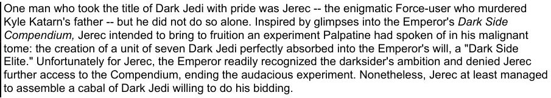
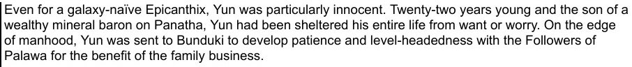
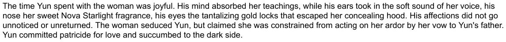
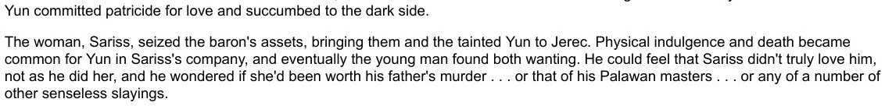
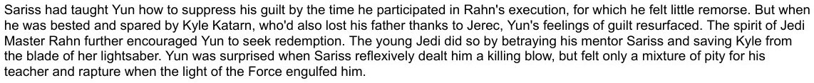
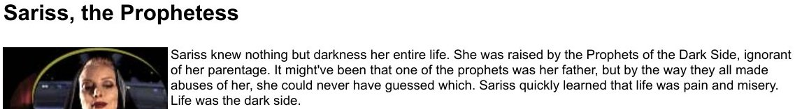
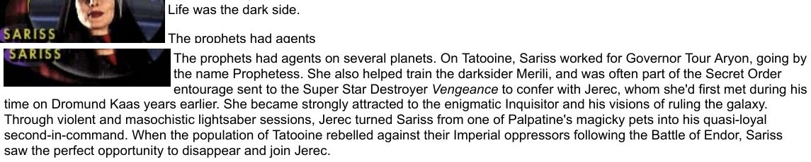
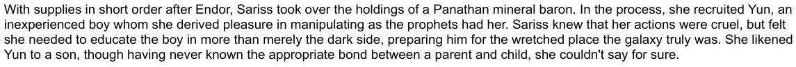
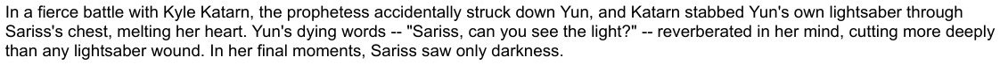
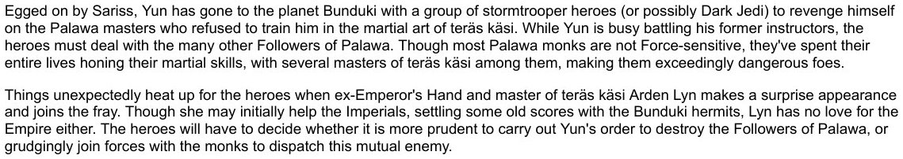

# Owner Material 037 — Star Wars D20 Drive folder (Core, Revised Core and Saga Edition): Characters/The Dark Forces Saga/The Dark Forces Saga, Part 3.pdf [Star Wars Roleplaying Game Revised Core (d20, 2002)]

- **Source:** Wizards of the Coast Star Wars Roleplaying Game books, web enhancements, Living Force campaign modules and articles (2000–2010), from the owner's "Star Wars D20" Drive folder (only the three edition subfolders; "General" was not read, as instructed). Secondary source (licensed Legends reference). Scan OCR'd on the box; the scan stays box-only and is **not** published.
- **Method:** every scanned page was OCR'd and machine-screened sentence by sentence for power-relevant statements (fights, kills, defeats, Force feats, rankings, superweapons) that name a character on our roster; each kept sentence is quoted verbatim from the OCR text and has a crop of the printed passage directly under it. Pages with nothing power-relevant are still listed with what is on them.
- **Citation:** "*The Dark Forces Saga, Part 3* (SWRPG d20 Revised Core), p.X" by printed page ("scan p.X" where no printed number applies). **Weight:** Licensed RPG material: a secondary source. Narrative text sums up Legends lore; game statistics are rules for players, not canon power levels, and rank lowest.

## scan p.1 (scan page 1)

Page contents: Intro on the term Dark Jedi, Jerec's Dark Side Elite; Yun, Fallen Jedi: Epicanthix from Panatha, Followers of Palawa on Bunduki, seduced by Sariss, patricide, redemption and death; Yun stats (Noble 2/Force Adept 3/Jedi Guardian 1, CC B) (hand-read)

- **Jerec; Palpatine (Darth Sidious); Kyle Katarn; Morgan Katarn** — entry/section: Jerec's Dark Side Elite: "One man who took the title of Dark Jedi with pride was Jerec -- the enigmatic Force-user who murdered Kyle Katarn's father -- but he did not do so alone. Inspired by glimpses into the Emperor's Dark Side Compendium, Jerec intended to bring to fruition an experiment Palpatine had spoken of in his malignant tome: the creation of a unit of seven Dark Jedi perfectly absorbed into the Emperor's will, a "Dark Side Elite." Unfortunately for Jerec, the Emperor readily recognized the darksider's ambition and denied Jerec further access to the Compendium, ending the audacious experiment. Nonetheless, Jerec at least managed to assemble a cabal of Dark Jedi willing to do his bidding." Source: *The Dark Forces Saga, Part 3* (SWRPG d20 Revised Core), scan p.1
  
- **Yun (Dark Jedi)** — entry/section: Yun at Bunduki: "Even for a galaxy-naive Epicanthix, Yun was particularly innocent. Twenty-two years young and the son of a wealthy mineral baron on Panatha, Yun had been sheltered his entire life from want or worry. On the edge of manhood, Yun was sent to Bunduki to develop patience and level-headedness with the Followers of Palawa for the benefit of the family business." Source: *The Dark Forces Saga, Part 3* (SWRPG d20 Revised Core), scan p.1
  
- **Yun (Dark Jedi); Sariss** — entry/section: Yun falls for Sariss: "The time Yun spent with the woman was joyful. His mind absorbed her teachings, while his ears took in the soft sound of her voice, his nose her sweet Nova Starlight fragrance, his eyes the tantalizing gold locks that escaped her concealing hood. His affections did not go unnoticed or unreturned. The woman seduced Yun, but claimed she was constrained from acting on her ardor by her vow to Yun's father. Yun committed patricide for love and succumbed to the dark side." Source: *The Dark Forces Saga, Part 3* (SWRPG d20 Revised Core), scan p.1
  
- **Yun (Dark Jedi); Sariss; Jerec** — entry/section: Yun's doubts: "The woman, Sariss, seized the baron's assets, bringing them and the tainted Yun to Jerec. Physical indulgence and death became common for Yun in Sariss's company, and eventually the young man found both wanting. He could feel that Sariss didn't truly love him, not as he did her, and he wondered if she'd been worth his father's murder . . . or that of his Palawan masters . . . or any of a number of other senseless slayings." Source: *The Dark Forces Saga, Part 3* (SWRPG d20 Revised Core), scan p.1
  
- **Yun (Dark Jedi); Sariss; Kyle Katarn; Qu Rahn** — entry/section: Yun's redemption: "Sariss had taught Yun how to suppress his guilt by the time he participated in Rahn's execution, for which he felt little remorse. But when he was bested and spared by Kyle Katarn, who'd also lost his father thanks to Jerec, Yun's feelings of guilt resurfaced. The spirit of Jedi Master Rahn further encouraged Yun to seek redemption. The young Jedi did so by betraying his mentor Sariss and saving Kyle from the blade of her lightsaber. Yun was surprised when Sariss reflexively dealt him a killing blow, but felt only a mixture of pity for his teacher and rapture when the light of the Force engulfed him." Source: *The Dark Forces Saga, Part 3* (SWRPG d20 Revised Core), scan p.1
  

### Stat block notes (game mechanics, not feats)

- yun: Yun: Male Epicanthix Noble 2/Force Adept 3/Jedi Guardian 1; Defense 18; VP/WP 30/11; FP 3; DSP 6; Challenge Code B (Source: *The Dark Forces Saga, Part 3* (SWRPG d20 Revised Core), scan p.1)

## scan p.2 (scan page 2)

Page contents: Sariss, the Prophetess: Prophets of the Dark Side, Tatooine, Merili, Jerec; recruits Yun; death; Sariss stats (Jedi Consular 5/Dark Side Devotee 3/Dark Side Marauder 4, CC D); Adventure Seed: Now I Am the Master! (Bunduki, Palawa, Arden Lyn) (hand-read)

- **Sariss** — entry/section: Sariss raised in darkness: "Sariss knew nothing but darkness her entire life. She was raised by the Prophets of the Dark Side, ignorant of her parentage. It might've been that one of the prophets was her father, but by the way they all made abuses of her, she could never have guessed which. Sariss quickly learned that life was pain and misery. Life was the dark side." Source: *The Dark Forces Saga, Part 3* (SWRPG d20 Revised Core), scan p.2
  
- **Sariss; Jerec** — entry/section: The Prophetess and Jerec: "The prophets had agents on several planets. On Tatooine, Sariss worked for Governor Tour Aryon, going by the name Prophetess. She also helped train the darksider Merili, and was often part of the Secret Order entourage sent to the Super Star Destroyer Vengeance to confer with Jerec, whom she'd first met during his time on Dromund Kaas years earlier. She became strongly attracted to the enigmatic Inquisitor and his visions of ruling the galaxy. Through violent and masochistic lightsaber sessions, Jerec turned Sariss from one of Palpatine's magicky pets into his quasi-loyal second-in-command. When the population of Tatooine rebelled against their Imperial oppressors following the Battle of Endor, Sariss saw the perfect opportunity to disappear and join Jerec." Source: *The Dark Forces Saga, Part 3* (SWRPG d20 Revised Core), scan p.2
  
- **Sariss; Yun (Dark Jedi)** — entry/section: Sariss and Yun: "With supplies in short order after Endor, Sariss took over the holdings of a Panathan mineral baron. In the process, she recruited Yun, an inexperienced boy whom she derived pleasure in manipulating as the prophets had her. Sariss knew that her actions were cruel, but felt she needed to educate the boy in more than merely the dark side, preparing him for the wretched place the galaxy truly was. She likened Yun to a son, though having never known the appropriate bond between a parent and child, she couldn't say for sure." Source: *The Dark Forces Saga, Part 3* (SWRPG d20 Revised Core), scan p.2
  
- **Sariss; Yun (Dark Jedi); Kyle Katarn** — entry/section: Sariss's death: "In a fierce battle with Kyle Katarn, the prophetess accidentally struck down Yun, and Katarn stabbed Yun's own lightsaber through Sariss's chest, melting her heart. Yun's dying words -- "Sariss, can you see the light?” -- reverberated in her mind, cutting more deeply than any lightsaber wound. In her final moments, Sariss saw only darkness." Source: *The Dark Forces Saga, Part 3* (SWRPG d20 Revised Core), scan p.2
  
- **Yun (Dark Jedi); Sariss; Arden Lyn** — entry/section: Adventure seed: Now I Am the Master!: "Egged on by Sariss, Yun has gone to the planet Bunduki with a group of stormtrooper heroes (or possibly Dark Jedi) to revenge himself on the Palawa masters who refused to train him in the martial art of teras kasi. While Yun is busy battling his former instructors, the heroes must deal with the many other Followers of Palawa. Though most Palawa monks are not Force-sensitive, they've spent their entire lives honing their martial skills, with several masters of teras kasi among them, making them exceedingly dangerous foes.
Things unexpectedly heat up for the heroes when ex-Emperor's Hand and master of teras kasi Arden Lyn makes a surprise appearance and joins the fray. Though she may initially help the Imperials, settling some old scores with the Bunduki hermits, Lyn has no love for the Empire either. The heroes will have to decide whether it is more prudent to carry out Yun's order to destroy the Followers of Palawa, or grudgingly join forces with the monks to dispatch this mutual enemy." Source: *The Dark Forces Saga, Part 3* (SWRPG d20 Revised Core), scan p.2
  

### Stat block notes (game mechanics, not feats)

- sariss: Sariss: Female Human Jedi Consular 5/Dark Side Devotee 3/Dark Side Marauder 4; Defense 23; VP/WP 88/14; FP 4; DSP 12; Rep 5; Challenge Code D; Battlemind +12, Knowledge (Sith lore) +12 (Source: *The Dark Forces Saga, Part 3* (SWRPG d20 Revised Core), scan p.2)
