# Owner Material 037 — Star Wars D20 Drive folder (Core, Revised Core and Saga Edition): Characters/The Dark Forces Saga/The Dark Forces Saga, Part 4.pdf [Star Wars Roleplaying Game Revised Core (d20, 2002)]

- **Source:** Wizards of the Coast Star Wars Roleplaying Game books, web enhancements, Living Force campaign modules and articles (2000–2010), from the owner's "Star Wars D20" Drive folder (only the three edition subfolders; "General" was not read, as instructed). Secondary source (licensed Legends reference). Scan OCR'd on the box; the scan stays box-only and is **not** published.
- **Method:** every scanned page was OCR'd and machine-screened sentence by sentence for power-relevant statements (fights, kills, defeats, Force feats, rankings, superweapons) that name a character on our roster; each kept sentence is quoted verbatim from the OCR text and has a crop of the printed passage directly under it. Pages with nothing power-relevant are still listed with what is on them.
- **Citation:** "*The Dark Forces Saga, Part 4* (SWRPG d20 Revised Core), p.X" by printed page ("scan p.X" where no printed number applies). **Weight:** Licensed RPG material: a secondary source. Narrative text sums up Legends lore; game statistics are rules for players, not canon power levels, and rank lowest.

## scan p.1 (scan page 1)

Page contents: Intro (luminous beings vs crude matter); Maw, the Half-Man: Boltrunian, legs severed by Qu Rahn, Force flight, Jedi Shadow turned by Jerec, Morgan Katarn's head, killed by Kyle; Maw stats (Jedi Guardian 7/Jedi Investigator 4/Dark Side Devotee 3, CC F); Permanent Hover special quality (hand-read)

- **Maw (Dark Jedi); Qu Rahn** — entry/section: Maw, the Half-Man: "A Boltrunian over seven decades old but appearing no older than thirty standard years of age, Maw was a specimen of peak physical conditioning. He fed off the hate of others to keep the debilitating effects of the dark side at bay and used anger to fuel his grav-workouts, letting the dark side surge alongside blood and adrenaline. Cords of muscle ran like durasteel cables throughout the length of his body. At least, they did until Maw crossed blades with Master Qu Rahn, who executed a sai tok on the Dark Jedi, severing his legs from his torso." Source: *The Dark Forces Saga, Part 4* (SWRPG d20 Revised Core), scan p.1
  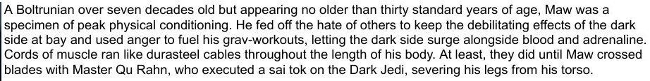
- **Maw (Dark Jedi)** — entry/section: Maw's Force flight: "Maw took the loss in stride; leg workouts had always been a pain in the choobies, anyway. Though he initially relied on a repulsorlift carriage to get around, Maw ultimately opted for the crutch of the dark side. With the same diligence and intensity with which he sculpted his massive body, Maw practiced Force flight until hovering became as second nature as walking. He quickly adapted to the advantages that free flight granted, honing a radical style of lightsaber combat based on the fighting techniques originally developed by the airborne Majestrix of Skye." Source: *The Dark Forces Saga, Part 4* (SWRPG d20 Revised Core), scan p.1
  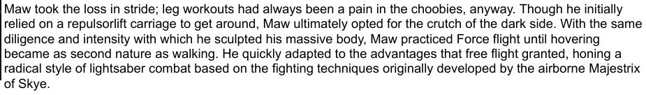
- **Maw (Dark Jedi); Jerec** — entry/section: Maw turned by Jerec: "Maw was once a vain Jedi Knight, but his refusal to take on a Padawan and his general selfishness meant that he never attained the rank of Jedi Master. He had always been a relentless tracker, though, and was attached to a group of Jedi Shadows, Jedi investigators intent on rooting out and destroying any sign of the dark side. After the Clone Wars, Maw and his clan of compatriots were hunted down by Inquisitor Jerec, who succeeded in turning Maw to the dark side while the rest were slaughtered by Jerec and the newly turned Dark Jedi. Jerec afterward took the animalistic Maw under his wing, teaching him to smell the panic of his prey and taste their fear like a trained bloodsniffer." Source: *The Dark Forces Saga, Part 4* (SWRPG d20 Revised Core), scan p.1
  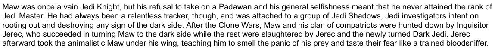
- **Maw (Dark Jedi); Jerec; Boc Aseca; Morgan Katarn; Kyle Katarn** — entry/section: Maw's end: "Maw took Morgan Katarn's head after Jerec severed it with his Jengardin double-bladed vibroblade and, along with the Dark Jedi Boc, used it and the heads of Morgan's fellow Rebel conspirators to "decorate" the walls of the Sulon spaceport. Maw's tyranny came to an end, however, when he taunted Kyle with details of his participation in Morgan's death. Kyle sunk his lightsaber into Maw's deltoid, through the chest, and out the latissimus dorsi -- a blow the already once-halved Boltrunian could not survive. The last thing Maw sensed before dying was the delicious gush of loathing from his killer." Source: *The Dark Forces Saga, Part 4* (SWRPG d20 Revised Core), scan p.1
  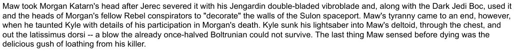
- **Maw (Dark Jedi)** — entry/section: Permanent Hover (special quality): "Special Qualities: Permanent Hover -- Maw has perfected Force flight to a degree that he no longer needs to make any skill checks when hovering between 1 and 2 meters off the ground. Anything above that requires that Maw make a DC 20 Move Object check, allowing him to travel at 10 meters per round, soaring as high above the ground as he wishes. At this point, Maw is required to spend vitality points as per the Move Object skill." Source: *The Dark Forces Saga, Part 4* (SWRPG d20 Revised Core), scan p.1
  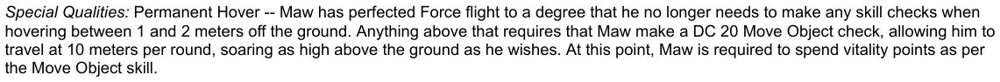

### Stat block notes (game mechanics, not feats)

- maw: Maw: Male Boltrunian Jedi Guardian 7/Jedi Investigator 4/Dark Side Devotee 3; Defense 23; Spd 10 m, fly 10 m; VP/WP 120/18; FP 4; DSP 10; Rep 7; Str 20; Challenge Code F; Permanent Hover; Trispzest Mastery (Source: *The Dark Forces Saga, Part 4* (SWRPG d20 Revised Core), scan p.1)

## scan p.2 (scan page 2)

Page contents: Boc the Crude: Twi'lek heroes and villains, Anoon Bondara, Nejaa Halcyon, Newar Forrth idols, Screed, Jerec, dual lightsabers, death in the Valley; image placeholder {{insert boc.jpeg}}; Boc stats (Force Adept 4/Dark Side Marauder 6, CC E); Lightsaber Combat: Trispzest (Majestrix of Skye, sai cha; heirs Maw and Nazish); Trispzest Mastery feat begins (hand-read)

- **Boc Aseca; Anoon Bondara; Nejaa Halcyon; Newar Forrth; Tott Doneeta** — entry/section: Boc cheated of his destiny: "Though born Force-sensitive, circumstances would prevent Bocas'eca from becoming a Jedi. Ryloth's assigned Jedi scout, the Twi'lek Anoon Bondara, was killed the year Boc was born, and his Force-sensitivity went unnoticed until much later, when the Human Jedi Nejaa Halcyon deemed Boc too old for training. Familiar with the stories of Twi'lek warriors such as Tott Doneeta and Newar Forrth, Boc felt cheated out of his destiny." Source: *The Dark Forces Saga, Part 4* (SWRPG d20 Revised Core), scan p.2
  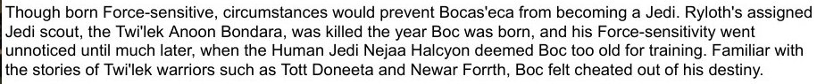
- **Boc Aseca; Newar Forrth; Tott Doneeta** — entry/section: Boc reads Newar's idols: "Boc learned all that he could about these heroes, such as how the invincible Tott had battled hordes of darksiders in the Old Sith Wars, or how Newar of the Nercathi clan led the Third Legion of Light to victory at the cost of his own life in one of Ruusan's seven battles, his pyre ashes crystallized and shaped into three idols in his likeness. Gifted with a rare power, Boc used the Force to read the impressions from these idols and access fragments of Newar's memory. Boc was fascinated by the grisly images he saw of Jedi victory at Malrev IV and Ruusan, and he felt more determined than ever to become a Jedi warrior." Source: *The Dark Forces Saga, Part 4* (SWRPG d20 Revised Core), scan p.2
  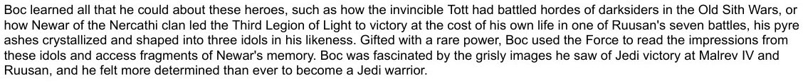
- **Boc Aseca; Vice-Admiral Terrinald Screed; Jerec** — entry/section: Boc enslaved by Jerec: "However, when the Empire rose up, so did alien prejudice and the Twi'lek slave trade. Boc became the manservant of the pitiless bigot Vice- Admiral Terrinald Screed. When Inquisitor Jerec came across the Force-sensitive Boc, he demanded that Screed hand him over for execution, but Jerec didn't kill the Twi'lek. Instead, he ripped the information about Ruusan from Boc's mind. Taking the Twi'lek as a slave, Jerec rewarded Boc's strength in the Force with a brutal indentured servitude, a cruel quasi-apprenticeship that naturally exacerbated Boc's hatred toward Humans. But in the end, Boc emerged a Jedi after all -- a Dark Jedi." Source: *The Dark Forces Saga, Part 4* (SWRPG d20 Revised Core), scan p.2
  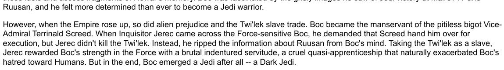
- **Boc Aseca; Newar Forrth** — entry/section: Boc's lightsaber trick: "Boc's treacherous lightsaber skills escalated in direct proportion to his mounting malice. Boc often duped opponents into believing he wielded one unreasonably fat lightsaber, later splitting the modified weapon into two separate fire brands and launching into an awkward but deadly imitation of Jedi Forrth's two-bladed Jar'Kai style." Source: *The Dark Forces Saga, Part 4* (SWRPG d20 Revised Core), scan p.2
  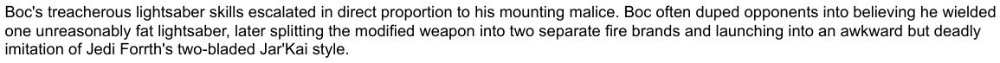
- **Boc Aseca; Kyle Katarn; Qu Rahn; Yun (Dark Jedi); Newar Forrth** — entry/section: Boc's end: "The copycat tactic ultimately didn't help him, however. Upon meeting Kyle Katarn, Boc smashed the lightsaber Master Qu Rahn had given to Kyle. But Kyle later used Yun's lightsaber to end Boc's Jedi dreams, cutting the Twi'lek down at the foot of a statue honoring Newar Forrth in the Valley of the Jedi." Source: *The Dark Forces Saga, Part 4* (SWRPG d20 Revised Core), scan p.2
  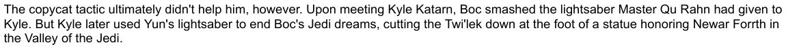
- **Maw (Dark Jedi)** — entry/section: Trispzest Mastery (Force Feat) (part 1 of 2, continues next page): "Trispzest Mastery (Force Feat)
You are skilled in a flying form of lightsaber combat. You can use your flying ability to engage in an air duel, and use your speed and aerial superiority to take advantage of the vulnerability of opponents on the ground." Source: *The Dark Forces Saga, Part 4* (SWRPG d20 Revised Core), scan p.2
  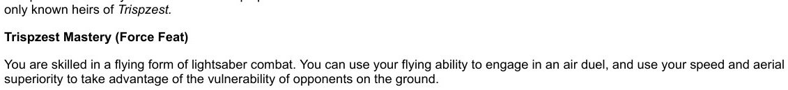
- **Mace Windu**: "Like Mace Windu's variant Vaapad, the S'kytri Majestrix adapted Form VII lightsaber combat (or Juyo in High Galactic), mixing it with traditional S'kytri aerial dueling techniques to take particular advantage allowed her by flight." Source: *The Dark Forces Saga, Part 4* (SWRPG d20 Revised Core), scan p.2
  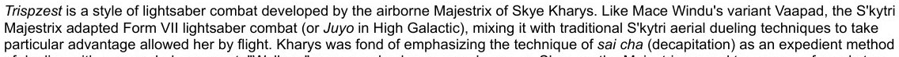

### Stat block notes (game mechanics, not feats)

- boc: Boc: Male Twi'lek Force Adept 4/Dark Side Marauder 6; Defense 20; VP/WP 84/16; FP 3; DSP 9; Rep 3; Challenge Code E; modified lightsaber (2); Niman Mastery; Psychometry (Source: *The Dark Forces Saga, Part 4* (SWRPG d20 Revised Core), scan p.2)

## scan p.3 (scan page 3)

Page contents: Trispzest Mastery prerequisites/benefit/normal/special; Jar'Kai history (Yovshin Swordsmen, Royale Macheteros, Legions of Lettow, Awdrysta Pina, Dark Underlord, Boc, Jeng Droga, Sora Bulg vs Mace Windu, Luke vs Lumiya); link to Niman (Jar'Kai) Mastery web enhancement (hand-read)

- **Maw (Dark Jedi)** — entry/section: Trispzest Mastery (Force Feat) (part 2 of 2, continued from previous page): "Prerequisite: Base attack bonus +8, fly speed, Exotic Weapon Proficiency (lightsaber). Benefit: During the first round of combat, you gain a full attack after performing a charge action while flying.
Normal: As per the charge rules, even if a character has extra attacks, such as a high attack bonus or from using multiple weapons, characters can only make one attack.
Special: This feat can be used in conjunction with the Improved Flyby Attack feat to negate provoking attacks of opportunity." Source: *The Dark Forces Saga, Part 4* (SWRPG d20 Revised Core), scan p.3
  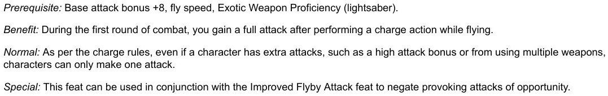
- **Boc Aseca; Jeng Droga; Kyle Katarn; Luke Skywalker; Lumiya; Mace Windu** — entry/section: Jar'Kai stylists: "Though Jedi and Sith since those early times have taken to substituting laser swords in place of steel ones, the ancient Jedi Awdrysta Pina favored dual Jedi Katana, while the Dark Underlord insisted on using twin Sith Swords despite being outmoded by the time of the New Sith Wars. The Jedi Kyle Katarn has faced and exterminated two Jar’Kai stylists: the Dark Jedi Boc and the Emperor's Hand Jeng Droga.
A popular variant of Jar‘Kai involves the combination of one lightsaber and one short saber. This method was employed by the Weequay Jedi Master Sora Bulg in combat against Mace Windu, as well as by Luke Skywalker when faced with the Sith lightwhip of the Dark Lady Lumiya." Source: *The Dark Forces Saga, Part 4* (SWRPG d20 Revised Core), scan p.3
  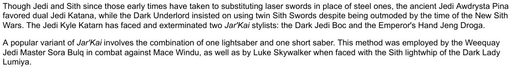
