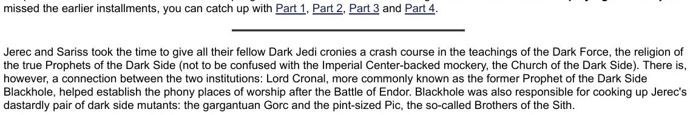
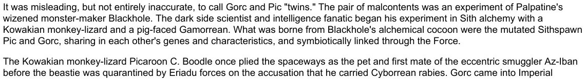
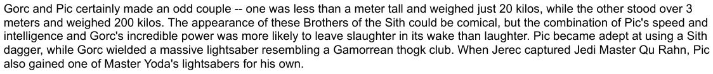
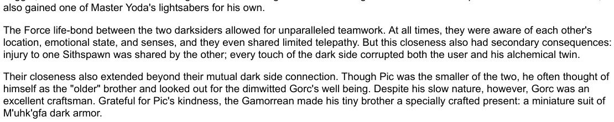
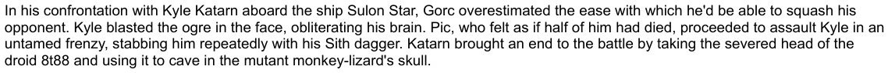
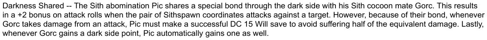
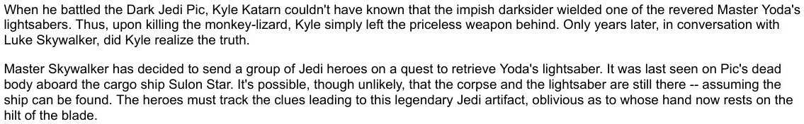
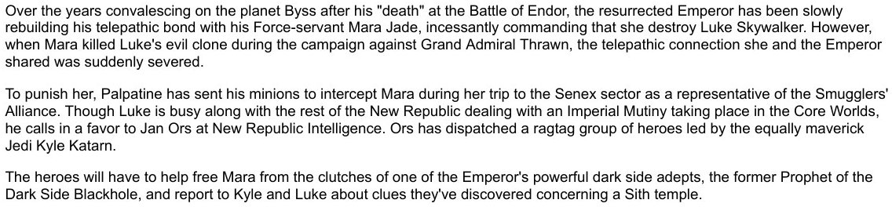
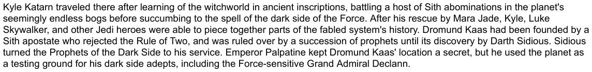
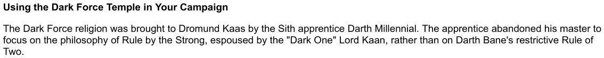

# Owner Material 037 — Star Wars D20 Drive folder (Core, Revised Core and Saga Edition): Characters/The Dark Forces Saga/The Dark Forces Saga, Part 5.pdf [Star Wars Roleplaying Game Revised Core (d20, 2002)]

- **Source:** Wizards of the Coast Star Wars Roleplaying Game books, web enhancements, Living Force campaign modules and articles (2000–2010), from the owner's "Star Wars D20" Drive folder (only the three edition subfolders; "General" was not read, as instructed). Secondary source (licensed Legends reference). Scan OCR'd on the box; the scan stays box-only and is **not** published.
- **Method:** every scanned page was OCR'd and machine-screened sentence by sentence for power-relevant statements (fights, kills, defeats, Force feats, rankings, superweapons) that name a character on our roster; each kept sentence is quoted verbatim from the OCR text and has a crop of the printed passage directly under it. Pages with nothing power-relevant are still listed with what is on them.
- **Citation:** "*The Dark Forces Saga, Part 5* (SWRPG d20 Revised Core), p.X" by printed page ("scan p.X" where no printed number applies). **Weight:** Licensed RPG material: a secondary source. Narrative text sums up Legends lore; game statistics are rules for players, not canon power levels, and rank lowest.

## scan p.1 (scan page 1)

Page contents: Intro (Dark Force, Prophets of the Dark Side, Blackhole/Lord Cronal); Gorc and Pic, the Twins: Blackhole's Sith alchemy, Picaroon C. Boodle and Az-Iban, Thok betrays Gorc, Project Chubar, life-bond, M'uhk'gfa armor, deaths at Kyle's hands aboard Sulon Star; Pic stats (Scoundrel 3/Jedi Consular 3/Dark Side Marauder 2, CC D) (hand-read)

- **Jerec; Sariss; Blackhole (Emperor's Hand); Gorc and Pic** — entry/section: The Brothers of the Sith: "Jerec and Sariss took the time to give all their fellow Dark Jedi cronies a crash course in the teachings of the Dark Force, the religion of the true Prophets of the Dark Side (not to be confused with the Imperial Center-backed mockery, the Church of the Dark Side). There is, however, a connection between the two institutions: Lord Cronal, more commonly known as the former Prophet of the Dark Side Blackhole, helped establish the phony places of worship after the Battle of Endor. Blackhole was also responsible for cooking up Jerec's dastardly pair of dark side mutants: the gargantuan Gorc and the pint-sized Pic, the so-called Brothers of the Sith." Source: *The Dark Forces Saga, Part 5* (SWRPG d20 Revised Core), scan p.1
  
- **Gorc and Pic; Blackhole (Emperor's Hand)** — entry/section: Gorc and Pic, Sithspawn: "It was misleading, but not entirely inaccurate, to call Gorc and Pic "twins." The pair of malcontents was an experiment of Palpatine's wizened monster-maker Blackhole. The dark side scientist and intelligence fanatic began his experiment in Sith alchemy with a Kowakian monkey-lizard and a pig-faced Gamorrean. What was borne from Blackhole's alchemical cocoon were the mutated Sithspawn Pic and Gorc, sharing in each other's genes and characteristics, and symbiotically linked through the Force." Source: *The Dark Forces Saga, Part 5* (SWRPG d20 Revised Core), scan p.1
  
- **Gorc and Pic; Qu Rahn; Yoda; Jerec** — entry/section: An odd couple: "Gorc and Pic certainly made an odd couple -- one was less than a meter tall and weighed just 20 kilos, while the other stood over 3 meters and weighed 200 kilos. The appearance of these Brothers of the Sith could be comical, but the combination of Pic's speed and intelligence and Gorc's incredible power was more likely to leave slaughter in its wake than laughter. Pic became adept at using a Sith dagger, while Gorc wielded a massive lightsaber resembling a Gamorrean thogk club. When Jerec captured Jedi Master Qu Rahn, Pic also gained one of Master Yoda's lightsabers for his own." Source: *The Dark Forces Saga, Part 5* (SWRPG d20 Revised Core), scan p.1
  
- **Gorc and Pic** — entry/section: The Force life-bond: "The Force life-bond between the two darksiders allowed for unparalleled teamwork. At all times, they were aware of each other's location, emotional state, and senses, and they even shared limited telepathy. But this closeness also had secondary consequences: injury to one Sithspawn was shared by the other; every touch of the dark side corrupted both the user and his alchemical twin.
Their closeness also extended beyond their mutual dark side connection. Though Pic was the smaller of the two, he often thought of himself as the "older" brother and looked out for the dimwitted Gorc's well being. Despite his slow nature, however, Gorc was an excellent craftsman. Grateful for Pic's kindness, the Gamorrean made his tiny brother a specially crafted present: a miniature suit of M'uhk'gfa dark armor." Source: *The Dark Forces Saga, Part 5* (SWRPG d20 Revised Core), scan p.1
  
- **Gorc and Pic; Kyle Katarn** — entry/section: Deaths of Gorc and Pic: "In his confrontation with Kyle Katarn aboard the ship Sulon Star, Gorc overestimated the ease with which he'd be able to squash his opponent. Kyle blasted the ogre in the face, obliterating his brain. Pic, who felt as if half of him had died, proceeded to assault Kyle in an untamed frenzy, stabbing him repeatedly with his Sith dagger. Katarn brought an end to the battle by taking the severed head of the droid 8t88 and using it to cave in the mutant monkey-lizard's skull." Source: *The Dark Forces Saga, Part 5* (SWRPG d20 Revised Core), scan p.1
  

### Stat block notes (game mechanics, not feats)

- pic: Pic (Sith Abomination): Male mutated Kowakian monkey-lizard Scoundrel 3/Jedi Consular 3/Dark Side Marauder 2; Defense 24; Spd 4 m; VP/WP 44/10; FP 6; DSP 16; Rep +5; Challenge Code D; Abominable Presence, Darkness Shared (Source: *The Dark Forces Saga, Part 5* (SWRPG d20 Revised Core), scan p.1)

## scan p.2 (scan page 2)

Page contents: Pic SQ Abominable Presence and Darkness Shared; Gorc stats from image (Soldier 3/Jedi Guardian 2/Dark Side Marauder 3, Init -1, CC D) and SQs; Adventure Seed: Jedi Search II (Yoda's lightsaber on Sulon Star); Adventure Seed: Kyle Katarn, Meet Mara Jade (Byss, Blackhole, Senex sector); Dromund Kaas header (hand-read)

- **Gorc and Pic** — entry/section: Pic: Darkness Shared: "Darkness Shared -- The Sith abomination Pic shares a special bond through the dark side with his Sith cocoon mate Gorc. This results in a +2 bonus on attack rolls when the pair of Sithspawn coordinates attacks against a target. However, because of their bond, whenever Gorc takes damage from an attack, Pic must make a successful DC 15 Will save to avoid suffering half of the equivalent damage. Lastly, whenever Gorc gains a dark side point, Pic automatically gains one as well." Source: *The Dark Forces Saga, Part 5* (SWRPG d20 Revised Core), scan p.2
  
- **Kyle Katarn; Gorc and Pic; Luke Skywalker; Yoda** — entry/section: Adventure seed: Jedi Search II: "When he battled the Dark Jedi Pic, Kyle Katarn couldn't have known that the impish darksider wielded one of the revered Master Yoda's lightsabers. Thus, upon killing the monkey-lizard, Kyle simply left the priceless weapon behind. Only years later, in conversation with Luke Skywalker, did Kyle realize the truth.
Master Skywalker has decided to send a group of Jedi heroes on a quest to retrieve Yoda's lightsaber. It was last seen on Pic's dead body aboard the cargo ship Sulon Star. It's possible, though unlikely, that the corpse and the lightsaber are still there -- assuming the ship can be found. The heroes must track the clues leading to this legendary Jedi artifact, oblivious as to whose hand now rests on the hilt of the blade." Source: *The Dark Forces Saga, Part 5* (SWRPG d20 Revised Core), scan p.2
  
- **Mara Jade Skywalker; Palpatine (Darth Sidious); Luke Skywalker; Grand Admiral Thrawn; Jan Ors; Kyle Katarn; Blackhole (Emperor's Hand)** — entry/section: Adventure seed: Kyle Katarn, Meet Mara Jade: "Over the years convalescing on the planet Byss after his "death" at the Battle of Endor, the resurrected Emperor has been slowly rebuilding his telepathic bond with his Force-servant Mara Jade, incessantly commanding that she destroy Luke Skywalker. However, when Mara killed Luke's evil clone during the campaign against Grand Admiral Thrawn, the telepathic connection she and the Emperor shared was suddenly severed.
To punish her, Palpatine has sent his minions to intercept Mara during her trip to the Senex sector as a representative of the Smugglers' Alliance. Though Luke is busy along with the rest of the New Republic dealing with an Imperial Mutiny taking place in the Core Worlds, he calls in a favor to Jan Ors at New Republic Intelligence. Ors has dispatched a ragtag group of heroes led by the equally maverick Jedi Kyle Katarn.
The heroes will have to help free Mara from the clutches of one of the Emperor's powerful dark side adepts, the former Prophet of the Dark Side Blackhole, and report to Kyle and Luke about clues they've discovered concerning a Sith temple." Source: *The Dark Forces Saga, Part 5* (SWRPG d20 Revised Core), scan p.2
  

### Stat block notes (game mechanics, not feats)

- gorc: Gorc (Sith Abomination): Male mutated Gamorrean Soldier 3/Jedi Guardian 2/Dark Side Marauder 3; Init -1; Defense 18 (+3 natural, -1 Size, -1 Dex, +7 class); Spd 6 m; VP/WP 44/20; Atk +15/+10/+5 melee (3d8+7/19-20, lightclub); DR 8; SV Fort +16, Ref +6, Will +4; SZ L; FP 6; DSP 16; Rep +5; Str 24, Dex 8, Con 20, Int 8, Wis 10, Cha 9; Challenge Code D (Source: *The Dark Forces Saga, Part 5* (SWRPG d20 Revised Core), scan p.2)

## scan p.3 (scan page 3)

Page contents: Dromund Kaas planet stats (Dromund system planets); history (deleted from Jedi archives, Kyle's fall, Darth Sidious, Grand Admiral Declann, Luke's decision); The Dark Force Temple; Using the Dark Force Temple in Your Campaign (Darth Millennial, Lord Kaan, Darth Bane) (hand-read)

- **Kyle Katarn; Mara Jade Skywalker; Luke Skywalker; Palpatine (Darth Sidious)** — entry/section: Kyle on Dromund Kaas: "Kyle Katarn traveled there after learning of the witchworld in ancient inscriptions, battling a host of Sith abominations in the planet's seemingly endless bogs before succumbing to the spell of the dark side of the Force. After his rescue by Mara Jade, Kyle, Luke Skywalker, and other Jedi heroes were able to piece together parts of the fabled system's history. Dromund Kaas had been founded by a Sith apostate who rejected the Rule of Two, and was ruled over by a succession of prophets until its discovery by Darth Sidious. Sidious turned the Prophets of the Dark Side to his service. Emperor Palpatine kept Dromund Kaas' location a secret, but he used the planet as a testing ground for his dark side adepts, including the Force-sensitive Grand Admiral Declann." Source: *The Dark Forces Saga, Part 5* (SWRPG d20 Revised Core), scan p.3
  
- **Darth Millennial; Lord Kaan; Darth Bane** — entry/section: Darth Millennial's Dark Force: "The Dark Force religion was brought to Dromund Kaas by the Sith apprentice Darth Millennial. The apprentice abandoned his master to focus on the philosophy of Rule by the Strong, espoused by the "Dark One" Lord Kaan, rather than on Darth Bane's restrictive Rule of Two." Source: *The Dark Forces Saga, Part 5* (SWRPG d20 Revised Core), scan p.3
  

## scan p.4 (scan page 4)

Page contents: Footnotes only (from image): swamp wampas use wampa ice creature template p339 RCR; Noghri abominations use Massassi abomination p119 Dark Side Sourcebook (hand-read)

