# Owner Material 037 — Star Wars D20 Drive folder (Core, Revised Core and Saga Edition): Characters/The Dark Forces Saga/The Dark Forces Saga, Part 6.pdf [Star Wars Roleplaying Game Revised Core (d20, 2002)]

- **Source:** Wizards of the Coast Star Wars Roleplaying Game books, web enhancements, Living Force campaign modules and articles (2000–2010), from the owner's "Star Wars D20" Drive folder (only the three edition subfolders; "General" was not read, as instructed). Secondary source (licensed Legends reference). Scan OCR'd on the box; the scan stays box-only and is **not** published.
- **Method:** every scanned page was OCR'd and machine-screened sentence by sentence for power-relevant statements (fights, kills, defeats, Force feats, rankings, superweapons) that name a character on our roster; each kept sentence is quoted verbatim from the OCR text and has a crop of the printed passage directly under it. Pages with nothing power-relevant are still listed with what is on them.
- **Citation:** "*The Dark Forces Saga, Part 6* (SWRPG d20 Revised Core), p.X" by printed page ("scan p.X" where no printed number applies). **Weight:** Licensed RPG material: a secondary source. Narrative text sums up Legends lore; game statistics are rules for players, not canon power levels, and rank lowest.

## scan p.1 (scan page 1)

Page contents: Intro (Valley seekers: Johun Othone, Darth Zannah, Jerec, Desann); Jerec, Dark Jedi: Miraluka, Jocasta Nu's Padawan, Ameesa Darys, Tremayne, Inquisitorius, Lord Cronal, governor of Sulon, Spore, Vengeance/Vengeance II, Ardus Kaine, Blackhole, Pentastar Alignment, valley access (hand-read)

- **Lord Hoth; Darth Zannah; Jerec; Desann** — entry/section: Seekers of the Valley: "Many have sought the Valley of the Jedi, but few have found it. One was Lord Hoth's former apprentice Johun Othone, who set up vain shrines in the valley in honor of his beloved master. Another was the Sith Lord Darth Zannah, who returned to the valley years after abandoning her brother there during the Battle of Ruusan and engaged her sibling in a final deadly confrontation. The valley has had few visitors since, but two of the most recent were power-hungry individuals of the worst kind: the treacherous Dark Jedi Jerec, and an outcast from Luke's New Jedi Order, the reptilian Desann." Source: *The Dark Forces Saga, Part 6* (SWRPG d20 Revised Core), scan p.1
  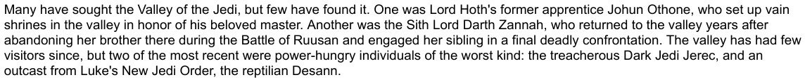
- **Jerec; Jocasta Nu** — entry/section: Jerec, Padawan of Jocasta Nu: "Mistakenly believed to be a blind Human, the man known as Jerec is actually a Miraluka and was born without physical means of sight. But, fatefully, he was not born blind to the Force. Jerec came to the attention of the haughty Jedi Jocasta Nu during her days as an archaeologist for the Jedi ExplorCorps, and was taken on as her Padawan learner. Jerec learned a great deal under Nu's tutelage, inheriting not only much of his master's supercilious bearing and delicate mannerisms, but also her love of knowledge. Nu encouraged her apprentice never to stop searching for answers, as many were found only by the most ardent seekers. Watching his Force powers grow with the learning he accumulated, Jerec slowly came to understand that knowledge truly was power. And realizing there was always more to learn, Jerec's appetite for knowledge became insatiable." Source: *The Dark Forces Saga, Part 6* (SWRPG d20 Revised Core), scan p.1
  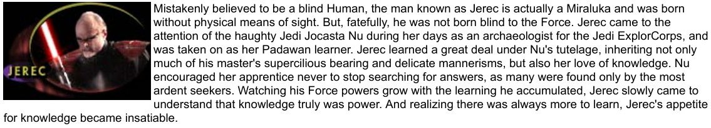
- **Jerec; Antinnis Tremayne; Blackhole (Emperor's Hand); Sariss** — entry/section: Jerec joins the Inquisitorius: "After training his Padawan Ameesa Darys to knighthood and becoming a Jedi Master, Jerec felt he had exhausted all that the light side of the Force had to offer. During the Clone Wars, he traveled with a group of Jedi artifact finders to the Unknown Regions in search of other sources of wisdom. After being caught by the Imperial Inquisitor Tremayne, Jerec declared his allegiance to the Empire, and joined the Inquisitorius himself. He also studied the Dark Force religion of Palpatine's Prophets of the Dark Side. It was from the prophet Lord Cronal, father to the sorceress Sariss and the man later known as the shadowy Dark Side magus Blackhole, that Jerec learned of the Valley of the Jedi. To him, it seemed a fabled place that promised to grant him understanding unlimited, a place steeped in the Forcepower of thousands and thousands of Sith and Jedi spirits." Source: *The Dark Forces Saga, Part 6* (SWRPG d20 Revised Core), scan p.1
  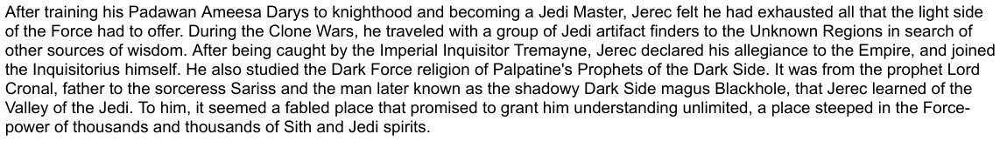
- **Jerec; Kyle Katarn** — entry/section: Jerec's ambition: "Jerec remained very busy in the time leading up to the Battle of Endor. For a time, he became governor of Kyle Katarn's homeworld Sulon, having an extravagant palace built in honor of himself. Jerec's ambition also drove him to seek out a mind-controlling monster called Spore in order to create an army of slaves, though the beast instead destroyed Jerec's Imperial Star Destroyer Vengeance. Jerec had the ship's computer core salvaged from the wreckage and transferred to a new Star Destroyer called the Vengeance II, though with its predecessor destroyed, the numerical amendment was infrequently applied. Jerec eventually ordered the ship's captain to join Admiral Ozzel's Death Squadron, as the Dark Jedi already had a Super Star Destroyer being built to accommodate his unceasingly swelling ego." Source: *The Dark Forces Saga, Part 6* (SWRPG d20 Revised Core), scan p.1
  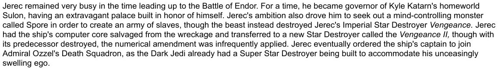
- **Jerec; Blackhole (Emperor's Hand); Palpatine (Darth Sidious)** — entry/section: Jerec and Blackhole: "Approximately a year after the Battle of Endor, however, Jerec was contacted by the former Prophet Blackhole, who revealed that Emperor Palpatine was in fact alive and watching galactic events from the Deep Core at the center of the galaxy. Blackhole charged Jerec with finding the fabled Valley of the Jedi for the glory of the Emperor, and Jerec pledged his submission to the reincarnated dictator, giving Blackhole the Vengeance II to take back to the planet Byss as a sign of his commitment." Source: *The Dark Forces Saga, Part 6* (SWRPG d20 Revised Core), scan p.1
  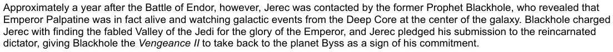
- **Jerec; Blackhole (Emperor's Hand)** — entry/section: Jerec's triple game: "What Blackhole couldn't have known, however, was that Jerec was already searching for the valley on behalf of not only the Pentastar Alignment but also his old mentors, the true Prophets of the Dark Side. Resembling a Divoran holochess grandmaster, Jerec pulled resources from all three parties while playing each side against the middle, intending to be the only true victor. Once he secured the coordinates to the Valley of the Jedi, Jerec converged on the site with his Dark Jedi." Source: *The Dark Forces Saga, Part 6* (SWRPG d20 Revised Core), scan p.1
  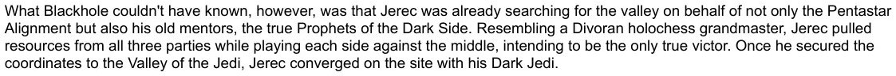
- **Jerec; Kyle Katarn** — entry/section: Jerec's omniscience (part 1 of 2, continues next page): "Ultimately, all of Jerec's pupils were killed by the Jedi Kyle Katarn, but the price was worth the reward. Jerec at last gained access to the valley, and for one lucid moment, absolute omniscience was his. The will of the Force, Chaos, the ancient civilizations of the Rakata and" Source: *The Dark Forces Saga, Part 6* (SWRPG d20 Revised Core), scan p.1
  

## scan p.2 (scan page 2)

Page contents: Jerec's omniscience and death; Jerec stats (Jedi Guardian 8/Jedi Master 3/Imperial Inquisitor 4, CC H) and SQs Quick Reaction, Force Sight; Desann, Jedi Outcast: Chistori, Havet Storm murder, Galak Fyyar, Lord Hethrir, Empire Youths, Tavion, the Reborn, death at Yavin 4; caption: A Miraluka, from Ultimate Alien Anthology (hand-read)

- **Jerec; Kyle Katarn** — entry/section: Jerec's omniscience (part 2 of 2, continued from previous page): "Xim, what lay beyond the galactic barrier, and the origins of the universe -- Jerec understood them all, and endowed with Force powers beyond imagination, he would have ruled accordingly." Source: *The Dark Forces Saga, Part 6* (SWRPG d20 Revised Core), scan p.2
  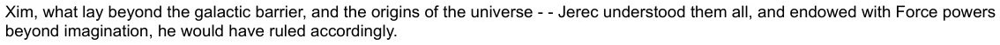
- **Jerec; Kyle Katarn** — entry/section: Jerec's end: "However, during this rapturous illumination, Kyle used an ancient Force technique to sever Jerec's connection to the Force with a wall of pure light. Kyle then proceeded to cut the Dark Jedi down, sending Jerec's soul screaming toward Chaos alongside the Sith spirits of a thousand years hence. Thanks to his enlightenment, Jerec was well aware of the torture without respite that awaited him there." Source: *The Dark Forces Saga, Part 6* (SWRPG d20 Revised Core), scan p.2
  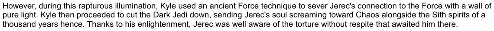
- **Desann; Havet Storm; Luke Skywalker** — entry/section: Desann at the Academy: "At last among similarly gifted beings, Desann finally felt accepted. But old habits die hard. The shell of his personality, developed like a protective carapace after so many years of being treated like refuse, quickly set back in, and as Desann's Force powers grew, his true colors began to show. Desann patronized weaker students on a regular basis until one Jedi trainee, Havet Storm, stood up to Desann. After Havet's bold confrontation, Desann never bullied another student at the Academy again. In fact, after murdering Havet, Desann left the Academy altogether." Source: *The Dark Forces Saga, Part 6* (SWRPG d20 Revised Core), scan p.2
  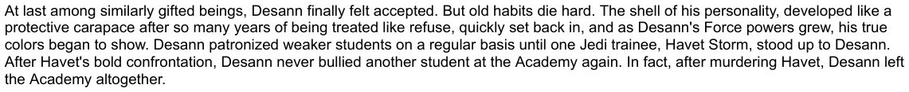
- **Desann; Admiral Galak Fyyar; Lord Hethrir; Palpatine (Darth Sidious)** — entry/section: Desann and Hethrir: "Eventually, Desann crossed paths with Imperial Admiral Galak Fyyar, who promptly took the Chistori to meet his obscure master, the Procurator of Justice Lord Hethrir. Despite the Procurator's prejudice toward aliens, Lord Hethrir made Desann his right hand in his Empire Reborn, reasoning that even Emperor Palpatine had made some exceptions." Source: *The Dark Forces Saga, Part 6* (SWRPG d20 Revised Core), scan p.2
  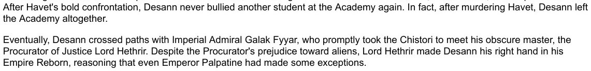
- **Desann; Lord Hethrir; Tavion Axmis** — entry/section: Desann trains Tavion: "Hethrir entrusted Desann with training a number of his Empire Youths, individuals who had shown a potent Force-sensitivity and devotion to Hethrir's cause and had been specially "purified" by a demigod known as Waru. Desann took one of these Youths, Tavion, as his apprentice. He even experimented with imbuing Human Empire Youths who had little to no talent in the Force -- chosen by Hethrir due to the magistrate’s racist philosophies -- with dark side powers using atrusian crystals and Sith alchemy." Source: *The Dark Forces Saga, Part 6* (SWRPG d20 Revised Core), scan p.2
  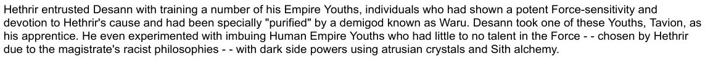
- **Desann; Lord Hethrir; Antinnis Tremayne; Kyle Katarn** — entry/section: The Reborn: "Lastly, Hethrir tasked Desann with finding a fabled Jedi valley made known to him by his ally, Inquisitor Tremayne. Tricking the Jedi Kyle Katarn into revealing the location of the Valley of the Jedi, Desann led his band of trainees to the Force nexus on Ruusan, quadrupling their innate powers with the residue of the ancient Jedi sprits. To these specially empowered Empire Youths Desann gave the name the Reborn." Source: *The Dark Forces Saga, Part 6* (SWRPG d20 Revised Core), scan p.2
  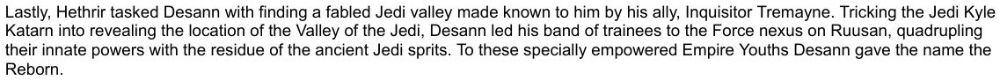
- **Desann; Kyle Katarn** — entry/section: Desann's end: "Desann and Kyle had multiple hazardous confrontations, during which each combatant attempted to persuade the other to join his cause. In the end, Kyle chased the Dark Jedi to the temples of Luke's Jedi academy on Yavin 4, where he and Desann engaged in furious lightsaber battle for a final time. Only Kyle emerged alive from the conflict." Source: *The Dark Forces Saga, Part 6* (SWRPG d20 Revised Core), scan p.2
  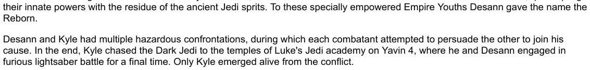

### Stat block notes (game mechanics, not feats)

- jerec: Jerec: Male Miraluka, Jedi Guardian 8/Jedi Master 3/Imperial Inquisitor 4; Defense 26; VP/WP 108/15; FP 7; DSP 15; Rep 8; Challenge Code H; Force sight, quick reaction; Move Object +14; Jengardin double-bladed vibroblade (Source: *The Dark Forces Saga, Part 6* (SWRPG d20 Revised Core), scan p.2)

## scan p.3 (scan page 3)

Page contents: Desann stats (Fringer 2/Jedi Guardian 5, CC D, Doomgiver) and cold-blooded SQ; The Valley of the Jedi (Kaan's Thought Bomb, Sith globe); Using the Valley in Your Campaign (hand-read)

- **Lord Kaan; Lord Hoth; Exar Kun; Kyle Katarn** — entry/section: The Valley of the Jedi: "Sith Lord Kaan's Brotherhood of Darkness carved rooms within the valley, which were used to store their war resources -- everything from exotic weapons and technology to plain old food. The valley became the final resting place of Lord Hoth's Army of Light and Kaan's Brotherhood of Darkness when Kaan detonated a dark side "Thought Bomb," annihilating both armies and trapping their spirits in a Sith globe, similar to that used by the Dark Lord Exar Kun to trap the spirits of Massassi children. It would be a more than a thousand years before the Jedi Kyle Katarn would find and release them." Source: *The Dark Forces Saga, Part 6* (SWRPG d20 Revised Core), scan p.3
  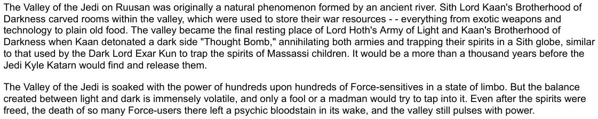
- **Lord Hoth; Lord Kaan** — entry/section: The last New Sith War: "Bringing the fight to the home turf of the New Sith Empire, Lord Hoth's Jedi Army chased Lord Kaan's Sith Brotherhood from their home in the nearly impregnable region of space known as the Cloak of the Sith and waged battle across the galaxy, from Hoth to Dromund Kaas to Malrev IV, before ending up in the lush forests of Ruusan. Kaan's Thought Bomb then proceeded to destroy nearly everyone with any knowledge of Ruusan's coordinates. Time silenced the rest, and Ruusan became lost to the ages." Source: *The Dark Forces Saga, Part 6* (SWRPG d20 Revised Core), scan p.3
  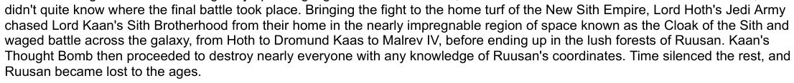
- **Jerec; Kyle Katarn**: "After defeating Jerec, Kyle kept the location of the valley to himself, fearing it would be misused." Source: *The Dark Forces Saga, Part 6* (SWRPG d20 Revised Core), scan p.3
  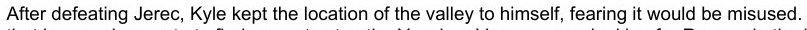

### Stat block notes (game mechanics, not feats)

- desann: Desann: Male Chistori Fringer 2/Jedi Guardian 5; Defense 20; VP/WP 42/14; FP 6; DSP 13; Rep +4; Challenge Code D; cold-blooded; Doomgiver (Source: *The Dark Forces Saga, Part 6* (SWRPG d20 Revised Core), scan p.3)
