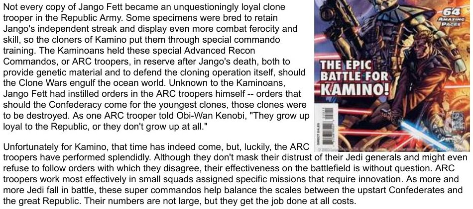
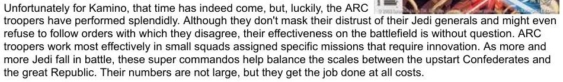
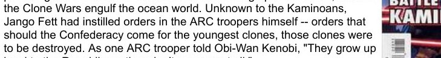

# Owner Material 037 — Star Wars D20 Drive folder (Core, Revised Core and Saga Edition): Characters/ARC Trooper.pdf [Star Wars Roleplaying Game Revised Core (d20, 2002)]

- **Source:** Wizards of the Coast Star Wars Roleplaying Game books, web enhancements, Living Force campaign modules and articles (2000–2010), from the owner's "Star Wars D20" Drive folder (only the three edition subfolders; "General" was not read, as instructed). Secondary source (licensed Legends reference). Scan OCR'd on the box; the scan stays box-only and is **not** published.
- **Method:** every scanned page was OCR'd and machine-screened sentence by sentence for power-relevant statements (fights, kills, defeats, Force feats, rankings, superweapons) that name a character on our roster; each kept sentence is quoted verbatim from the OCR text and has a crop of the printed passage directly under it. Pages with nothing power-relevant are still listed with what is on them.
- **Citation:** "*ARC Trooper* (SWRPG d20 Revised Core), p.X" by printed page ("scan p.X" where no printed number applies). **Weight:** Licensed RPG material: a secondary source. Narrative text sums up Legends lore; game statistics are rules for players, not canon power levels, and rank lowest.

## scan p.1 (scan page 1)

Page contents: ARC troopers: Jango clones with independent streak, Advanced Recon Commandos held in reserve on Kamino, Jango's orders to destroy youngest clones, distrust of Jedi generals; generic ARC Trooper stats (medium powered battle armor DR 2, light repeating blaster rifle); Republic comic cover image (hand-read)

- **Jango Fett; Obi-Wan Kenobi** — entry/section: ARC troopers: Jango's secret orders: "Not every copy of Jango Fett became an unquestioningly loyal clone trooper in the Republic Army. Some specimens were bred to retain Jango's independent streak and display even more combat ferocity and skill, so the cloners of Kamino put them through special commando training. The Kaminoans held these special Advanced Recon Commandos, or ARC troopers, in reserve after Jango's death, both to provide genetic material and to defend the cloning operation itself, should the Clone Wars engulf the ocean world. Unknown to the Kaminoans, Jango Fett had instilled orders in the ARC troopers himself -- orders that should the Confederacy come for the youngest clones, those clones were to be destroyed. As one ARC trooper told Obi-Wan Kenobi, "They grow up loyal to the Republic, or they don't grow up at all."" Source: *ARC Trooper* (SWRPG d20 Revised Core), scan p.1
  
- **Jango Fett** — entry/section: ARC troopers in battle: "Unfortunately for Kamino, that time has indeed come, but, luckily, the ARC troopers have performed splendidly. Although they don't mask their distrust of their Jedi generals and might even. refuse to follow orders with which they disagree, their effectiveness on the battlefield is without question. ARC troopers work most effectively in small squads assigned specific missions that require innovation. As more and more Jedi fall in battle, these super commandos help balance the scales between the upstart Confederates and the great Republic. Their numbers are not large, but they get the job done at all costs." Source: *ARC Trooper* (SWRPG d20 Revised Core), scan p.1
  
- **Jango Fett**: "Unknown to the Kaminoans, r Jango Fett had instilled orders in the ARC troopers himself -- orders that should the Confederacy come for the youngest clones, those clones were to be destroyed." Source: *ARC Trooper* (SWRPG d20 Revised Core), scan p.1
  

### Stat block notes (game mechanics, not feats)

- arc-trooper (generic): ARC Trooper: Male Human Scout 2/Soldier 6/Elite Trooper 4; Init +6; Defense 19; VP/WP 96/17; DR 2 (armor); FP 2; Rep +4; Challenge Code E (Source: *ARC Trooper* (SWRPG d20 Revised Core), scan p.1)
