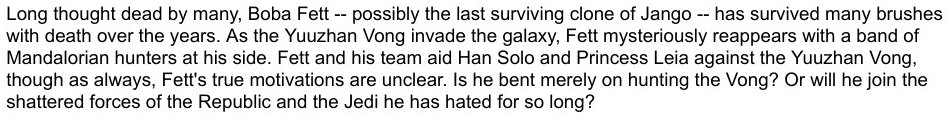
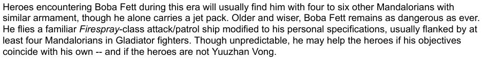

# Owner Material 037 — Star Wars D20 Drive folder (Core, Revised Core and Saga Edition): Characters/Boba Fett (NJO Era).pdf [Star Wars Roleplaying Game Revised Core (d20, 2002)]

- **Source:** Wizards of the Coast Star Wars Roleplaying Game books, web enhancements, Living Force campaign modules and articles (2000–2010), from the owner's "Star Wars D20" Drive folder (only the three edition subfolders; "General" was not read, as instructed). Secondary source (licensed Legends reference). Scan OCR'd on the box; the scan stays box-only and is **not** published.
- **Method:** every scanned page was OCR'd and machine-screened sentence by sentence for power-relevant statements (fights, kills, defeats, Force feats, rankings, superweapons) that name a character on our roster; each kept sentence is quoted verbatim from the OCR text and has a crop of the printed passage directly under it. Pages with nothing power-relevant are still listed with what is on them.
- **Citation:** "*Boba Fett (NJO Era)* (SWRPG d20 Revised Core), p.X" by printed page ("scan p.X" where no printed number applies). **Weight:** Licensed RPG material: a secondary source. Narrative text sums up Legends lore; game statistics are rules for players, not canon power levels, and rank lowest.

## scan p.1 (scan page 1)

Page contents: Boba Fett returns in NJO era with Mandalorian hunters, aids Han and Leia against Yuuzhan Vong; usually with 4-6 Mandalorians, Firespray ship, Gladiator fighter escorts; NJO stats and equipment (hand-read)

- **Boba Fett; Jango Fett; Han Solo; Leia Organa Solo** — entry/section: Boba Fett in the NJO era: "Long thought dead by many, Boba Fett -- possibly the last surviving clone of Jango -- has survived many brushes with death over the years. As the Yuuzhan Vong invade the galaxy, Fett mysteriously reappears with a band of Mandalorian hunters at his side. Fett and his team aid Han Solo and Princess Leia against the Yuuzhan Vong, though as always, Fett's true motivations are unclear. Is he bent merely on hunting the Vong? Or will he join the shattered forces of the Republic and the Jedi he has hated for so long?" Source: *Boba Fett (NJO Era)* (SWRPG d20 Revised Core), scan p.1
  
- **Boba Fett** — entry/section: Encountering Boba Fett (NJO): "Heroes encountering Boba Fett during this era will usually find him with four to six other Mandalorians with similar armament, though he alone carries a jet pack. Older and wiser, Boba Fett remains as dangerous as ever. He flies a familiar Firespray-class attack/patrol ship modified to his personal specifications, usually flanked by at least four Mandalorians in Gladiator fighters. Though unpredictable, he may help the heroes if his objectives coincide with his own -- and if the heroes are not Yuuzhan Vong." Source: *Boba Fett (NJO Era)* (SWRPG d20 Revised Core), scan p.1
  

### Stat block notes (game mechanics, not feats)

- boba-fett: Boba Fett (NJO Era): Male Human Soldier 6/Scoundrel 2/Bounty Hunter 10; Init +3; Defense 21; DR 4; VP/WP 136/15; sneak attack +5d6, target bonus +5; FP 1; DSP 6; Rep +12; Challenge Code H (Source: *Boba Fett (NJO Era)* (SWRPG d20 Revised Core), scan p.1)
