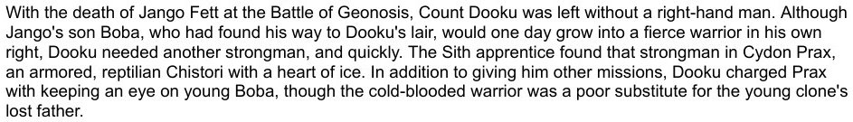
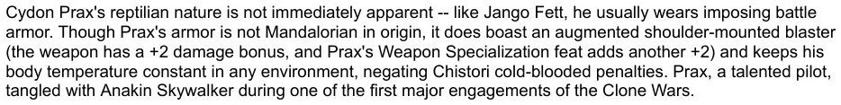
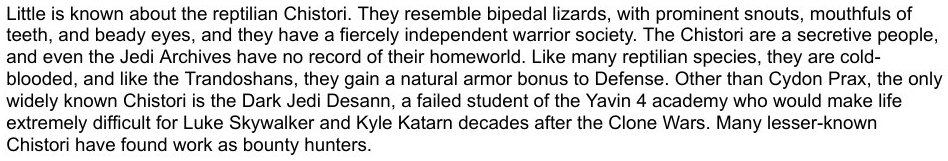

# Owner Material 037 — Star Wars D20 Drive folder (Core, Revised Core and Saga Edition): Characters/Cydon Prax.pdf [Star Wars Roleplaying Game Revised Core (d20, 2002)]

- **Source:** Wizards of the Coast Star Wars Roleplaying Game books, web enhancements, Living Force campaign modules and articles (2000–2010), from the owner's "Star Wars D20" Drive folder (only the three edition subfolders; "General" was not read, as instructed). Secondary source (licensed Legends reference). Scan OCR'd on the box; the scan stays box-only and is **not** published.
- **Method:** every scanned page was OCR'd and machine-screened sentence by sentence for power-relevant statements (fights, kills, defeats, Force feats, rankings, superweapons) that name a character on our roster; each kept sentence is quoted verbatim from the OCR text and has a crop of the printed passage directly under it. Pages with nothing power-relevant are still listed with what is on them.
- **Citation:** "*Cydon Prax* (SWRPG d20 Revised Core), p.X" by printed page ("scan p.X" where no printed number applies). **Weight:** Licensed RPG material: a secondary source. Narrative text sums up Legends lore; game statistics are rules for players, not canon power levels, and rank lowest.

## scan p.1 (scan page 1)

Page contents: Cydon Prax: Dooku's new right-hand man after Jango's death, watches young Boba; armor with augmented shoulder-mounted blaster negates cold-blooded penalties; tangled with Anakin Skywalker; stats; New Species: The Chistori (Desann noted); Chistori Commoner stats (hand-read)

- **Cydon Prax; Count Dooku; Jango Fett; Boba Fett** — entry/section: Dooku's new strongman: "With the death of Jango Fett at the Battle of Geonosis, Count Dooku was left without a right-hand man. Although Jango's son Boba, who had found his way to Dooku's lair, would one day grow into a fierce warrior in his own right, Dooku needed another strongman, and quickly. The Sith apprentice found that strongman in Cydon Prax, an armored, reptilian Chistori with a heart of ice. In addition to giving him other missions, Dooku charged Prax with keeping an eye on young Boba, though the cold-blooded warrior was a poor substitute for the young clone's lost father." Source: *Cydon Prax* (SWRPG d20 Revised Core), scan p.1
  
- **Cydon Prax; Jango Fett; Darth Vader (Anakin Skywalker)** — entry/section: Prax's armor: "Cydon Prax's reptilian nature is not immediately apparent -- like Jango Fett, he usually wears imposing battle armor. Though Prax's armor is not Mandalorian in origin, it does boast an augmented shoulder-mounted blaster (the weapon has a +2 damage bonus, and Prax's Weapon Specialization feat adds another +2) and keeps his body temperature constant in any environment, negating Chistori cold-blooded penalties. Prax, a talented pilot, tangled with Anakin Skywalker during one of the first major engagements of the Clone Wars." Source: *Cydon Prax* (SWRPG d20 Revised Core), scan p.1
  
- **Cydon Prax; Desann; Luke Skywalker; Kyle Katarn** — entry/section: The Chistori: "Little is known about the reptilian Chistori. They resemble bipedal lizards, with prominent snouts, mouthfuls of teeth, and beady eyes, and they have a fiercely independent warrior society. The Chistori are a secretive people, and even the Jedi Archives have no record of their homeworld. Like many reptilian species, they are coldblooded, and like the Trandoshans, they gain a natural armor bonus to Defense. Other than Cydon Prax, the only widely known Chistori is the Dark Jedi Desann, a failed student of the Yavin 4 academy who would make life extremely difficult for Luke Skywalker and Kyle Katarn decades after the Clone Wars. Many lesser-known Chistori have found work as bounty hunters." Source: *Cydon Prax* (SWRPG d20 Revised Core), scan p.1
  

### Stat block notes (game mechanics, not feats)

- cydon-prax: Cydon Prax: Male Chistori Soldier 7/Elite Trooper 7; Init +6; Defense 23; Spd 8 m; VP/WP 90/14; shoulder-mounted blaster 3d8+4; DR 5 (armor); FP 4; DSP 18; Rep +5; Challenge Code E (Source: *Cydon Prax* (SWRPG d20 Revised Core), scan p.1)

## scan p.2 (scan page 2)

Page contents: Chistori cold-blooded SQ continued (Fortitude saves); species traits +2 Str, -2 Dex, +2 Con, -2 Cha; Clone Wars videogame link (hand-read)

