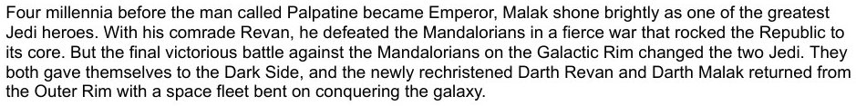
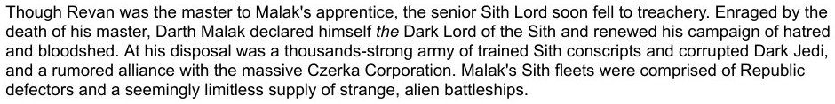
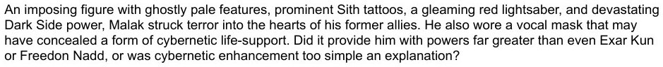
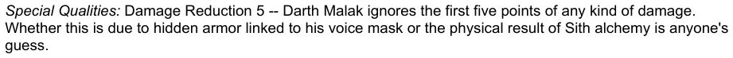
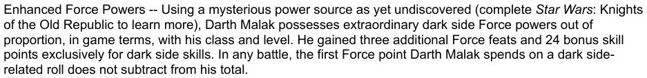

# Owner Material 037 — Star Wars D20 Drive folder (Core, Revised Core and Saga Edition): Characters/Darth Malak.pdf [Star Wars Roleplaying Game Revised Core (d20, 2002)]

- **Source:** Wizards of the Coast Star Wars Roleplaying Game books, web enhancements, Living Force campaign modules and articles (2000–2010), from the owner's "Star Wars D20" Drive folder (only the three edition subfolders; "General" was not read, as instructed). Secondary source (licensed Legends reference). Scan OCR'd on the box; the scan stays box-only and is **not** published.
- **Method:** every scanned page was OCR'd and machine-screened sentence by sentence for power-relevant statements (fights, kills, defeats, Force feats, rankings, superweapons) that name a character on our roster; each kept sentence is quoted verbatim from the OCR text and has a crop of the printed passage directly under it. Pages with nothing power-relevant are still listed with what is on them.
- **Citation:** "*Darth Malak* (SWRPG d20 Revised Core), p.X" by printed page ("scan p.X" where no printed number applies). **Weight:** Licensed RPG material: a secondary source. Narrative text sums up Legends lore; game statistics are rules for players, not canon power levels, and rank lowest.

## scan p.1 (scan page 1)

Page contents: Malak and Revan defeat the Mandalorians, fall to the dark side; Revan betrayed, Malak declares himself Dark Lord; Sith fleets, Czerka alliance; vocal mask; campaign use with ancient Sith sword from Korriban; stats and SQs (hand-read)

- **Darth Malak; Revan; Palpatine (Darth Sidious)** — entry/section: Malak and Revan: "Four millennia before the man called Palpatine became Emperor, Malak shone brightly as one of the greatest Jedi heroes. With his comrade Revan, he defeated the Mandalorians in a fierce war that rocked the Republic to its core. But the final victorious battle against the Mandalorians on the Galactic Rim changed the two Jedi. They both gave themselves to the Dark Side, and the newly rechristened Darth Revan and Darth Malak returned from the Outer Rim with a space fleet bent on conquering the galaxy." Source: *Darth Malak* (SWRPG d20 Revised Core), scan p.1
  
- **Darth Malak; Revan** — entry/section: Malak, Dark Lord of the Sith: "Though Revan was the master to Malak's apprentice, the senior Sith Lord soon fell to treachery. Enraged by the death of his master, Darth Malak declared himself the Dark Lord of the Sith and renewed his campaign of hatred and bloodshed. At his disposal was a thousands-strong army of trained Sith conscripts and corrupted Dark Jedi, and a rumored alliance with the massive Czerka Corporation. Malak's Sith fleets were comprised of Republic defectors and a seemingly limitless supply of strange, alien battleships." Source: *Darth Malak* (SWRPG d20 Revised Core), scan p.1
  
- **Darth Malak; Exar Kun; Freedon Nadd** — entry/section: Malak's mask: "An imposing figure with ghostly pale features, prominent Sith tattoos, a gleaming red lightsaber, and devastating Dark Side power, Malak struck terror into the hearts of his former allies. He also wore a vocal mask that may have concealed a form of cybernetic life-support. Did it provide him with powers far greater than even Exar Kun or Freedon Nadd, or was cybernetic enhancement too simple an explanation?" Source: *Darth Malak* (SWRPG d20 Revised Core), scan p.1
  
- **Darth Malak** — entry/section: Malak: Damage Reduction 5: "Damage Reduction 5 -- Darth Malak ignores the first five points of any kind of damage. Whether this is due to hidden armor linked to his voice mask or the physical result of Sith alchemy is anyone's guess." Source: *Darth Malak* (SWRPG d20 Revised Core), scan p.1
  
- **Darth Malak** — entry/section: Malak: Enhanced Force Powers: "Enhanced Force Powers -- Using a mysterious power source as yet undiscovered (complete Star Wars: Knights of the Old Republic to learn more), Darth Malak possesses extraordinary dark side Force powers out of proportion, in game terms, with his class and level. He gained three additional Force feats and 24 bonus skill points exclusively for dark side skills. In any battle, the first Force point Darth Malak spends on a dark siderelated roll does not subtract from his total." Source: *Darth Malak* (SWRPG d20 Revised Core), scan p.1
  

### Stat block notes (game mechanics, not feats)

- darth-malak: Darth Malak: Male Human Jedi Guardian 11/Sith Lord 9; Init +2; Defense 26; VP/WP 158/16; Atk +23 melee (7d8+5, lightsaber); DR 5; enhanced Force powers; FP 11; DSP 30; Rep +5; Force Lightning +24, Fear +20; Challenge Code H (Source: *Darth Malak* (SWRPG d20 Revised Core), scan p.1)

## scan p.2 (scan page 2)

Page contents: KOTOR videogame link and copyright only (page image) (hand-read)

