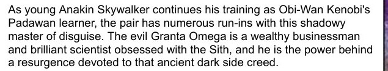
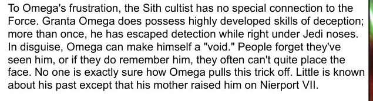
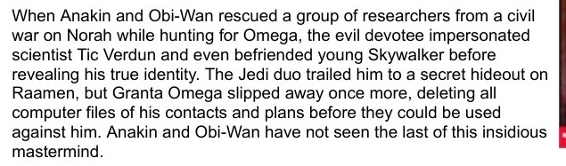

# Owner Material 037 — Star Wars D20 Drive folder (Core, Revised Core and Saga Edition): Characters/Granta Omega.pdf [Star Wars Roleplaying Game Revised Core (d20, 2002)]

- **Source:** Wizards of the Coast Star Wars Roleplaying Game books, web enhancements, Living Force campaign modules and articles (2000–2010), from the owner's "Star Wars D20" Drive folder (only the three edition subfolders; "General" was not read, as instructed). Secondary source (licensed Legends reference). Scan OCR'd on the box; the scan stays box-only and is **not** published.
- **Method:** every scanned page was OCR'd and machine-screened sentence by sentence for power-relevant statements (fights, kills, defeats, Force feats, rankings, superweapons) that name a character on our roster; each kept sentence is quoted verbatim from the OCR text and has a crop of the printed passage directly under it. Pages with nothing power-relevant are still listed with what is on them.
- **Citation:** "*Granta Omega* (SWRPG d20 Revised Core), p.X" by printed page ("scan p.X" where no printed number applies). **Weight:** Licensed RPG material: a secondary source. Narrative text sums up Legends lore; game statistics are rules for players, not canon power levels, and rank lowest.

## scan p.1 (scan page 1)

Page contents: Granta Omega: wealthy Sith-obsessed businessman and scientist with no Force connection, master of disguise who makes himself a 'void'; impersonates Tic Verdun on Norah, escapes from Raamen; stats (Disguise +31, Bluff +22); Jedi Quest: The Shadow Trap cover (hand-read)

- **Granta Omega; Darth Vader (Anakin Skywalker); Obi-Wan Kenobi** — entry/section: Granta Omega: "As young Anakin Skywalker continues his training as Obi-Wan Kenobi's Padawan learner, the pair has numerous run-ins with this shadowy master of disguise. The evil Granta Omega is a wealthy businessman and brilliant scientist obsessed with the Sith, and he is the power behind a resurgence devoted to that ancient dark side creed." Source: *Granta Omega* (SWRPG d20 Revised Core), scan p.1
  
- **Granta Omega** — entry/section: Omega's 'void': "To Omega's frustration, the Sith cultist has no special connection to the Force. Granta Omega does possess highly developed skills of deception; more than once, he has escaped detection while right under Jedi noses. In disguise, Omega can make himself a "void." People forget they've seen him, or if they do remember him, they often can't quite place the face. No one is exactly sure how Omega pulls this trick off. Little is known about his past except that his mother raised him on Nierport VII." Source: *Granta Omega* (SWRPG d20 Revised Core), scan p.1
  
- **Granta Omega; Darth Vader (Anakin Skywalker); Obi-Wan Kenobi** — entry/section: Omega on Norah and Raamen: "When Anakin and Obi-Wan rescued a group of researchers from a civil war on Norah while hunting for Omega, the evil devotee impersonated scientist Tic Verdun and even befriended young Skywalker before revealing his true identity. The Jedi duo trailed him to a secret hideout on Raamen, but Granta Omega slipped away once more, deleting all computer files of his contacts and plans before they could be used against him. Anakin and Obi-Wan have not seen the last of this insidious mastermind." Source: *Granta Omega* (SWRPG d20 Revised Core), scan p.1
  

### Stat block notes (game mechanics, not feats)

- granta-omega: Granta Omega: Male Human Scoundrel 4/Tech Specialist 2/Noble 6; Init +5; Def 18; VP/WP 45/10; FP 2; DSP 17; Rep +3; Disguise +31, Bluff +22; Challenge Code E (Source: *Granta Omega* (SWRPG d20 Revised Core), scan p.1)
