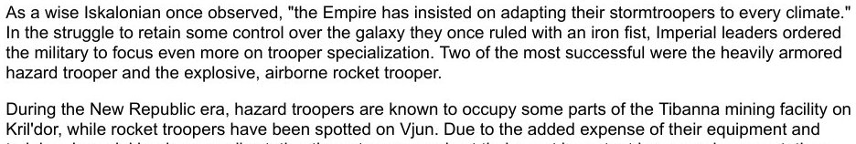
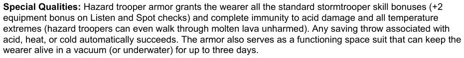

# Owner Material 037 — Star Wars D20 Drive folder (Core, Revised Core and Saga Edition): Characters/Hazard and Rocket Troopers.pdf [Star Wars Roleplaying Game Revised Core (d20, 2002)]

- **Source:** Wizards of the Coast Star Wars Roleplaying Game books, web enhancements, Living Force campaign modules and articles (2000–2010), from the owner's "Star Wars D20" Drive folder (only the three edition subfolders; "General" was not read, as instructed). Secondary source (licensed Legends reference). Scan OCR'd on the box; the scan stays box-only and is **not** published.
- **Method:** every scanned page was OCR'd and machine-screened sentence by sentence for power-relevant statements (fights, kills, defeats, Force feats, rankings, superweapons) that name a character on our roster; each kept sentence is quoted verbatim from the OCR text and has a crop of the printed passage directly under it. Pages with nothing power-relevant are still listed with what is on them.
- **Citation:** "*Hazard and Rocket Troopers* (SWRPG d20 Revised Core), p.X" by printed page ("scan p.X" where no printed number applies). **Weight:** Licensed RPG material: a secondary source. Narrative text sums up Legends lore; game statistics are rules for players, not canon power levels, and rank lowest.

## scan p.1 (scan page 1)

Page contents: Intro (Iskalonian quote on stormtrooper adaptation; Kril'dor, Vjun); Hazard Trooper stats (Thug 14, DR 8, immune to acid/cold/heat, CC E) and armor table (20,000 cr, DR 8, +0 Dex, -8 ACP, 6/2 m, 50 kg); Rocket Trooper stats (Thug 14, fly 6 m, DR 5, CC E) and SQ rocket pack (hand-read)

- **No single roster character (rules/setting/general)** — entry/section: Imperial trooper specialization: "As a wise Iskalonian once observed, "the Empire has insisted on adapting their stormtroopers to every climate." In the struggle to retain some control over the galaxy they once ruled with an iron fist, Imperial leaders ordered the military to focus even more on trooper specialization. Two of the most successful were the heavily armored hazard trooper and the explosive, airborne rocket trooper." Source: *Hazard and Rocket Troopers* (SWRPG d20 Revised Core), scan p.1
  
- **No single roster character (rules/setting/general)** — entry/section: Hazard trooper armor: "Hazard trooper armor grants the wearer all the standard stormtrooper skill bonuses (+2 equipment bonus on Listen and Spot checks) and complete immunity to acid damage and all temperature extremes (hazard troopers can even walk through molten lava unharmed). Any saving throw associated with acid, heat, or cold automatically succeeds. The armor also serves as a functioning space suit that can keep the wearer alive in a vacuum (or underwater) for up to three days." Source: *Hazard and Rocket Troopers* (SWRPG d20 Revised Core), scan p.1
  

### Stat block notes (game mechanics, not feats)

- hazard-trooper (generic): Hazard Trooper: Male Human Thug 14; Defense 15; Spd 6 m; VP/WP -/17; heavy repeating blaster 4d8; DR 8; immune to acid, cold, heat; Challenge Code E (Source: *Hazard and Rocket Troopers* (SWRPG d20 Revised Core), scan p.1)
- rocket-trooper (generic): Rocket Trooper: Male Human Thug 14; Defense 15; Spd 8 m or fly (poor) 6 m; VP/WP -/16; Merr-Sonn missile system 4d8+1; DR 5; Challenge Code E (Source: *Hazard and Rocket Troopers* (SWRPG d20 Revised Core), scan p.1)

## scan p.2 (scan page 2)

Page contents: Rocket trooper armor table (from image: 20,000 cr, DR 5, +1 Dex, -4 ACP, 8/4 m, 40 kg); Merr-Sonn Missile System (from image: 10,000 cr, 4d8+1, crit 20, 60 m (4 m), 35 kg, Energy/Slashing, Large, Heavy); Jedi Academy videogame link (hand-read)

