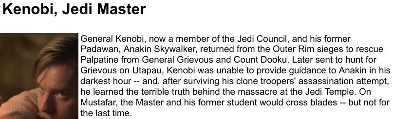
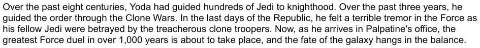
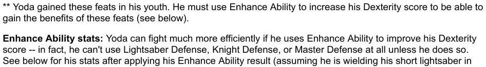
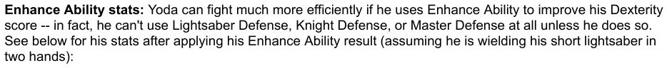
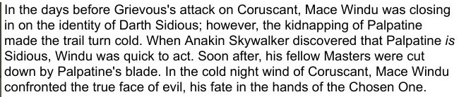
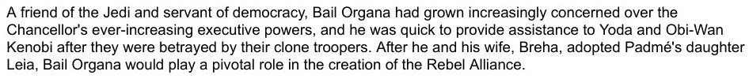
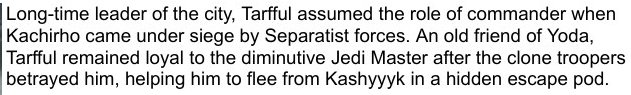
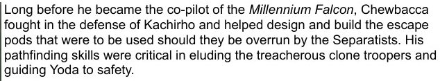
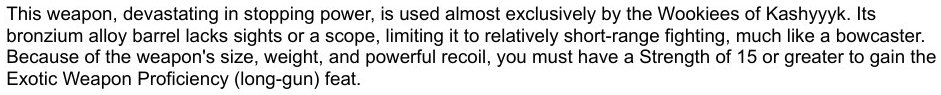

# Owner Material 037 — Star Wars D20 Drive folder (Core, Revised Core and Saga Edition): Characters/Heroes of Revenge of the Sith.pdf [Star Wars Roleplaying Game Revised Core (d20, 2002)]

- **Source:** Wizards of the Coast Star Wars Roleplaying Game books, web enhancements, Living Force campaign modules and articles (2000–2010), from the owner's "Star Wars D20" Drive folder (only the three edition subfolders; "General" was not read, as instructed). Secondary source (licensed Legends reference). Scan OCR'd on the box; the scan stays box-only and is **not** published.
- **Method:** every scanned page was OCR'd and machine-screened sentence by sentence for power-relevant statements (fights, kills, defeats, Force feats, rankings, superweapons) that name a character on our roster; each kept sentence is quoted verbatim from the OCR text and has a crop of the printed passage directly under it. Pages with nothing power-relevant are still listed with what is on them.
- **Citation:** "*Heroes of Revenge of the Sith* (SWRPG d20 Revised Core), p.X" by printed page ("scan p.X" where no printed number applies). **Weight:** Licensed RPG material: a secondary source. Narrative text sums up Legends lore; game statistics are rules for players, not canon power levels, and rank lowest.

## scan p.1 (scan page 1)

Page contents: Intro; Obi-Wan Kenobi, Jedi Master: bio and stats (Jedi guardian 7/Jedi Master 5/Jedi investigator 2; Cha 13 from image); Yoda, Jedi Master: bio and stats (Jedi consular 7/Jedi Master 9/Jedi instructor 4) (hand-read)

- **Obi-Wan Kenobi; Darth Vader (Anakin Skywalker); Palpatine (Darth Sidious); General Grievous; Count Dooku** — entry/section: Obi-Wan Kenobi, Jedi Master: "General Kenobi, now a member of the Jedi Council, and his former Padawan, Anakin Skywalker, returned from the Outer Rim sieges to rescue Palpatine from General Grievous and Count Dooku. Later sent to hunt for Grievous on Utapau, Kenobi was unable to provide guidance to Anakin in his darkest hour -- and, after surviving his clone troopers' assassination attempt, he learned the terrible truth behind the massacre at the Jedi Temple. On Mustafar, the Master and his former student would cross blades -- but not for the last time." Source: *Heroes of Revenge of the Sith* (SWRPG d20 Revised Core), scan p.1
  
- **Yoda; Palpatine (Darth Sidious)** — entry/section: Yoda, Jedi Master: "Over the past eight centuries, Yoda had guided hundreds of Jedi to knighthood. Over the past three years, he guided the order through the Clone Wars. In the last days of the Republic, he felt a terrible tremor in the Force as his fellow Jedi were betrayed by the treacherous clone troopers. Now, as he arrives in Palpatine's office, the greatest Force duel in over 1,000 years is about to take place, and the fate of the galaxy hangs in the balance." Source: *Heroes of Revenge of the Sith* (SWRPG d20 Revised Core), scan p.1
  

### Stat block notes (game mechanics, not feats)

- obi-wan-kenobi: Obi-Wan Kenobi (ROTS): Male Human Jedi guardian 7/Jedi Master 5/Jedi investigator 2; Defense 24 (30 with Master Defense); VP/WP 119/14; Atk +17/+12/+7 melee (5d8+3/18-20, lightsaber); FP 9; Rep +4; Form III Mastery; Cha 13 (Source: *Heroes of Revenge of the Sith* (SWRPG d20 Revised Core), scan p.1)
- yoda: Yoda (ROTS): Male Jedi consular 7/Jedi Master 9/Jedi instructor 4; Defense 26; VP/WP 141/14; Atk +21 melee (2d6+5d8+1/18-20, short lightsaber); SV Will +19; FP 15; Rep +10; Move Object +18, Farseeing +19. Enhance Ability (p2, from image): 15-19 Def 33, Atk +22, Dex 14; 20-24 Def 34, Atk +23, Dex 16; 25-29 Def 35, Atk +24, Dex 18; 30+ Init +5, Def 36, Atk +25/+20/+15/+10 (2d6+5d8+7/18-20), Dex 20, Tumble +16 (Source: *Heroes of Revenge of the Sith* (SWRPG d20 Revised Core), scan p.1)

## scan p.2 (scan page 2)

Page contents: Yoda skills/feats, youth-feats note, Enhance Ability stats table (15-19 to 30+, from image); Mace Windu, Jedi Master: bio and stats (Jedi guardian 5/Jedi weapon master 7/Jedi Master 7) (hand-read)

- **Yoda** — entry/section: Yoda's youth feats: "** Yoda gained these feats in his youth. He must use Enhance Ability to increase his Dexterity score to be able to gain the benefits of these feats (see below)." Source: *Heroes of Revenge of the Sith* (SWRPG d20 Revised Core), scan p.2
  
- **Yoda** — entry/section: Yoda: Enhance Ability stats: "Enhance Ability stats: Yoda can fight much more efficiently if he uses Enhance Ability to improve his Dexterity score -- in fact, he can't use Lightsaber Defense, Knight Defense, or Master Defense at all unless he does so. See below for his stats after applying his Enhance Ability result (assuming he is wielding his short lightsaber in two hands):" Source: *Heroes of Revenge of the Sith* (SWRPG d20 Revised Core), scan p.2
  
- **Mace Windu; Palpatine (Darth Sidious); General Grievous; Darth Vader (Anakin Skywalker)** — entry/section: Mace Windu, Jedi Master: "In the days before Grievous's attack on Coruscant, Mace Windu was closing in on the identity of Darth Sidious; however, the kidnapping of Palpatine made the trail turn cold. When Anakin Skywalker discovered that Palpatine is Sidious, Windu was quick to act. Soon after, his fellow Masters were cut down by Palpatine's blade. In the cold night wind of Coruscant, Mace Windu confronted the true face of evil, his fate in the hands of the Chosen One." Source: *Heroes of Revenge of the Sith* (SWRPG d20 Revised Core), scan p.2
  

### Stat block notes (game mechanics, not feats)

- mace-windu: Mace Windu (ROTS): Male Human Jedi guardian 5/Jedi weapon master 7/Jedi Master 7; Defense 25 (29 with Knight Defense); VP/WP 149/15; Atk +23/+18/+13/+8 melee (7d8+1/18-20, lightsaber); FP 12; Rep +9; Form VII Mastery; Battlemind +16, Force Strike +15 (Source: *Heroes of Revenge of the Sith* (SWRPG d20 Revised Core), scan p.2)

## scan p.3 (scan page 3)

Page contents: Bail Organa bio and stats (noble 9); Captain Raymus Antilles bio and stats (Soldier 4/Noble 1/Officer 1); Tarfful bio and stats (Wookiee soldier 9) (hand-read)

- **Bail Organa; Yoda; Obi-Wan Kenobi; Leia Organa Solo; Padmé Amidala** — entry/section: Bail Organa: "A friend of the Jedi and servant of democracy, Bail Organa had grown increasingly concerned over the Chancellor's ever-increasing executive powers, and he was quick to provide assistance to Yoda and Obi-Wan Kenobi after they were betrayed by their clone troopers. After he and his wife, Breha, adopted Padmé's daughter Leia, Bail Organa would play a pivotal role in the creation of the Rebel Alliance." Source: *Heroes of Revenge of the Sith* (SWRPG d20 Revised Core), scan p.3
  
- **Captain Raymus Antilles; Bail Organa; Leia Organa Solo; R2-D2; C-3PO; Darth Vader (Anakin Skywalker)** — entry/section: Captain Antilles: "Captain of the Tantive IV, Raymus Antilles served both Bail Organa and his adopted daughter, Leia, as they fought against the Emperor's subjugation of the galaxy. His ship was home to R2-D2 and C-3PO off and on for the next 19 years until it was captured by Lord Vader's flagship, the Devastator, over
Tatooine." Source: *Heroes of Revenge of the Sith* (SWRPG d20 Revised Core), scan p.3
  
- **Tarfful; Yoda** — entry/section: Tarfful: "Long-time leader of the city, Tarfful assumed the role of commander when Kachirho came under siege by Separatist forces. An old friend of Yoda, Tarfful remained loyal to the diminutive Jedi Master after the clone troopers betrayed him, helping him to flee from Kashyyyk in a hidden escape pod." Source: *Heroes of Revenge of the Sith* (SWRPG d20 Revised Core), scan p.3
  

### Stat block notes (game mechanics, not feats)

- bail-organa: Bail Organa: Male Human noble 9; Defense 15; VP/WP 66/14; FP 2; Rep +8; Diplomacy +20 (Source: *Heroes of Revenge of the Sith* (SWRPG d20 Revised Core), scan p.3)
- raymus-antilles: Captain Raymus Antilles: Adult Male Human Soldier 4/Noble 1/Officer 1; Init +6; Defense 17; VP/WP 58/14; FP 1; Rep +3 (Source: *Heroes of Revenge of the Sith* (SWRPG d20 Revised Core), scan p.3)
- tarfful: Tarfful: Male Wookiee soldier 9; Defense 16; VP/WP 92/16; Atk +10/+5 melee (3d4+9/18-20, punch) or 3d12 Kashyyyk long-gun; Wookiee rage; FP 2; Rep +2 (Source: *Heroes of Revenge of the Sith* (SWRPG d20 Revised Core), scan p.3)

## scan p.4 (scan page 4)

Page contents: Tarfful feats (Wrruushi Expertise/Mastery); Chewbacca of Kashyyyk bio and stats (scout 4/tech specialist 1); New Weapon: Kashyyyk Long-Gun (3d12, Str 15 to gain proficiency); About the Author (hand-read)

- **Chewbacca; Yoda** — entry/section: Chewbacca of Kashyyyk: "Long before he became the co-pilot of the Millennium Falcon, Chewbacca fought in the defense of Kachirho and helped design and build the escape pods that were to be used should they be overrun by the Separatists. His pathfinding skills were critical in eluding the treacherous clone troopers and guiding Yoda to safety." Source: *Heroes of Revenge of the Sith* (SWRPG d20 Revised Core), scan p.4
  
- **Tarfful** — entry/section: Kashyyyk long-gun: "This weapon, devastating in stopping power, is used almost exclusively by the Wookiees of Kashyyyk. Its bronzium alloy barrel lacks sights or a scope, limiting it to relatively short-range fighting, much like a bowcaster. Because of the weapon's size, weight, and powerful recoil, you must have a Strength of 15 or greater to gain the Exotic Weapon Proficiency (long-gun) feat." Source: *Heroes of Revenge of the Sith* (SWRPG d20 Revised Core), scan p.4
  

### Stat block notes (game mechanics, not feats)

- chewbacca: Chewbacca (ROTS): Male Wookiee scout 4/tech specialist 1; Defense 15; VP/WP 58/19; bowcaster 3d10; Wookiee rage; FP 2; Rep +1 (Source: *Heroes of Revenge of the Sith* (SWRPG d20 Revised Core), scan p.4)
