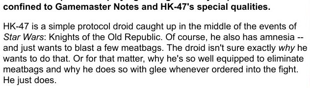
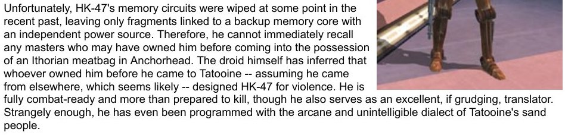
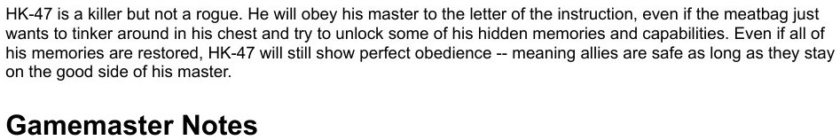
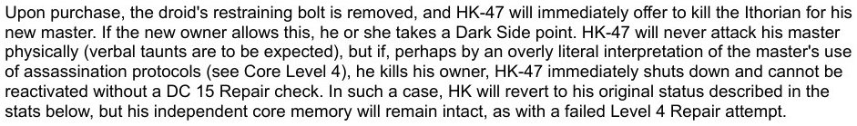
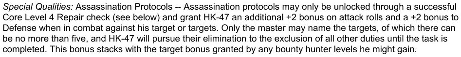
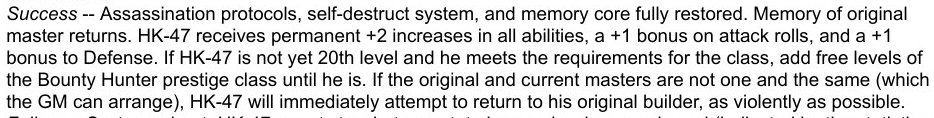

# Owner Material 037 — Star Wars D20 Drive folder (Core, Revised Core and Saga Edition): Characters/HK-47.pdf [Star Wars Roleplaying Game Revised Core (d20, 2002)]

- **Source:** Wizards of the Coast Star Wars Roleplaying Game books, web enhancements, Living Force campaign modules and articles (2000–2010), from the owner's "Star Wars D20" Drive folder (only the three edition subfolders; "General" was not read, as instructed). Secondary source (licensed Legends reference). Scan OCR'd on the box; the scan stays box-only and is **not** published.
- **Method:** every scanned page was OCR'd and machine-screened sentence by sentence for power-relevant statements (fights, kills, defeats, Force feats, rankings, superweapons) that name a character on our roster; each kept sentence is quoted verbatim from the OCR text and has a crop of the printed passage directly under it. Pages with nothing power-relevant are still listed with what is on them.
- **Citation:** "*HK-47* (SWRPG d20 Revised Core), p.X" by printed page ("scan p.X" where no printed number applies). **Weight:** Licensed RPG material: a secondary source. Narrative text sums up Legends lore; game statistics are rules for players, not canon power levels, and rank lowest.

## scan p.1 (scan page 1)

Page contents: HK-47: amnesiac protocol/assassin droid on Tatooine, meatbags, sand people dialect, perfect obedience; GM notes (Anchorhead Ithorian sells for 5,000 cr; offers to kill the Ithorian; shuts down if he kills his owner); stats ready for sale (hand-read)

- **HK-47** — entry/section: HK-47, protocol droid: "HK-47 is a simple protocol droid caught up in the middle of the events of Star Wars: Knights of the Old Republic. Of course, he also has amnesia -- and just wants to blast a few meatbags. The droid isn't sure exactly why he wants to do that. Or for that matter, why he's so well equipped to eliminate meatbags and why he does so with glee whenever ordered into the fight. He just does." Source: *HK-47* (SWRPG d20 Revised Core), scan p.1
  
- **HK-47** — entry/section: HK-47 designed for violence: "Unfortunately, HK-47's memory circuits were wiped at some point in the recent past, leaving only fragments linked to a backup memory core with an independent power source. Therefore, he cannot immediately recall any masters who may have owned him before coming into the possession of an Ithorian meatbag in Anchorhead. The droid himself has inferred that whoever owned him before he came to Tatooine -- assuming he came from elsewhere, which seems likely -- designed HK-47 for violence. He is fully combat-ready and more than prepared to kill, though he also serves as an excellent, if grudging, translator. Strangely enough, he has even been programmed with the arcane and unintelligible dialect of Tatooine's sand people." Source: *HK-47* (SWRPG d20 Revised Core), scan p.1
  
- **HK-47** — entry/section: HK-47's obedience: "HK-47 is a killer but not a rogue. He will obey his master to the letter of the instruction, even if the meatbag just wants to tinker around in his chest and try to unlock some of his hidden memories and capabilities. Even if all of his memories are restored, HK-47 will still show perfect obedience -- meaning allies are safe as long as they stay on the good side of his master." Source: *HK-47* (SWRPG d20 Revised Core), scan p.1
  
- **HK-47** — entry/section: HK-47 and his master: "Upon purchase, the droid's restraining bolt is removed, and HK-47 will immediately offer to kill the Ithorian for his new master. If the new owner allows this, he or she takes a Dark Side point. HK-47 will never attack his master physically (verbal taunts are to be expected), but if, perhaps by an overly literal interpretation of the master's use of assassination protocols (see Core Level 4), he kills his owner, HK-47 immediately shuts down and cannot be reactivated without a DC 15 Repair check. In such a case, HK will revert to his original status described in the stats below, but his independent core memory will remain intact, as with a failed Level 4 Repair attempt." Source: *HK-47* (SWRPG d20 Revised Core), scan p.1
  

### Stat block notes (game mechanics, not feats)

- hk-47: HK-47 (ready for sale): Fourth-degree walking protocol/assassin droid, Diplomat 1/Soldier 3/Scoundrel 5; Init +6; Defense 16; VP/WP 35/14; SQ assassination protocols, protected memory core; FP 0; DSP 12; Challenge Code C (Source: *HK-47* (SWRPG d20 Revised Core), scan p.1)

## scan p.2 (scan page 2)

Page contents: SQs Assassination Protocols, Protected Memory Core; Memory Core table (from image: L1 DC 10/5 rds/lvl 9; L2 14/8/11; L3 18/12/14; L4 24/18/18); Core Levels 1-4 success/failure (hand-read)

- **HK-47** — entry/section: HK-47: Assassination Protocols: "Assassination Protocols -- Assassination protocols may only be unlocked through a successful Core Level 4 Repair check (see below) and grant HK-47 an additional +2 bonus on attack rolls and a +2 bonus to Defense when in combat against his target or targets. Only the master may name the targets, of which there can be no more than five, and HK-47 will pursue their elimination to the exclusion of all other duties until the task is completed. This bonus stacks with the target bonus granted by any bounty hunter levels he might gain." Source: *HK-47* (SWRPG d20 Revised Core), scan p.2
  
- **HK-47** — entry/section: HK-47: Core Level 4: "Success -- Assassination protocols, self-destruct system, and memory core fully restored. Memory of original master returns. HK-47 receives permanent +2 increases in all abilities, a +1 bonus on attack rolls, and a +1 bonus to Defense. If HK-47 is not yet 20th level and he meets the requirements for the class, add free levels of the Bounty Hunter prestige class until he is. If the original and current masters are not one and the same (which the GM can arrange), HK-47 will immediately attempt to return to his original builder, as violently as possible." Source: *HK-47* (SWRPG d20 Revised Core), scan p.2
  
