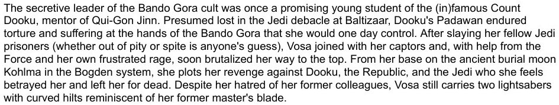

# Owner Material 037 — Star Wars D20 Drive folder (Core, Revised Core and Saga Edition): Characters/Komari Vosa.pdf [Star Wars Roleplaying Game Revised Core (d20, 2002)]

- **Source:** Wizards of the Coast Star Wars Roleplaying Game books, web enhancements, Living Force campaign modules and articles (2000–2010), from the owner's "Star Wars D20" Drive folder (only the three edition subfolders; "General" was not read, as instructed). Secondary source (licensed Legends reference). Scan OCR'd on the box; the scan stays box-only and is **not** published.
- **Method:** every scanned page was OCR'd and machine-screened sentence by sentence for power-relevant statements (fights, kills, defeats, Force feats, rankings, superweapons) that name a character on our roster; each kept sentence is quoted verbatim from the OCR text and has a crop of the printed passage directly under it. Pages with nothing power-relevant are still listed with what is on them.
- **Citation:** "*Komari Vosa* (SWRPG d20 Revised Core), p.X" by printed page ("scan p.X" where no printed number applies). **Weight:** Licensed RPG material: a secondary source. Narrative text sums up Legends lore; game statistics are rules for players, not canon power levels, and rank lowest.

## scan p.1 (scan page 1)

Page contents: Komari Vosa: Dooku's Padawan presumed lost at Baltizaar, tortured by Bando Gora then leads them from Kohlma; two curved-hilt lightsabers; stats (from image: FP 2, DSP 16, Rep +9, Cha 18, CC E; Control Mind +20); videogame links (hand-read)

- **Komari Vosa; Count Dooku; Qui-Gon Jinn** — entry/section: Komari Vosa: "The secretive leader of the Bando Gora cult was once a promising young student of the (in)famous Count Dooku, mentor of Qui-Gon Jinn. Presumed lost in the Jedi debacle at Baltizaar, Dooku's Padawan endured torture and suffering at the hands of the Bando Gora that she would one day control. After slaying her fellow Jedi prisoners (whether out of pity or spite is anyone's guess), Vosa joined with her captors and, with help from the Force and her own frustrated rage, soon brutalized her way to the top. From her base on the ancient burial moon Kohlma in the Bogden system, she plots her revenge against Dooku, the Republic, and the Jedi who she feels betrayed her and left her for dead. Despite her hatred of her former colleagues, Vosa still carries two lightsabers with curved hilts reminiscent of her former master's blade." Source: *Komari Vosa* (SWRPG d20 Revised Core), scan p.1
  

### Stat block notes (game mechanics, not feats)

- komari-vosa: Komari Vosa: Female Human Jedi Guardian 3/Dark Side Devotee 2/Scoundrel 2/Noble 1/Crime Lord 5; Init +2; Defense 18; VP/WP 63/12; Atk +9/+4 melee (3d8, lightsaber) or +5/+0/-4 (two lightsabers); SV Fort +7, Ref +13, Will +11; FP 2; DSP 16; Rep +9; Str 10, Dex 15, Con 12, Int 16, Wis 15, Cha 18; Challenge Code E; Control Mind +20, Force Grip +5, Move Object +6 (stat block middle read from page image) (Source: *Komari Vosa* (SWRPG d20 Revised Core), scan p.1)
