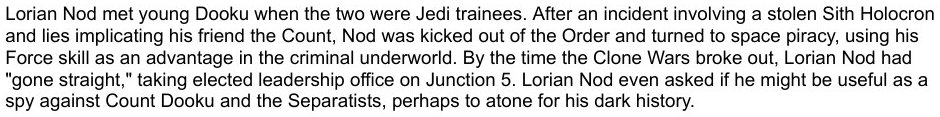

# Owner Material 037 — Star Wars D20 Drive folder (Core, Revised Core and Saga Edition): Characters/Lorian Nod.pdf [Star Wars Roleplaying Game Revised Core (d20, 2002)]

- **Source:** Wizards of the Coast Star Wars Roleplaying Game books, web enhancements, Living Force campaign modules and articles (2000–2010), from the owner's "Star Wars D20" Drive folder (only the three edition subfolders; "General" was not read, as instructed). Secondary source (licensed Legends reference). Scan OCR'd on the box; the scan stays box-only and is **not** published.
- **Method:** every scanned page was OCR'd and machine-screened sentence by sentence for power-relevant statements (fights, kills, defeats, Force feats, rankings, superweapons) that name a character on our roster; each kept sentence is quoted verbatim from the OCR text and has a crop of the printed passage directly under it. Pages with nothing power-relevant are still listed with what is on them.
- **Citation:** "*Lorian Nod* (SWRPG d20 Revised Core), p.X" by printed page ("scan p.X" where no printed number applies). **Weight:** Licensed RPG material: a secondary source. Narrative text sums up Legends lore; game statistics are rules for players, not canon power levels, and rank lowest.

## scan p.1 (scan page 1)

Page contents: Lorian Nod and young Dooku as trainees, stolen Sith Holocron, expelled, pirate, leader of Junction 5, offers to spy on Dooku; three stat blocks (hand-read)

- **Lorian Nod; Count Dooku** — entry/section: Lorian Nod: "Lorian Nod met young Dooku when the two were Jedi trainees. After an incident involving a stolen Sith Holocron and lies implicating his friend the Count, Nod was kicked out of the Order and turned to space piracy, using his Force skill as an advantage in the criminal underworld. By the time the Clone Wars broke out, Lorian Nod had "gone straight," taking elected leadership office on Junction 5. Lorian Nod even asked if he might be useful as a spy against Count Dooku and the Separatists, perhaps to atone for his dark history." Source: *Lorian Nod* (SWRPG d20 Revised Core), scan p.1
  

### Stat block notes (game mechanics, not feats)

- lorian-nod: Lorian Nod: Young Jedi (Jedi Consular 1, CC A); Pirate (Jedi Consular 1/Fringer 2/Scoundrel 6, VP/WP 38/11, CC D); Elected Leader of Junction 5 (Jedi Consular 1/Fringer 2/Scoundrel 6/Noble 6, VP/WP 59/11, Rep +6, CC F) (Source: *Lorian Nod* (SWRPG d20 Revised Core), scan p.1)

## scan p.2 (scan page 2)

Page contents: Legacy of the Jedi novel link (Jude Watson) (hand-read)

