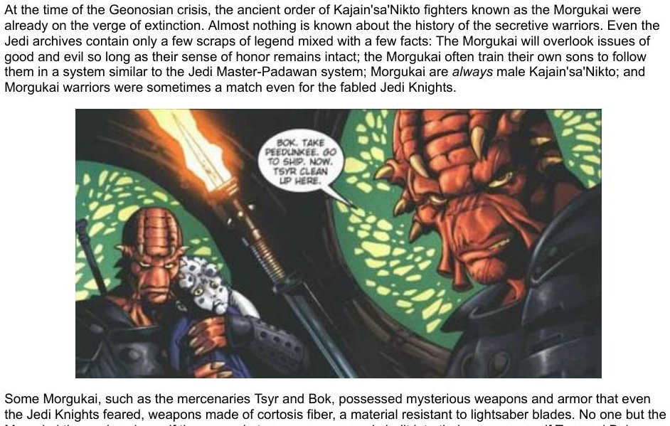
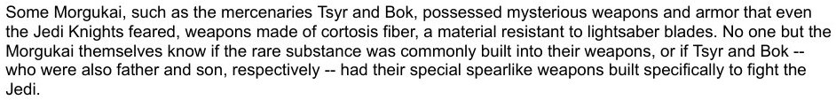
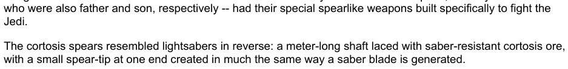

# Owner Material 037 — Star Wars D20 Drive folder (Core, Revised Core and Saga Edition): Characters/Morgukai Warriors.pdf [Star Wars Roleplaying Game Revised Core (d20, 2002)]

- **Source:** Wizards of the Coast Star Wars Roleplaying Game books, web enhancements, Living Force campaign modules and articles (2000–2010), from the owner's "Star Wars D20" Drive folder (only the three edition subfolders; "General" was not read, as instructed). Secondary source (licensed Legends reference). Scan OCR'd on the box; the scan stays box-only and is **not** published.
- **Method:** every scanned page was OCR'd and machine-screened sentence by sentence for power-relevant statements (fights, kills, defeats, Force feats, rankings, superweapons) that name a character on our roster; each kept sentence is quoted verbatim from the OCR text and has a crop of the printed passage directly under it. Pages with nothing power-relevant are still listed with what is on them.
- **Citation:** "*Morgukai Warriors* (SWRPG d20 Revised Core), p.X" by printed page ("scan p.X" where no printed number applies). **Weight:** Licensed RPG material: a secondary source. Narrative text sums up Legends lore; game statistics are rules for players, not canon power levels, and rank lowest.

## scan p.1 (scan page 1)

Page contents: Morgukai: Kajain'sa'Nikto warrior order near extinction, honor code, father-son training, sometimes a match for Jedi; Tsyr and Bok's cortosis spears; outlawed by the Empire; Morgukai Warrior stats (hand-read)

- **No single roster character (rules/setting/general)** — entry/section: The Morgukai: "At the time of the Geonosian crisis, the ancient order of Kajain'sa'Nikto fighters known as the Morgukai were already on the verge of extinction. Almost nothing is known about the history of the secretive warriors. Even the Jedi archives contain only a few scraps of legend mixed with a few facts: The Morgukai will overlook issues of good and evil so long as their sense of honor remains intact; the Morgukai often train their own sons to follow them in a system similar to the Jedi Master-Padawan system; Morgukai are always male Kajain'sa'Nikto; and Morgukai warriors were sometimes a match even for the fabled Jedi Knights." Source: *Morgukai Warriors* (SWRPG d20 Revised Core), scan p.1
  
- **Tsyr; Bok (Morgukai)** — entry/section: Tsyr and Bok's cortosis weapons: "Some Morgukai, such as the mercenaries Tsyr and Bok, possessed mysterious weapons and armor that even the Jedi Knights feared, weapons made of cortosis fiber, a material resistant to lightsaber blades. No one but the Morgukai themselves know if the rare substance was commonly built into their weapons, or if Tsyr and Bok -- who were also father and son, respectively -- had their special spearlike weapons built specifically to fight the Jedi." Source: *Morgukai Warriors* (SWRPG d20 Revised Core), scan p.1
  
- **Tsyr; Bok (Morgukai)** — entry/section: Cortosis spears: "The cortosis spears resembled lightsabers in reverse: a meter-long shaft laced with saber-resistant cortosis ore, with a small spear-tip at one end created in much the same way a saber blade is generated." Source: *Morgukai Warriors* (SWRPG d20 Revised Core), scan p.1
  

### Stat block notes (game mechanics, not feats)

- morgukai-warrior (generic): Morgukai Warrior: Male Kajain'sa'Nikto Soldier 6/Elite Trooper 3; Defense 21; VP/WP 142/18; Atk +10/+5 melee (cortosis staff); DR 3; Challenge Code E (Source: *Morgukai Warriors* (SWRPG d20 Revised Core), scan p.1)

## scan p.2 (scan page 2)

Page contents: SQs Desert Dweller, Natural Armor, Uncanny Dodge; Rite of Passage comic (issues 42-45) link (hand-read)

