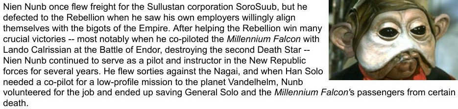
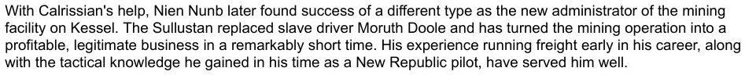

# Owner Material 037 — Star Wars D20 Drive folder (Core, Revised Core and Saga Edition): Characters/Nien Nunb, Kessel Administrator.pdf [Star Wars Roleplaying Game Revised Core (d20, 2002)]

- **Source:** Wizards of the Coast Star Wars Roleplaying Game books, web enhancements, Living Force campaign modules and articles (2000–2010), from the owner's "Star Wars D20" Drive folder (only the three edition subfolders; "General" was not read, as instructed). Secondary source (licensed Legends reference). Scan OCR'd on the box; the scan stays box-only and is **not** published.
- **Method:** every scanned page was OCR'd and machine-screened sentence by sentence for power-relevant statements (fights, kills, defeats, Force feats, rankings, superweapons) that name a character on our roster; each kept sentence is quoted verbatim from the OCR text and has a crop of the printed passage directly under it. Pages with nothing power-relevant are still listed with what is on them.
- **Citation:** "*Nien Nunb, Kessel Administrator* (SWRPG d20 Revised Core), p.X" by printed page ("scan p.X" where no printed number applies). **Weight:** Licensed RPG material: a secondary source. Narrative text sums up Legends lore; game statistics are rules for players, not canon power levels, and rank lowest.

## scan p.1 (scan page 1)

Page contents: Nien Nunb: defects from SoroSuub, co-pilots the Falcon at Endor, New Republic pilot, Vandelhelm missions with Han, Kessel administrator replacing Moruth Doole; hires heroes; stats (hand-read)

- **Nien Nunb; Lando Calrissian; Han Solo** — entry/section: Nien Nunb's career: "Nien Nunb once flew freight for the Sullustan corporation SoroSuub, but he defected to the Rebellion when he saw his own employers willingly align themselves with the bigots of the Empire. After helping the Rebellion win many crucial victories -- most notably when he co-piloted the Millennium Falcon with Lando Calrissian at the Battle of Endor, destroying the second Death Star -- Nien Nunb continued to serve as a pilot and instructor in the New Republic forces for several years. He flew sorties against the Nagai, and when Han Solo needed a co-pilot for a low-profile mission to the planet Vandelhelm, Nunb volunteered for the job and ended up saving General Solo and the Millennium Falcon's passengers from certain death." Source: *Nien Nunb, Kessel Administrator* (SWRPG d20 Revised Core), scan p.1
  
- **Nien Nunb; Lando Calrissian; Moruth Doole** — entry/section: Nien Nunb on Kessel: "With Calrissian's help, Nien Nunb later found success of a different type as the new administrator of the mining facility on Kessel. The Sullustan replaced slave driver Moruth Doole and has turned the mining operation into a profitable, legitimate business in a remarkably short time. His experience running freight early in his career, along with the tactical knowledge he gained in his time as a New Republic pilot, have served him well." Source: *Nien Nunb, Kessel Administrator* (SWRPG d20 Revised Core), scan p.1
  

### Stat block notes (game mechanics, not feats)

- nien-nunb: Nien Nunb (10 years after Episode VI): Male Sullustan Scout 8/Space Transport Ace 5/Diplomat 3; Init +7; Defense 22; VP/WP 71/10; FP 2; Rep +5; Challenge Code E (Source: *Nien Nunb, Kessel Administrator* (SWRPG d20 Revised Core), scan p.1)
