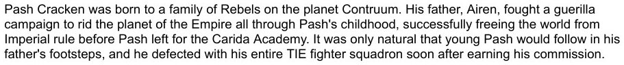
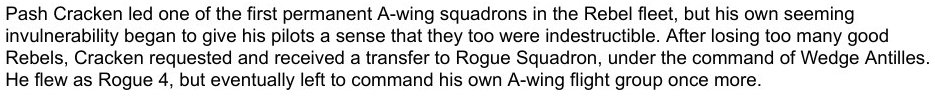
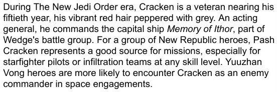

# Owner Material 037 — Star Wars D20 Drive folder (Core, Revised Core and Saga Edition): Characters/Pash Cracken.pdf [Star Wars Roleplaying Game Revised Core (d20, 2002)]

- **Source:** Wizards of the Coast Star Wars Roleplaying Game books, web enhancements, Living Force campaign modules and articles (2000–2010), from the owner's "Star Wars D20" Drive folder (only the three edition subfolders; "General" was not read, as instructed). Secondary source (licensed Legends reference). Scan OCR'd on the box; the scan stays box-only and is **not** published.
- **Method:** every scanned page was OCR'd and machine-screened sentence by sentence for power-relevant statements (fights, kills, defeats, Force feats, rankings, superweapons) that name a character on our roster; each kept sentence is quoted verbatim from the OCR text and has a crop of the printed passage directly under it. Pages with nothing power-relevant are still listed with what is on them.
- **Citation:** "*Pash Cracken* (SWRPG d20 Revised Core), p.X" by printed page ("scan p.X" where no printed number applies). **Weight:** Licensed RPG material: a secondary source. Narrative text sums up Legends lore; game statistics are rules for players, not canon power levels, and rank lowest.

## scan p.1 (scan page 1)

Page contents: Pash Cracken: son of Airen Cracken on Contruum, defects with TIE squadron, A-wing leader, Rogue 4 under Wedge, NJO acting general commanding Memory of Ithor; stats; The Final Prophecy link (hand-read)

- **Pash Cracken** — entry/section: Pash Cracken's defection: "Pash Cracken was born to a family of Rebels on the planet Contruum. His father, Airen, fought a guerilla campaign to rid the planet of the Empire all through Pash's childhood, successfully freeing the world from Imperial rule before Pash left for the Carida Academy. It was only natural that young Pash would follow in his father's footsteps, and he defected with his entire TIE fighter squadron soon after earning his commission." Source: *Pash Cracken* (SWRPG d20 Revised Core), scan p.1
  
- **Pash Cracken; Wedge Antilles** — entry/section: Pash Cracken, A-wing leader: "Pash Cracken led one of the first permanent A-wing squadrons in the Rebel fleet, but his own seeming invulnerability began to give his pilots a sense that they too were indestructible. After losing too many good Rebels, Cracken requested and received a transfer to Rogue Squadron, under the command of Wedge Antilles. He flew as Rogue 4, but eventually left to command his own A-wing flight group once more." Source: *Pash Cracken* (SWRPG d20 Revised Core), scan p.1
  
- **Pash Cracken; Wedge Antilles** — entry/section: Pash Cracken in the NJO era: "During The New Jedi Order era, Cracken is a veteran nearing his fiftieth year, his vibrant red hair peppered with grey. An acting general, he commands the capital ship Memory of Ithor, part of Wedge's battle group. For a group of New Republic heroes, Pash Cracken represents a good source for missions, especially for starfighter pilots or infiltration teams at any skill level. Yuuzhan Vong heroes are more likely to encounter Cracken as an enemy commander in space engagements." Source: *Pash Cracken* (SWRPG d20 Revised Core), scan p.1
  

### Stat block notes (game mechanics, not feats)

- pash-cracken: Pash Cracken: Male Human Soldier 7/Starship Ace 5/Officer 5; Init +7; Defense 25; VP/WP 88/11; FP 4; Rep +7; Challenge Code F (Source: *Pash Cracken* (SWRPG d20 Revised Core), scan p.1)
