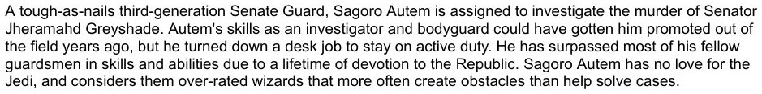

# Owner Material 037 — Star Wars D20 Drive folder (Core, Revised Core and Saga Edition): Characters/Sagoro Autem.pdf [Star Wars Roleplaying Game Revised Core (d20, 2002)]

- **Source:** Wizards of the Coast Star Wars Roleplaying Game books, web enhancements, Living Force campaign modules and articles (2000–2010), from the owner's "Star Wars D20" Drive folder (only the three edition subfolders; "General" was not read, as instructed). Secondary source (licensed Legends reference). Scan OCR'd on the box; the scan stays box-only and is **not** published.
- **Method:** every scanned page was OCR'd and machine-screened sentence by sentence for power-relevant statements (fights, kills, defeats, Force feats, rankings, superweapons) that name a character on our roster; each kept sentence is quoted verbatim from the OCR text and has a crop of the printed passage directly under it. Pages with nothing power-relevant are still listed with what is on them.
- **Citation:** "*Sagoro Autem* (SWRPG d20 Revised Core), p.X" by printed page ("scan p.X" where no printed number applies). **Weight:** Licensed RPG material: a secondary source. Narrative text sums up Legends lore; game statistics are rules for players, not canon power levels, and rank lowest.

## scan p.1 (scan page 1)

Page contents: Sagoro Autem: third-generation Senate Guard investigating Senator Jheramahd Greyshade's murder, disdains Jedi; wife Sula, children Lissa and Reymet; stats; Honor and Duty comic (issues 46-48) (hand-read)

- **Sagoro Autem** — entry/section: Sagoro Autem: "A tough-as-nails third-generation Senate Guard, Sagoro Autem is assigned to investigate the murder of Senator Jheramahd Greyshade. Autem's skills as an investigator and bodyguard could have gotten him promoted out of the field years ago, but he turned down a desk job to stay on active duty. He has surpassed most of his fellow guardsmen in skills and abilities due to a lifetime of devotion to the Republic. Sagoro Autem has no love for the Jedi, and considers them over-rated wizards that more often create obstacles than help solve cases." Source: *Sagoro Autem* (SWRPG d20 Revised Core), scan p.1
  

### Stat block notes (game mechanics, not feats)

- sagoro-autem: Sagoro Autem: Male Human Soldier 5/Senate Guard 4; Init +8; Defense 21; VP/WP 68/17; ceremonial rifle 3d10; DR 2; FP 5; Rep +3; Challenge Code D (Source: *Sagoro Autem* (SWRPG d20 Revised Core), scan p.1)
