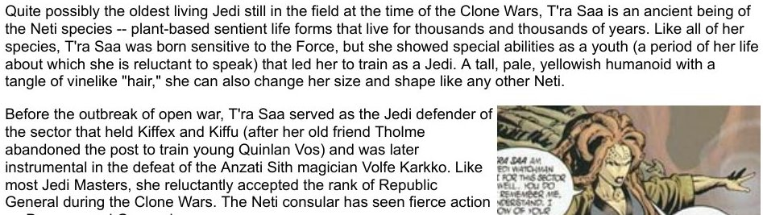
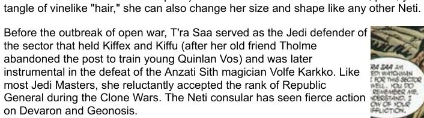

# Owner Material 037 — Star Wars D20 Drive folder (Core, Revised Core and Saga Edition): Characters/T'ra Saa.pdf [Star Wars Roleplaying Game Revised Core (d20, 2002)]

- **Source:** Wizards of the Coast Star Wars Roleplaying Game books, web enhancements, Living Force campaign modules and articles (2000–2010), from the owner's "Star Wars D20" Drive folder (only the three edition subfolders; "General" was not read, as instructed). Secondary source (licensed Legends reference). Scan OCR'd on the box; the scan stays box-only and is **not** published.
- **Method:** every scanned page was OCR'd and machine-screened sentence by sentence for power-relevant statements (fights, kills, defeats, Force feats, rankings, superweapons) that name a character on our roster; each kept sentence is quoted verbatim from the OCR text and has a crop of the printed passage directly under it. Pages with nothing power-relevant are still listed with what is on them.
- **Citation:** "*T'ra Saa* (SWRPG d20 Revised Core), p.X" by printed page ("scan p.X" where no printed number applies). **Weight:** Licensed RPG material: a secondary source. Narrative text sums up Legends lore; game statistics are rules for players, not canon power levels, and rank lowest.

## scan p.1 (scan page 1)

Page contents: T'ra Saa: ancient Neti Jedi, defender of Kiffex/Kiffu sector after Tholme, defeated Volfe Karkko, Republic General on Devaron and Geonosis; stats; Neti SQs (hand-read)

- **T'ra Saa** — entry/section: T'ra Saa: "Quite possibly the oldest living Jedi still in the field at the time of the Clone Wars, T'ra Saa is an ancient being of the Neti species -- plant-based sentient life forms that live for thousands and thousands of years. Like all of her species, T'ra Saa was born sensitive to the Force, but she showed special abilities as a youth (a period of her life about which she is reluctant to speak) that led her to train as a Jedi. A tall, pale, yellowish humanoid with a tangle of vinelike "hair," she can also change her size and shape like any other Neti." Source: *T'ra Saa* (SWRPG d20 Revised Core), scan p.1
  
- **T'ra Saa; Tholme; Quinlan Vos; Volfe Karkko** — entry/section: T'ra Saa before the Clone Wars: "Before the outbreak of open war, T'ra Saa served as the Jedi defender of the sector that held Kiffex and Kiffu (after her old friend Tholme abandoned the post to train young Quinlan Vos) and was later instrumental in the defeat of the Anzati Sith magician Volfe Karkko. Like most Jedi Masters, she reluctantly accepted the rank of Republic General during the Clone Wars. The Neti consular has seen fierce action on Devaron and Geonosis." Source: *T'ra Saa* (SWRPG d20 Revised Core), scan p.1
  

### Stat block notes (game mechanics, not feats)

- t-ra-saa: T'ra Saa: Female Neti Jedi Consular 13/Jedi Master 4; Defense 22; VP/WP 158/16; Atk +16/+11/+6 melee (5d8+3, lightsaber); SQ camouflage, metamorph, photosynthesis; FP 11; DSP 0; Rep +6; Wis 21; Challenge Code H (Source: *T'ra Saa* (SWRPG d20 Revised Core), scan p.1)

## scan p.2 (scan page 2)

Page contents: Copyright line only (from image) (hand-read)

