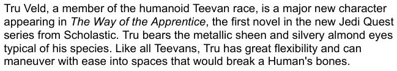
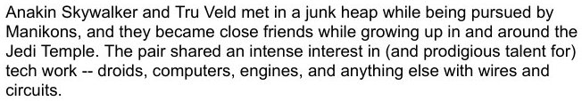
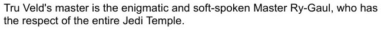

# Owner Material 037 — Star Wars D20 Drive folder (Core, Revised Core and Saga Edition): Characters/Tru Veld, Jedi Padawan.pdf [Star Wars Roleplaying Game Revised Core (d20, 2002)]

- **Source:** Wizards of the Coast Star Wars Roleplaying Game books, web enhancements, Living Force campaign modules and articles (2000–2010), from the owner's "Star Wars D20" Drive folder (only the three edition subfolders; "General" was not read, as instructed). Secondary source (licensed Legends reference). Scan OCR'd on the box; the scan stays box-only and is **not** published.
- **Method:** every scanned page was OCR'd and machine-screened sentence by sentence for power-relevant statements (fights, kills, defeats, Force feats, rankings, superweapons) that name a character on our roster; each kept sentence is quoted verbatim from the OCR text and has a crop of the printed passage directly under it. Pages with nothing power-relevant are still listed with what is on them.
- **Citation:** "*Tru Veld, Jedi Padawan* (SWRPG d20 Revised Core), p.X" by printed page ("scan p.X" where no printed number applies). **Weight:** Licensed RPG material: a secondary source. Narrative text sums up Legends lore; game statistics are rules for players, not canon power levels, and rank lowest.

## scan p.1 (scan page 1)

Page contents: Tru Veld: Teevan Padawan, flexible, friend of Anakin (Manikons, tech work), Master Ry-Gaul; stats (from image: Ref +11, Will +4, FP 7, Rep +8, Dex 17, CC B) (hand-read)

- **Tru Veld** — entry/section: Tru Veld: "Tru Veld, a member of the humanoid Teevan race, is a major new character appearing in The Way of the Apprentice, the first novel in the new Jedi Quest series from Scholastic. Tru bears the metallic sheen and silvery almond eyes typical of his species. Like all Teevans, Tru has great flexibility and can maneuver with ease into spaces that would break a Human's bones." Source: *Tru Veld, Jedi Padawan* (SWRPG d20 Revised Core), scan p.1
  
- **Tru Veld; Darth Vader (Anakin Skywalker)** — entry/section: Tru Veld and Anakin: "Anakin Skywalker and Tru Veld met in a junk heap while being pursued by Manikons, and they became close friends while growing up in and around the Jedi Temple. The pair shared an intense interest in (and prodigious talent for) tech work -- droids, computers, engines, and anything else with wires and circuits." Source: *Tru Veld, Jedi Padawan* (SWRPG d20 Revised Core), scan p.1
  
- **Tru Veld; Ry-Gaul** — entry/section: Tru Veld's master: "Tru Veld's master is the enigmatic and soft-spoken Master Ry-Gaul, who has the respect of the entire Jedi Temple." Source: *Tru Veld, Jedi Padawan* (SWRPG d20 Revised Core), scan p.1
  

### Stat block notes (game mechanics, not feats)

- tru-veld: Tru Veld: Male Teevan Jedi Guardian 3; Init +3; Defense 17; VP/WP 21/10; SV Fort +12, Ref +11, Will +4; FP 7; DSP 0; Rep +8; Str 12, Dex 17, Con 10, Int 13, Wis 9, Cha 12; Challenge Code B (end of line from image) (Source: *Tru Veld, Jedi Padawan* (SWRPG d20 Revised Core), scan p.1)
