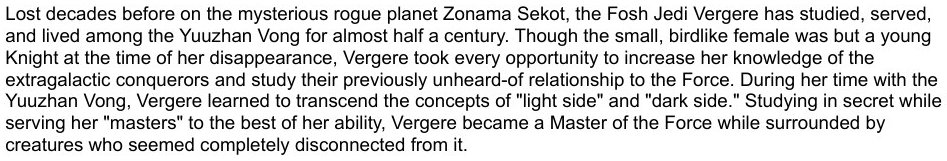
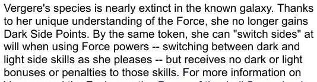
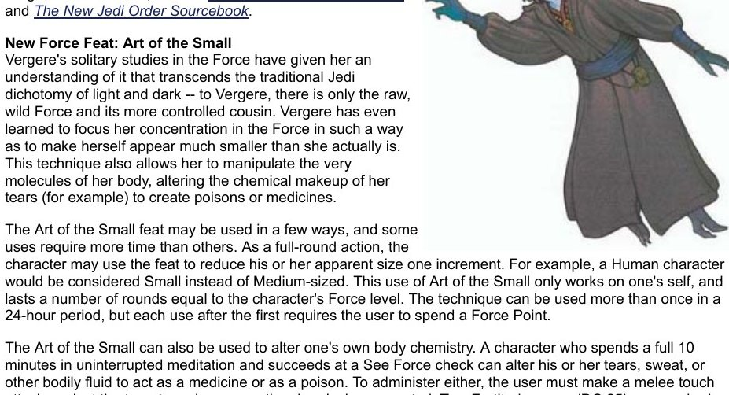
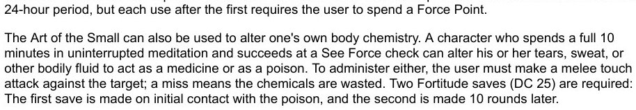

# Owner Material 037 — Star Wars D20 Drive folder (Core, Revised Core and Saga Edition): Characters/Vergere, Master of Mystery.pdf [Star Wars Roleplaying Game Revised Core (d20, 2002)]

- **Source:** Wizards of the Coast Star Wars Roleplaying Game books, web enhancements, Living Force campaign modules and articles (2000–2010), from the owner's "Star Wars D20" Drive folder (only the three edition subfolders; "General" was not read, as instructed). Secondary source (licensed Legends reference). Scan OCR'd on the box; the scan stays box-only and is **not** published.
- **Method:** every scanned page was OCR'd and machine-screened sentence by sentence for power-relevant statements (fights, kills, defeats, Force feats, rankings, superweapons) that name a character on our roster; each kept sentence is quoted verbatim from the OCR text and has a crop of the printed passage directly under it. Pages with nothing power-relevant are still listed with what is on them.
- **Citation:** "*Vergere, Master of Mystery* (SWRPG d20 Revised Core), p.X" by printed page ("scan p.X" where no printed number applies). **Weight:** Licensed RPG material: a secondary source. Narrative text sums up Legends lore; game statistics are rules for players, not canon power levels, and rank lowest.

## scan p.1 (scan page 1)

Page contents: Vergere: Fosh Jedi lost at Zonama Sekot, half a century among the Yuuzhan Vong, transcends light/dark, gains no DSP; feat Art of the Small (table: Curative tears 40-FL, Healing tears 30-FL, Paralysis Poison 35-FL Fort 25); stats (hand-read)

- **Vergere** — entry/section: Vergere among the Yuuzhan Vong: "Lost decades before on the mysterious rogue planet Zonama Sekot, the Fosh Jedi Vergere has studied, served, and lived among the Yuuzhan Vong for almost half a century. Though the small, birdlike female was but a young Knight at the time of her disappearance, Vergere took every opportunity to increase her knowledge of the extragalactic conquerors and study their previously unheard-of relationship to the Force. During her time with the Yuuzhan Vong, Vergere learned to transcend the concepts of "light side" and "dark side." Studying in secret while serving her "masters" to the best of her ability, Vergere became a Master of the Force while surrounded by creatures who seemed completely disconnected from it." Source: *Vergere, Master of Mystery* (SWRPG d20 Revised Core), scan p.1
  
- **Vergere** — entry/section: Vergere and the dark side: "Vergere's species is nearly extinct in the known galaxy. Thanks to her unique understanding of the Force, she no longer gains Dark Side Points. By the same token, she can "switch sides" at will when using Force powers -- switching between dark and light side skills as she pleases -- but receives no dark or light bonuses or penalties to those skills." Source: *Vergere, Master of Mystery* (SWRPG d20 Revised Core), scan p.1
  
- **Vergere** — entry/section: Art of the Small (feat): "New Force Feat: Art of the Small
Vergere's solitary studies in the Force have given her an understanding of it that transcends the traditional Jedi dichotomy of light and dark -- to Vergere, there is only the raw, wild Force and its more controlled cousin. Vergere has even learned to focus her concentration in the Force in such a way as to make herself appear much smaller than she actually is. This technique also allows her to manipulate the very molecules of her body, altering the chemical makeup of her tears (for example) to create poisons or medicines.
The Art of the Small feat may be used in a few ways, and some uses require more time than others. As a full-round action, the character may use the feat to reduce his or her apparent size one increment. For example, a Human character would be considered Small instead of Medium-sized. This use of Art of the Small only works on one's self, and lasts a number of rounds equal to the character's Force level. The technique can be used more than once in a 24-hour period, but each use after the first requires the user to spend a Force Point." Source: *Vergere, Master of Mystery* (SWRPG d20 Revised Core), scan p.1
  
- **Vergere** — entry/section: Art of the Small: body chemistry: "The Art of the Small can also be used to alter one's own body chemistry. A character who spends a full 10 minutes in uninterrupted meditation and succeeds at a See Force check can alter his or her tears, sweat, or other bodily fluid to act as a medicine or as a poison. To administer either, the user must make a melee touch attack against the target; a miss means the chemicals are wasted. Two Fortitude saves (DC 25) are required: The first save is made on initial contact with the poison, and the second is made 10 rounds later." Source: *Vergere, Master of Mystery* (SWRPG d20 Revised Core), scan p.1
  
- **Vergere** — entry/section: Art of the Small: requirements: "Requirements: Alter, Control, Sense, See Force 12 ranks, Force level 12th. Only Vergere and characters who have studied with Vergere may take this feat. At the GM's option, other Force-sensitive members of Vergere's species (and their pupils) may have access to this feat." Source: *Vergere, Master of Mystery* (SWRPG d20 Revised Core), scan p.1
  

### Stat block notes (game mechanics, not feats)

- vergere: Vergere: Female Fosh Jedi Consular 8/Jedi Investigator 5/Jedi Master 6; Defense 25; VP/WP 89/10; SQ contacts (2 Yuuzhan Vong); FP 5; DSP 9; Rep 8; Int 19, Wis 20; Challenge Code G (Source: *Vergere, Master of Mystery* (SWRPG d20 Revised Core), scan p.1)

## scan p.2 (scan page 2)

Page contents: Novel and Databank links (hand-read)

