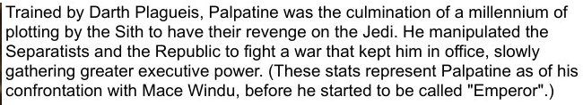
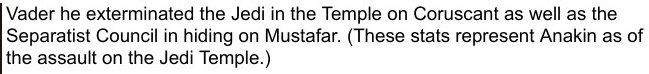
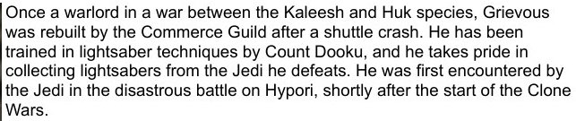
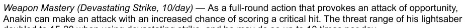
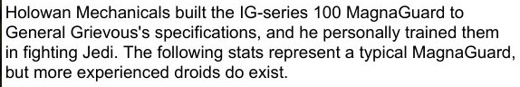
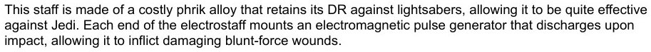

# Owner Material 037 — Star Wars D20 Drive folder (Core, Revised Core and Saga Edition): Characters/Villains of Revenge of the Sith.pdf [Star Wars Roleplaying Game Revised Core (d20, 2002)]

- **Source:** Wizards of the Coast Star Wars Roleplaying Game books, web enhancements, Living Force campaign modules and articles (2000–2010), from the owner's "Star Wars D20" Drive folder (only the three edition subfolders; "General" was not read, as instructed). Secondary source (licensed Legends reference). Scan OCR'd on the box; the scan stays box-only and is **not** published.
- **Method:** every scanned page was OCR'd and machine-screened sentence by sentence for power-relevant statements (fights, kills, defeats, Force feats, rankings, superweapons) that name a character on our roster; each kept sentence is quoted verbatim from the OCR text and has a crop of the printed passage directly under it. Pages with nothing power-relevant are still listed with what is on them.
- **Citation:** "*Villains of Revenge of the Sith* (SWRPG d20 Revised Core), p.X" by printed page ("scan p.X" where no printed number applies). **Weight:** Licensed RPG material: a secondary source. Narrative text sums up Legends lore; game statistics are rules for players, not canon power levels, and rank lowest.

## scan p.1 (scan page 1)

Page contents: Intro and references; Palpatine, Sith Lord (as of confrontation with Mace Windu) stats; Sith warrior enemy bonus; Anakin intro (hand-read)

- **Palpatine (Darth Sidious); Darth Plagueis; Mace Windu** — entry/section: Palpatine, Sith Lord: "Trained by Darth Plagueis, Palpatine was the culmination of a millennium of plotting by the Sith to have their revenge on the Jedi. He manipulated the Separatists and the Republic to fight a war that kept him in office, slowly gathering greater executive power. (These stats represent Palpatine as of his confrontation with Mace Windu, before he started to be called "Emperor".)" Source: *Villains of Revenge of the Sith* (SWRPG d20 Revised Core), scan p.1
  
- **Darth Vader (Anakin Skywalker); Padmé Amidala; Palpatine (Darth Sidious)** — entry/section: Anakin Skywalker, Sith Apprentice (part 1 of 2, continues next page): "This one-time slave boy was the Chosen One, destined to bring balance to the Force in a way the Jedi had never foreseen. Palpatine used Anakin's fear of losing Padmé to lure him to the dark side of the Force, and as Darth" Source: *Villains of Revenge of the Sith* (SWRPG d20 Revised Core), scan p.1
  

### Stat block notes (game mechanics, not feats)

- darth-sidious: Palpatine (Darth Sidious): Male Human noble 3/dark side marauder 3/Sith warrior 4/Sith lord 10; Defense 25 (31 with Master Defense); VP/WP 173/15; Atk +22/+17/+12/+7 melee (6d8+1/17-20, personalized lightsaber); FP 9; DSP 24; Rep +10; Challenge Code I (Source: *Villains of Revenge of the Sith* (SWRPG d20 Revised Core), scan p.1)

## scan p.2 (scan page 2)

Page contents: Anakin (Darth Vader) stats as of Temple assault, Chosen One, Devastating Strike; General Grievous history and stats (from image: Male Kaleesh cyborg hybrid soldier 9/officer 5, Defense 21, DR 7, VP/WP 101/11, FP 3, DSP 11, Rep +5, Str 22 Dex 19, CC G); Power Attack note; equipment (hand-read)

- **Darth Vader (Anakin Skywalker)** — entry/section: Anakin Skywalker, Sith Apprentice (part 2 of 2, continued from previous page): "Vader he exterminated the Jedi in the Temple on Coruscant as well as the Separatist Council in hiding on Mustafar. (These stats represent Anakin as of the assault on the Jedi Temple.)" Source: *Villains of Revenge of the Sith* (SWRPG d20 Revised Core), scan p.2
  
- **General Grievous; Count Dooku** — entry/section: General Grievous, Supreme Commander: "Once a warlord in a war between the Kaleesh and Huk species, Grievous was rebuilt by the Commerce Guild after a shuttle crash. He has been trained in lightsaber techniques by Count Dooku, and he takes pride in collecting lightsabers from the Jedi he defeats. He was first encountered by the Jedi in the disastrous battle on Hypori, shortly after the start of the Clone Wars." Source: *Villains of Revenge of the Sith* (SWRPG d20 Revised Core), scan p.2
  
- **Darth Vader (Anakin Skywalker)** — entry/section: Anakin Skywalker, Sith Apprentice: "Weapon Mastery (Devastating Strike, 10/day) — As a full-round action that provokes an attack of opportunity, Anakin can make an attack with an increased chance of scoring a critical hit." Source: *Villains of Revenge of the Sith* (SWRPG d20 Revised Core), scan p.2
  

### Stat block notes (game mechanics, not feats)

- darth-vader: Anakin Skywalker (Darth Vader): Male Human fringer 1/Jedi guardian 5/Jedi ace 2/Jedi weapon master 3/Sith lord 2; Defense 25; VP/WP 102/13; Chosen One; weapon mastery (Devastating Strike 10/day); FP 8; DSP 13; Rep +5; Challenge Code G (Source: *Villains of Revenge of the Sith* (SWRPG d20 Revised Core), scan p.2)
- general-grievous: General Grievous: Male Kaleesh (cyborg hybrid) soldier 9/officer 5; Init +4; Defense 21; DR 7; Spd 14 m, climb 14 m; VP/WP 101/11; three lightsabers, claw, customized BlasTech DT-57; SV Fort +9, Ref +10, Will +6; FP 3; DSP 11; Rep +5; Str 22, Dex 19, Con 11, Int 15, Wis 10, Cha 14; Challenge Code G (read from page image) (Source: *Villains of Revenge of the Sith* (SWRPG d20 Revised Core), scan p.2)

## scan p.3 (scan page 3)

Page contents: Grievous feats; MagnaGuard bodyguard droid (Holowan Mechanicals) stats and loyal protector features; DT-57 Annihilator stats (hand-read)

- **General Grievous** — entry/section: MagnaGuards: "Holowan Mechanicals built the |G-series 100 MagnaGuard to General Grievous's specifications, and he personally trained them in fighting Jedi. The following stats represent a typical MagnaGuard, but more experienced droids do exist." Source: *Villains of Revenge of the Sith* (SWRPG d20 Revised Core), scan p.3
  

### Stat block notes (game mechanics, not feats)

- magnaguard (generic): IG-series 100 MagnaGuard: Walking bodyguard droid, scout 1/soldier 4/loyal protector 3; Defense 18; DR 3; VP/WP 59/15; electrostaff; Challenge Code D (Source: *Villains of Revenge of the Sith* (SWRPG d20 Revised Core), scan p.3)

## scan p.4 (scan page 4)

Page contents: DT-57 description; electrostaff (phrik alloy); cyborg hybrid cybernetic enhancement; adjoining limbs (hand-read)

- **No single roster character (rules/setting/general)** — entry/section: Electrostaff: "This staff is made of a costly phrik alloy that retains its DR against lightsabers, allowing it to be quite effective against Jedi. Each end of the electrostaff mounts an electromagnetic pulse generator that discharges upon impact, allowing it to inflict damaging blunt-force wounds." Source: *Villains of Revenge of the Sith* (SWRPG d20 Revised Core), scan p.4
  

## scan p.5 (scan page 5)

Page contents: Climbing claws, grappling claw, jump servos; About the Author (hand-read)

