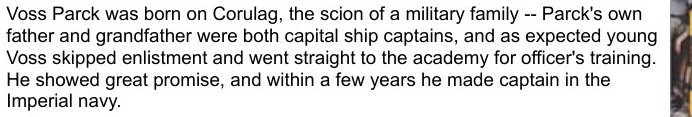
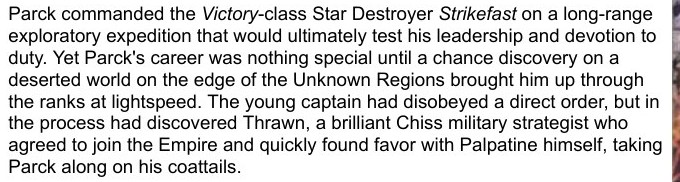
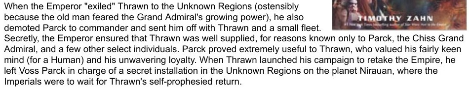
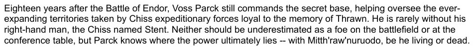

# Owner Material 037 — Star Wars D20 Drive folder (Core, Revised Core and Saga Edition): Characters/Voss Parck.pdf [Star Wars Roleplaying Game Revised Core (d20, 2002)]

- **Source:** Wizards of the Coast Star Wars Roleplaying Game books, web enhancements, Living Force campaign modules and articles (2000–2010), from the owner's "Star Wars D20" Drive folder (only the three edition subfolders; "General" was not read, as instructed). Secondary source (licensed Legends reference). Scan OCR'd on the box; the scan stays box-only and is **not** published.
- **Method:** every scanned page was OCR'd and machine-screened sentence by sentence for power-relevant statements (fights, kills, defeats, Force feats, rankings, superweapons) that name a character on our roster; each kept sentence is quoted verbatim from the OCR text and has a crop of the printed passage directly under it. Pages with nothing power-relevant are still listed with what is on them.
- **Citation:** "*Voss Parck* (SWRPG d20 Revised Core), p.X" by printed page ("scan p.X" where no printed number applies). **Weight:** Licensed RPG material: a secondary source. Narrative text sums up Legends lore; game statistics are rules for players, not canon power levels, and rank lowest.

## scan p.1 (scan page 1)

Page contents: Voss Parck: Corulag military family, captain of Strikefast, discovers Thrawn, exiled with him, commands Nirauan base, aide Stent; stats circa Survivor's Quest (hand-read)

- **Voss Parck** — entry/section: Voss Parck's origins: "Voss Parck was born on Corulag, the scion of a military family -- Parck's own father and grandfather were both capital ship captains, and as expected young Fy Voss skipped enlistment and went straight to the academy for officer's training. He showed great promise, and within a few years he made captain in the Imperial navy." Source: *Voss Parck* (SWRPG d20 Revised Core), scan p.1
  
- **Voss Parck; Grand Admiral Thrawn; Palpatine (Darth Sidious)** — entry/section: Voss Parck discovers Thrawn: "Parck commanded the Victory-class Star Destroyer Strikefast on a long-range exploratory expedition that would ultimately test his leadership and devotion to duty. Yet Parck's career was nothing special until a chance discovery on a deserted world on the edge of the Unknown Regions brought him up through the ranks at lightspeed. The young captain had disobeyed a direct order, but in the process had discovered Thrawn, a brilliant Chiss military strategist who agreed to join the Empire and quickly found favor with Palpatine himself, taking Parck along on his coattails." Source: *Voss Parck* (SWRPG d20 Revised Core), scan p.1
  
- **Voss Parck; Grand Admiral Thrawn; Palpatine (Darth Sidious)** — entry/section: Voss Parck and Thrawn's exile: "When the Emperor "exiled" Thrawn to the Unknown Regions (ostensibly because the old man feared the Grand Admiral's growing power), he also demoted Parck to commander and sent him off with Thrawn and a small fleet. Secretly, the Emperor ensured that Thrawn was well supplied, for reasons known only to Parck, the Chiss Grand Admiral, and a few other select individuals. Parck proved extremely useful to Thrawn, who valued his fairly keen mind (for a Human) and his unwavering loyalty. When Thrawn launched his campaign to retake the Empire, he left Voss Parck in charge of a secret installation in the Unknown Regions on the planet Nirauan, where the Imperials were to wait for Thrawn's self-prophesied return." Source: *Voss Parck* (SWRPG d20 Revised Core), scan p.1
  
- **Voss Parck; Grand Admiral Thrawn; Stent** — entry/section: Voss Parck at Nirauan: "Eighteen years after the Battle of Endor, Voss Parck still commands the secret base, helping oversee the ever-expanding territories taken by Chiss expeditionary forces loyal to the memory of Thrawn. He is rarely without his right-hand man, the Chiss named Stent. Neither should be underestimated as a foe on the battlefield or at the conference table, but Parck knows where the power ultimately lies -- with Mitth'raw'nuruodo, be he living or dead." Source: *Voss Parck* (SWRPG d20 Revised Core), scan p.1
  

### Stat block notes (game mechanics, not feats)

- voss-parck: Voss Parck (circa Survivor's Quest): Male Human Noble 6/Officer 10; Init +5; Defense 20; VP/WP 85/12; charric; FP 4; DSP 8; Rep +12; Challenge Code G (Source: *Voss Parck* (SWRPG d20 Revised Core), scan p.1)
