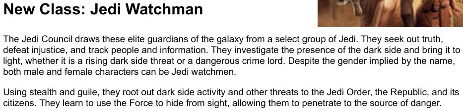
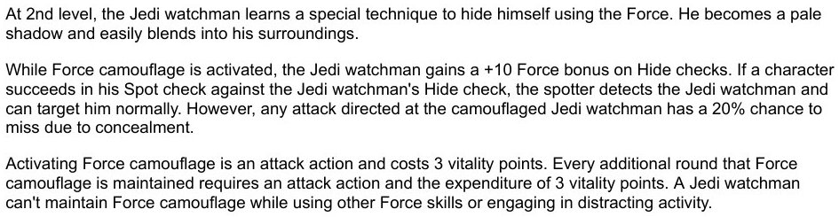
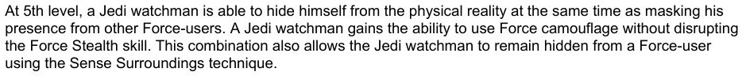
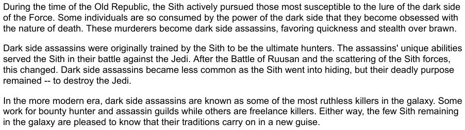
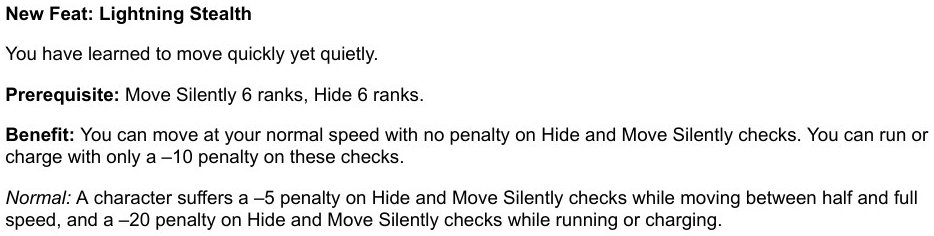
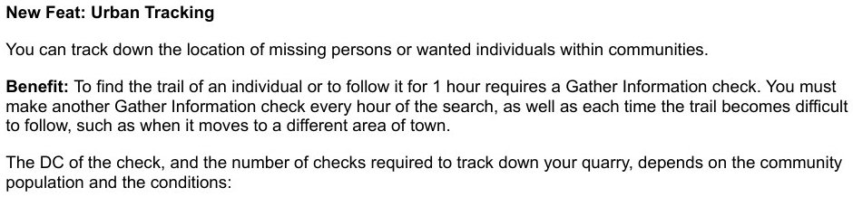
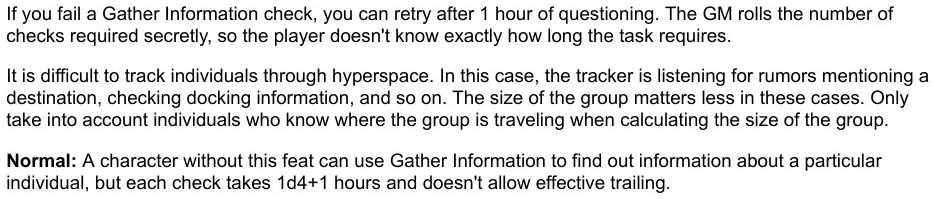

# Owner Material 037 — Star Wars D20 Drive folder (Core, Revised Core and Saga Edition): Classes/Classes of the Old Republic.pdf [Star Wars Roleplaying Game Revised Core (d20, 2002)]

- **Source:** Wizards of the Coast Star Wars Roleplaying Game books, web enhancements, Living Force campaign modules and articles (2000–2010), from the owner's "Star Wars D20" Drive folder (only the three edition subfolders; "General" was not read, as instructed). Secondary source (licensed Legends reference). Scan OCR'd on the box; the scan stays box-only and is **not** published.
- **Method:** every scanned page was OCR'd and machine-screened sentence by sentence for power-relevant statements (fights, kills, defeats, Force feats, rankings, superweapons) that name a character on our roster; each kept sentence is quoted verbatim from the OCR text and has a crop of the printed passage directly under it. Pages with nothing power-relevant are still listed with what is on them.
- **Citation:** "*Classes of the Old Republic* (SWRPG d20 Revised Core), p.X" by printed page ("scan p.X" where no printed number applies). **Weight:** Licensed RPG material: a secondary source. Narrative text sums up Legends lore; game statistics are rules for players, not canon power levels, and rank lowest.

## scan p.1 (scan page 1)

Page contents: KotOR/KotOR2 intro; Jedi Watchman: description, requirements, class skills (hand-read)

- **No single roster character (rules/setting/general)** — entry/section: Jedi Watchman: "The Jedi Council draws these elite guardians of the galaxy from a select group of Jedi. They seek out truth, defeat injustice, and track people and information. They investigate the presence of the dark side and bring it to light, whether it is a rising dark side threat or a dangerous crime lord. Despite the gender implied by the name, both male and female characters can be Jedi watchmen.
Using stealth and guile, they root out dark side activity and other threats to the Jedi Order, the Republic, and its citizens. They learn to use the Force to hide from sight, allowing them to penetrate to the source of danger." Source: *Classes of the Old Republic* (SWRPG d20 Revised Core), scan p.1
  

## scan p.2 (scan page 2)

Page contents: Jedi Watchman features (danger sense, bonus feat, Force camouflage, increase lightsaber damage, subtle camouflage) and table; Dark Side Assassin history (Ruusan) and requirements (hand-read)

- **No single roster character (rules/setting/general)** — entry/section: Jedi Watchman: Force Camouflage: "At 2nd level, the Jedi watchman learns a special technique to hide himself using the Force. He becomes a pale shadow and easily blends into his surroundings.
While Force camouflage is activated, the Jedi watchman gains a +10 Force bonus on Hide checks. If a character succeeds in his Spot check against the Jedi watchman's Hide check, the spotter detects the Jedi watchman and can target him normally. However, any attack directed at the camouflaged Jedi watchman has a 20% chance to miss due to concealment.
Activating Force camouflage is an attack action and costs 3 vitality points. Every additional round that Force camouflage is maintained requires an attack action and the expenditure of 3 vitality points. A Jedi watchman can't maintain Force camouflage while using other Force skills or engaging in distracting activity." Source: *Classes of the Old Republic* (SWRPG d20 Revised Core), scan p.2
  
- **No single roster character (rules/setting/general)** — entry/section: Jedi Watchman: Subtle Camouflage: "At 5th level, a Jedi watchman is able to hide himself from the physical reality at the same time as masking his presence from other Force-users. A Jedi watchman gains the ability to use Force camouflage without disrupting the Force Stealth skill. This combination also allows the Jedi watchman to remain hidden from a Force-user using the Sense Surroundings technique." Source: *Classes of the Old Republic* (SWRPG d20 Revised Core), scan p.2
  
- **No single roster character (rules/setting/general)** — entry/section: Dark side assassins: "During the time of the Old Republic, the Sith actively pursued those most susceptible to the lure of the dark side of the Force. Some individuals are so consumed by the power of the dark side that they become obsessed with the nature of death. These murderers become dark side assassins, favoring quickness and stealth over brawn.
Dark side assassins were originally trained by the Sith to be the ultimate hunters. The assassins’ unique abilities served the Sith in their battle against the Jedi. After the Battle of Ruusan and the scattering of the Sith forces, this changed. Dark side assassins became less common as the Sith went into hiding, but their deadly purpose remained -- to destroy the Jedi.
In the more modern era, dark side assassins are known as some of the most ruthless killers in the galaxy. Some work for bounty hunter and assassin guilds while others are freelance killers. Either way, the few Sith remaining in the galaxy are pleased to know that their traditions carry on in a new guise." Source: *Classes of the Old Republic* (SWRPG d20 Revised Core), scan p.2
  

## scan p.3 (scan page 3)

Page contents: Dark Side Assassin requirements, skills, features (starting feat, Force training, signature weapon, sneak attack, Force camouflage, uncanny dodge) (hand-read)

## scan p.4 (scan page 4)

Page contents: Signature weapon (damage); Dark Side Assassin table; feats Lightning Stealth and Urban Tracking with DC tables (hand-read)

- **No single roster character (rules/setting/general)** — entry/section: Lightning Stealth (feat): "New Feat: Lightning Stealth You have learned to move quickly yet quietly. Prerequisite: Move Silently 6 ranks, Hide 6 ranks.
Benefit: You can move at your normal speed with no penalty on Hide and Move Silently checks. You can run or charge with only a -10 penalty on these checks.
Normal: A character suffers a -5 penalty on Hide and Move Silently checks while moving between half and full speed, and a -20 penalty on Hide and Move Silently checks while running or charging." Source: *Classes of the Old Republic* (SWRPG d20 Revised Core), scan p.4
  
- **No single roster character (rules/setting/general)** — entry/section: Urban Tracking (feat) (part 1 of 2, continues next page): "New Feat: Urban Tracking
You can track down the location of missing persons or wanted individuals within communities.
Benefit: To find the trail of an individual or to follow it for 1 hour requires a Gather Information check. You must make another Gather Information check every hour of the search, as well as each time the trail becomes difficult
to follow, such as when it moves to a different area of town.
The DC of the check, and the number of checks required to track down your quarry, depends on the community population and the conditions:" Source: *Classes of the Old Republic* (SWRPG d20 Revised Core), scan p.4
  

## scan p.5 (scan page 5)

Page contents: Urban Tracking continued (hyperspace +10, retries, Normal) (hand-read)

- **No single roster character (rules/setting/general)** — entry/section: Urban Tracking (feat) (part 2 of 2, continued from previous page): "If you fail a Gather Information check, you can retry after 1 hour of questioning. The GM rolls the number of checks required secretly, so the player doesn't know exactly how long the task requires.
It is difficult to track individuals through hyperspace. In this case, the tracker is listening for rumors mentioning a destination, checking docking information, and so on. The size of the group matters less in these cases. Only take into account individuals who know where the group is traveling when calculating the size of the group.
Normal: A character without this feat can use Gather Information to find out information about a particular individual, but each check takes 1d4+1 hours and doesn't allow effective trailing." Source: *Classes of the Old Republic* (SWRPG d20 Revised Core), scan p.5
  
