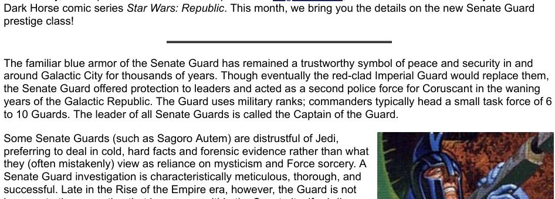
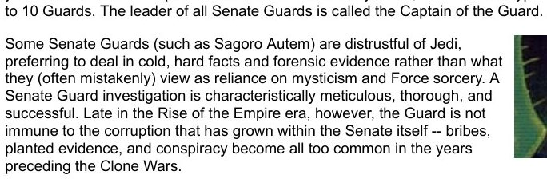
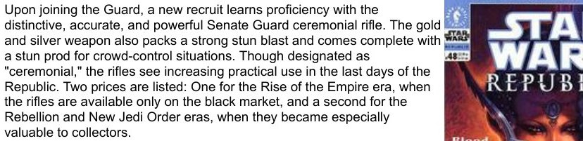

# Owner Material 037 — Star Wars D20 Drive folder (Core, Revised Core and Saga Edition): Classes/Senate Guard.pdf [Star Wars Roleplaying Game Revised Core (d20, 2002)]

- **Source:** Wizards of the Coast Star Wars Roleplaying Game books, web enhancements, Living Force campaign modules and articles (2000–2010), from the owner's "Star Wars D20" Drive folder (only the three edition subfolders; "General" was not read, as instructed). Secondary source (licensed Legends reference). Scan OCR'd on the box; the scan stays box-only and is **not** published.
- **Method:** every scanned page was OCR'd and machine-screened sentence by sentence for power-relevant statements (fights, kills, defeats, Force feats, rankings, superweapons) that name a character on our roster; each kept sentence is quoted verbatim from the OCR text and has a crop of the printed passage directly under it. Pages with nothing power-relevant are still listed with what is on them.
- **Citation:** "*Senate Guard* (SWRPG d20 Revised Core), p.X" by printed page ("scan p.X" where no printed number applies). **Weight:** Licensed RPG material: a secondary source. Narrative text sums up Legends lore; game statistics are rules for players, not canon power levels, and rank lowest.

## scan p.1 (scan page 1)

Page contents: Senate Guard: blue armor, Captain of the Guard, distrust of Jedi, corruption before Clone Wars; requirements; table; class skills (hand-read)

- **No single roster character (rules/setting/general)** — entry/section: The Senate Guard: "The familiar blue armor of the Senate Guard has remained a trustworthy symbol of peace and security in and around Galactic City for thousands of years. Though eventually the red-clad Imperial Guard would replace them, the Senate Guard offered protection to leaders and acted as a second police force for Coruscant in the waning years of the Galactic Republic. The Guard uses military ranks; commanders typically head a small task force of 6 to 10 Guards. The leader of all Senate Guards is called the Captain of the Guard." Source: *Senate Guard* (SWRPG d20 Revised Core), scan p.1
  
- **Sagoro Autem** — entry/section: Senate Guards and the Jedi: "Some Senate Guards (such as Sagoro Autem) are distrustful of Jedi, preferring to deal in cold, hard facts and forensic evidence rather than what they (often mistakenly) view as reliance on mysticism and Force sorcery. A Senate Guard investigation is characteristically meticulous, thorough, and successful. Late in the Rise of the Empire era, however, the Guard is not immune to the corruption that has grown within the Senate itself -- bribes, planted evidence, and conspiracy become all too common in the years preceding the Clone Wars." Source: *Senate Guard* (SWRPG d20 Revised Core), scan p.1
  

## scan p.2 (scan page 2)

Page contents: Class features (Charge bonus +1/+2/+3); ceremonial blaster rifle stats and description; Sagoro Autem/Honor and Duty links (hand-read)

- **No single roster character (rules/setting/general)** — entry/section: Senate Guard ceremonial rifle: "Upon joining the Guard, a new recruit learns proficiency with the
distinctive, accurate, and powerful Senate Guard ceremonial rifle. The gold and silver weapon also packs a strong stun blast and comes complete with a stun prod for crowd-control situations. Though designated as "ceremonial," the rifles see increasing practical use in the last days of the Republic. Two prices are listed: One for the Rise of the Empire era, when the rifles are available only on the black market, and a second for the Rebellion and New Jedi Order eras, when they became especially valuable to collectors." Source: *Senate Guard* (SWRPG d20 Revised Core), scan p.2
  
