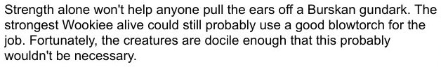
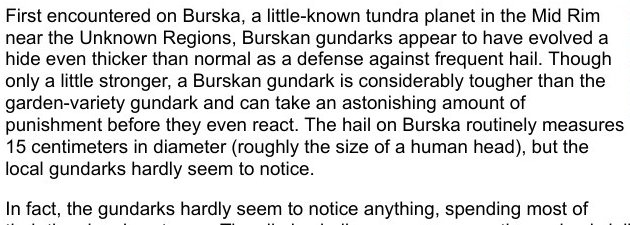

# Owner Material 037 — Star Wars D20 Drive folder (Core, Revised Core and Saga Edition): Creatures/Burskan Gundark.pdf [Star Wars Roleplaying Game Revised Core (d20, 2002)]

- **Source:** Wizards of the Coast Star Wars Roleplaying Game books, web enhancements, Living Force campaign modules and articles (2000–2010), from the owner's "Star Wars D20" Drive folder (only the three edition subfolders; "General" was not read, as instructed). Secondary source (licensed Legends reference). Scan OCR'd on the box; the scan stays box-only and is **not** published.
- **Method:** every scanned page was OCR'd and machine-screened sentence by sentence for power-relevant statements (fights, kills, defeats, Force feats, rankings, superweapons) that name a character on our roster; each kept sentence is quoted verbatim from the OCR text and has a crop of the printed passage directly under it. Pages with nothing power-relevant are still listed with what is on them.
- **Citation:** "*Burskan Gundark* (SWRPG d20 Revised Core), p.X" by printed page ("scan p.X" where no printed number applies). **Weight:** Licensed RPG material: a secondary source. Narrative text sums up Legends lore; game statistics are rules for players, not canon power levels, and rank lowest.

## scan p.1 (scan page 1)

Page contents: Burskan gundark: thick hide vs hail on Burska, lazy torpor, discovered late Republic (geologist lost), protected zone, unprofitable to exploit, quirks (hand-read)

- **No single roster character (rules/setting/general)** — entry/section: Burskan gundark: "Strength alone won't help anyone pull the ears off a Burskan gundark. The strongest Wookiee alive could still probably use a good blowtorch for the job. Fortunately, the creatures are docile enough that this probably wouldn't be necessary." Source: *Burskan Gundark* (SWRPG d20 Revised Core), scan p.1
  
- **No single roster character (rules/setting/general)** — entry/section: Burskan gundark toughness: "First encountered on Burska, a little-known tundra planet in the Mid Rim near the Unknown Regions, Burskan gundarks appear to have evolved a hide even thicker than normal as a defense against frequent hail. Though only a little stronger, a Burskan gundark is considerably tougher than the garden-variety gundark and can take an astonishing amount of punishment before they even react. The hail on Burska routinely measures 15 centimeters in diameter (roughly the size of a human head), but the local gundarks hardly seem to notice." Source: *Burskan Gundark* (SWRPG d20 Revised Core), scan p.1
  

## scan p.2 (scan page 2)

Page contents: Biology, species traits (constrict, fearlessness), stats (CC F), hooks: Bring 'Em Back Alive (Dreskin Foundation, Natural Planetary Protectorate), Call Him George, Rescue Work (hand-read)

### Stat block notes (game mechanics, not feats)

- burskan gundark (generic): Burskan Gundark: Medium-size arctic predator 7; Defense 23; DR 10; VP/WP 66/20; 4 punches 1d6+7, bite; Str 25; Challenge Code F (Source: *Burskan Gundark* (SWRPG d20 Revised Core), scan p.2)

## scan p.3 (scan page 3)

Page contents: Planet Hoppers (Aargau) and Jedi Counseling links (hand-read)

