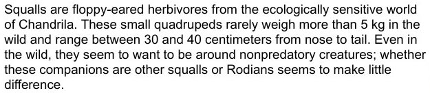

# Owner Material 037 — Star Wars D20 Drive folder (Core, Revised Core and Saga Edition): Creatures/Domesticated Squall.pdf [Star Wars Roleplaying Game Revised Core (d20, 2002)]

- **Source:** Wizards of the Coast Star Wars Roleplaying Game books, web enhancements, Living Force campaign modules and articles (2000–2010), from the owner's "Star Wars D20" Drive folder (only the three edition subfolders; "General" was not read, as instructed). Secondary source (licensed Legends reference). Scan OCR'd on the box; the scan stays box-only and is **not** published.
- **Method:** every scanned page was OCR'd and machine-screened sentence by sentence for power-relevant statements (fights, kills, defeats, Force feats, rankings, superweapons) that name a character on our roster; each kept sentence is quoted verbatim from the OCR text and has a crop of the printed passage directly under it. Pages with nothing power-relevant are still listed with what is on them.
- **Citation:** "*Domesticated Squall* (SWRPG d20 Revised Core), p.X" by printed page ("scan p.X" where no printed number applies). **Weight:** Licensed RPG material: a secondary source. Narrative text sums up Legends lore; game statistics are rules for players, not canon power levels, and rank lowest.

## scan p.1 (scan page 1)

Page contents: Squalls: cute Chandrilan herbivores, squall maintenance budget, accidental smuggling, breeding, pets and abandonment (hand-read)

- **No single roster character (rules/setting/general)** — entry/section: Squalls: "Squalls are floppy-eared herbivores from the ecologically sensitive world of Chandrila. These small quadrupeds rarely weigh more than 5 kg in the wild and range between 30 and 40 centimeters from nose to tail. Even in the wild, they seem to want to be around nonpredatory creatures; whether these companions are other squalls or Rodians seems to make little difference." Source: *Domesticated Squall* (SWRPG d20 Revised Core), scan p.1
  

## scan p.2 (scan page 2)

Page contents: Squall meat trade, Positive Ecology seal, protestors; Pet Squall stats (CC A); hooks Food Poisoning, Little Lost Squall, Crackdown (hand-read)

### Stat block notes (game mechanics, not feats)

- pet squall (generic): Pet Squall: Domesticated herd animal 2; Defense 16; VP/WP 3/5; SZ T; SQ docile; Challenge Code A (Source: *Domesticated Squall* (SWRPG d20 Revised Core), scan p.2)
