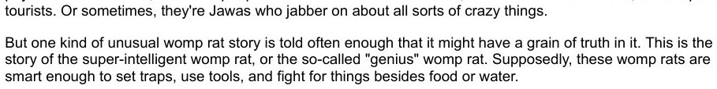
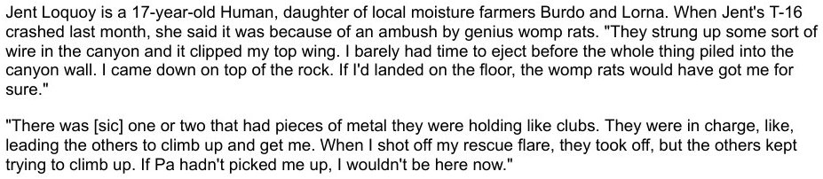
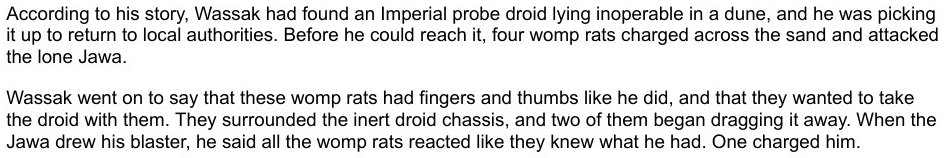

# Owner Material 037 — Star Wars D20 Drive folder (Core, Revised Core and Saga Edition): Creatures/Genius Womp Rat.pdf [Star Wars Roleplaying Game Revised Core (d20, 2002)]

- **Source:** Wizards of the Coast Star Wars Roleplaying Game books, web enhancements, Living Force campaign modules and articles (2000–2010), from the owner's "Star Wars D20" Drive folder (only the three edition subfolders; "General" was not read, as instructed). Secondary source (licensed Legends reference). Scan OCR'd on the box; the scan stays box-only and is **not** published.
- **Method:** every scanned page was OCR'd and machine-screened sentence by sentence for power-relevant statements (fights, kills, defeats, Force feats, rankings, superweapons) that name a character on our roster; each kept sentence is quoted verbatim from the OCR text and has a crop of the printed passage directly under it. Pages with nothing power-relevant are still listed with what is on them.
- **Citation:** "*Genius Womp Rat* (SWRPG d20 Revised Core), p.X" by printed page ("scan p.X" where no printed number applies). **Weight:** Licensed RPG material: a secondary source. Narrative text sums up Legends lore; game statistics are rules for players, not canon power levels, and rank lowest.

## scan p.1 (scan page 1)

Page contents: Womp rats on Tatooine, genius womp rat rumors; Jent Loquoy's T-16 ambush; Jawa Wassak and the probe droid (hand-read)

- **No single roster character (rules/setting/general)** — entry/section: Genius womp rats: "But one kind of unusual womp rat story is told often enough that it might have a grain of truth in it. This is the story of the super-intelligent womp rat, or the so-called "genius" womp rat. Supposedly, these womp rats are smart enough to set traps, use tools, and fight for things besides food or water." Source: *Genius Womp Rat* (SWRPG d20 Revised Core), scan p.1
  
- **Jent Loquoy** — entry/section: Jent Loquoy's genius womp rat ambush: "Jent Loquoy is a 17-year-old Human, daughter of local moisture farmers Burdo and Lorna. When Jent's T-16 crashed last month, she said it was because of an ambush by genius womp rats. "They strung up some sort of wire in the canyon and it clipped my top wing. I barely had time to eject before the whole thing piled into the canyon wall. I came down on top of the rock. If I'd landed on the floor, the womp rats would have got me for sure." "There was [sic] one or two that had pieces of metal they were holding like clubs. They were in charge, like, leading the others to climb up and get me. When I shot off my rescue flare, they took off, but the others kept trying to climb up. If Pa hadn't picked me up, I wouldn't be here now."" Source: *Genius Womp Rat* (SWRPG d20 Revised Core), scan p.1
  
- **Wassak** — entry/section: Wassak and the womp rats: "According to his story, Wassak had found an Imperial probe droid lying inoperable in a dune, and he was picking it up to return to local authorities. Before he could reach it, four womp rats charged across the sand and attacked the lone Jawa.
Wassak went on to say that these womp rats had fingers and thumbs like he did, and that they wanted to take the droid with them. They surrounded the inert droid chassis, and two of them began dragging it away. When the Jawa drew his blaster, he said all the womp rats reacted like they knew what he had. One charged him." Source: *Genius Womp Rat* (SWRPG d20 Revised Core), scan p.1
  

## scan p.2 (scan page 2)

Page contents: Wassak story end; conclusions (hands, curiosity about technology, malfunctioning evaporators); stats; GM options (Mon Calamari scientist for the Hutts, hermit trainer, only one, hoax) (hand-read)

### Stat block notes (game mechanics, not feats)

- highly evolved womp rat (generic): Highly Evolved Womp Rat: Desert predator 1/fringer 1; Defense 18; VP/WP 8/19; SQ manipulative digits; Int 7; Challenge Code B (Source: *Genius Womp Rat* (SWRPG d20 Revised Core), scan p.2)

## scan p.3 (scan page 3)

Page contents: Copyright only (hand-read)

