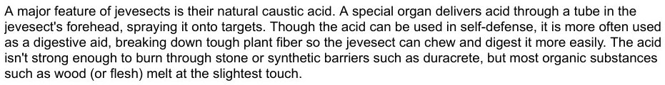

# Owner Material 037 — Star Wars D20 Drive folder (Core, Revised Core and Saga Edition): Creatures/Jevesect.pdf [Star Wars Roleplaying Game Revised Core (d20, 2002)]

- **Source:** Wizards of the Coast Star Wars Roleplaying Game books, web enhancements, Living Force campaign modules and articles (2000–2010), from the owner's "Star Wars D20" Drive folder (only the three edition subfolders; "General" was not read, as instructed). Secondary source (licensed Legends reference). Scan OCR'd on the box; the scan stays box-only and is **not** published.
- **Method:** every scanned page was OCR'd and machine-screened sentence by sentence for power-relevant statements (fights, kills, defeats, Force feats, rankings, superweapons) that name a character on our roster; each kept sentence is quoted verbatim from the OCR text and has a crop of the printed passage directly under it. Pages with nothing power-relevant are still listed with what is on them.
- **Citation:** "*Jevesect* (SWRPG d20 Revised Core), p.X" by printed page ("scan p.X" where no printed number applies). **Weight:** Licensed RPG material: a secondary source. Narrative text sums up Legends lore; game statistics are rules for players, not canon power levels, and rank lowest.

## scan p.1 (scan page 1)

Page contents: Herzob, jevesect swarms, physiology (acid tube, cartilage soup), behavior (heat-seeking) (hand-read)

- **No single roster character (rules/setting/general)** — entry/section: Jevesect acid: "A major feature of jevesects is their natural caustic acid. A special organ delivers acid through a tube in the jevesect's forehead, spraying it onto targets. Though the acid can be used in self-defense, it is more often used as a digestive aid, breaking down tough plant fiber so the jevesect can chew and digest it more easily. The acid isn't strong enough to burn through stone or synthetic barriers such as duracrete, but most organic substances such as wood (or flesh) melt at the slightest touch." Source: *Jevesect* (SWRPG d20 Revised Core), scan p.1
  

## scan p.2 (scan page 2)

Page contents: Exterminators and LD-8 droids; species traits; stats (CC B); hooks Bughunt, Live It Up, Pesticide (hand-read)

### Stat block notes (game mechanics, not feats)

- jevesect (generic): Jevesect: Medium-size vermin 3; Defense 16; VP/WP 10/13; bite 1d8, acid 1d6; Challenge Code B (Source: *Jevesect* (SWRPG d20 Revised Core), scan p.2)

## scan p.3 (scan page 3)

Page contents: Pesticide hook end; Planet Hoppers (Carida) link (hand-read)

