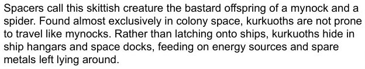
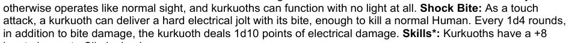

# Owner Material 037 — Star Wars D20 Drive folder (Core, Revised Core and Saga Edition): Creatures/Kurkuoth.pdf [Star Wars Roleplaying Game Revised Core (d20, 2002)]

- **Source:** Wizards of the Coast Star Wars Roleplaying Game books, web enhancements, Living Force campaign modules and articles (2000–2010), from the owner's "Star Wars D20" Drive folder (only the three edition subfolders; "General" was not read, as instructed). Secondary source (licensed Legends reference). Scan OCR'd on the box; the scan stays box-only and is **not** published.
- **Method:** every scanned page was OCR'd and machine-screened sentence by sentence for power-relevant statements (fights, kills, defeats, Force feats, rankings, superweapons) that name a character on our roster; each kept sentence is quoted verbatim from the OCR text and has a crop of the printed passage directly under it. Pages with nothing power-relevant are still listed with what is on them.
- **Citation:** "*Kurkuoth* (SWRPG d20 Revised Core), p.X" by printed page ("scan p.X" where no printed number applies). **Weight:** Licensed RPG material: a secondary source. Narrative text sums up Legends lore; game statistics are rules for players, not canon power levels, and rank lowest.

## scan p.1 (scan page 1)

Page contents: Kurkuoths: mynock-spider scavengers in colony space, body plan, asexual broods, power-line feeding, nests, scrap metal (hand-read)

- **No single roster character (rules/setting/general)** — entry/section: Kurkuoths: "Spacers call this skittish creature the bastard offspring of a mynock and a spider. Found almost exclusively in colony space, kurkuoths are not prone to travel like mynocks. Rather than latching onto ships, kurkuoths hide in ship hangars and space docks, feeding on energy sources and spare metals left lying around." Source: *Kurkuoth* (SWRPG d20 Revised Core), scan p.1
  

## scan p.2 (scan page 2)

Page contents: Extermination, spread (Sullust), traits (shock bite), stats (CC B), GM locations (hand-read)

- **No single roster character (rules/setting/general)** — entry/section: Kurkuoth shock bite: "Shock Bite: As a touch attack, a kurkuoth can deliver a hard electrical jolt with its bite, enough to kill a normal Human. Every 1d4 rounds, in addition to bite damage, the kurkuoth deals 1d10 points of electrical damage." Source: *Kurkuoth* (SWRPG d20 Revised Core), scan p.2
  

### Stat block notes (game mechanics, not feats)

- kurkuoth (generic): Kurkuoth: Tiny vacuum scavenger 3; Defense 17; VP/WP 11/7; shock bite 1d6+1d10; Challenge Code B (Source: *Kurkuoth* (SWRPG d20 Revised Core), scan p.2)
