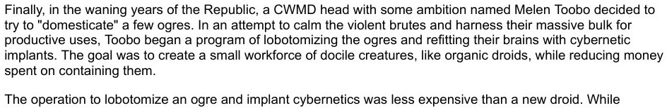
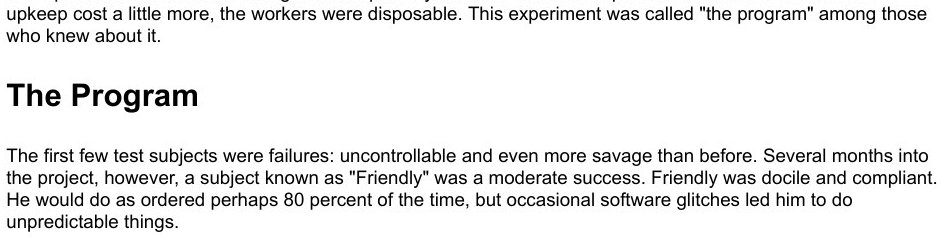
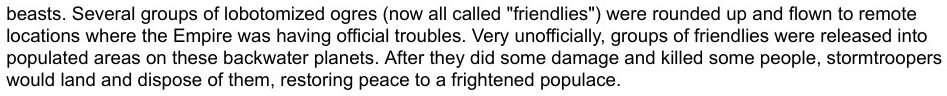

# Owner Material 037 — Star Wars D20 Drive folder (Core, Revised Core and Saga Edition): Creatures/Lobotomized Ogre.pdf [Star Wars Roleplaying Game Revised Core (d20, 2002)]

- **Source:** Wizards of the Coast Star Wars Roleplaying Game books, web enhancements, Living Force campaign modules and articles (2000–2010), from the owner's "Star Wars D20" Drive folder (only the three edition subfolders; "General" was not read, as instructed). Secondary source (licensed Legends reference). Scan OCR'd on the box; the scan stays box-only and is **not** published.
- **Method:** every scanned page was OCR'd and machine-screened sentence by sentence for power-relevant statements (fights, kills, defeats, Force feats, rankings, superweapons) that name a character on our roster; each kept sentence is quoted verbatim from the OCR text and has a crop of the printed passage directly under it. Pages with nothing power-relevant are still listed with what is on them.
- **Citation:** "*Lobotomized Ogre* (SWRPG d20 Revised Core), p.X" by printed page ("scan p.X" where no printed number applies). **Weight:** Licensed RPG material: a secondary source. Narrative text sums up Legends lore; game statistics are rules for players, not canon power levels, and rank lowest.

## scan p.1 (scan page 1)

Page contents: CWMD, Melen Toobo's program, Friendly the semi-successful ogre, failure, Imperial audit and military interest (hand-read)

- **Melen Toobo** — entry/section: Melen Toobo's program: "Finally, in the waning years of the Republic, a CWMD head with some ambition named Melen Toobo decided to try to "domesticate" a few ogres. In an attempt to calm the violent brutes and harness their massive bulk for productive uses, Toobo began a program of lobotomizing the ogres and refitting their brains with cybernetic implants. The goal was to create a small workforce of docile creatures, like organic droids, while reducing money spent on containing them." Source: *Lobotomized Ogre* (SWRPG d20 Revised Core), scan p.1
  
- **No single roster character (rules/setting/general)** — entry/section: Friendly: "The first few test subjects were failures: uncontrollable and even more savage than before. Several months into the project, however, a subject known as "Friendly" was a moderate success. Friendly was docile and compliant. He would do as ordered perhaps 80 percent of the time, but occasional software glitches led him to do unpredictable things." Source: *Lobotomized Ogre* (SWRPG d20 Revised Core), scan p.1
  

## scan p.2 (scan page 2)

Page contents: Friendlies released on backwater worlds then 'rescued' by stormtroopers; New Republic neglect; Vong-era Coruscant; traits; stats; Escapees hook (hand-read)

- **No single roster character (rules/setting/general)** — entry/section: The Empire's friendlies: "beasts. Several groups of lobotomized ogres (now all called "friendlies") were rounded up and flown to remote locations where the Empire was having official troubles. Very unofficially, groups of friendlies were released into populated areas on these backwater planets. After they did some damage and killed some people, stormtroopers would land and dispose of them, restoring peace to a frightened populace." Source: *Lobotomized Ogre* (SWRPG d20 Revised Core), scan p.2
  

### Stat block notes (game mechanics, not feats)

- lobotomized Coruscani ogre (generic): Lobotomized Coruscani Ogre: Large maddened subterranean scavenger 5; Defense 14; VP/WP 44/14; giant club 2d8+7; Str 24; Challenge Code D (Source: *Lobotomized Ogre* (SWRPG d20 Revised Core), scan p.2)

## scan p.3 (scan page 3)

Page contents: Hooks Follow the Trail, Wrong Place Wrong Time; Planet Hoppers (Kessel) link (hand-read)

