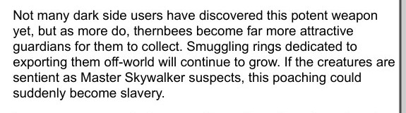
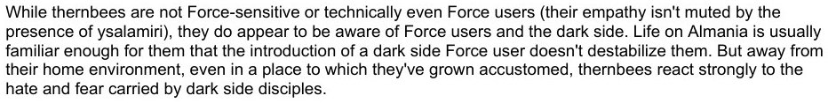

# Owner Material 037 — Star Wars D20 Drive folder (Core, Revised Core and Saga Edition): Creatures/Mood Swings.pdf [Star Wars Roleplaying Game Revised Core (d20, 2002)]

- **Source:** Wizards of the Coast Star Wars Roleplaying Game books, web enhancements, Living Force campaign modules and articles (2000–2010), from the owner's "Star Wars D20" Drive folder (only the three edition subfolders; "General" was not read, as instructed). Secondary source (licensed Legends reference). Scan OCR'd on the box; the scan stays box-only and is **not** published.
- **Method:** every scanned page was OCR'd and machine-screened sentence by sentence for power-relevant statements (fights, kills, defeats, Force feats, rankings, superweapons) that name a character on our roster; each kept sentence is quoted verbatim from the OCR text and has a crop of the printed passage directly under it. Pages with nothing power-relevant are still listed with what is on them.
- **Citation:** "*Mood Swings* (SWRPG d20 Revised Core), p.X" by printed page ("scan p.X" where no printed number applies). **Weight:** Licensed RPG material: a secondary source. Narrative text sums up Legends lore; game statistics are rules for players, not canon power levels, and rank lowest.

## scan p.1 (scan page 1)

Page contents: Thernbees: empathic predators, reaction to dark side points, maddened thernbees, poaching/slavery concern (Master Skywalker), For GMs Only sidebar (from image) (hand-read)

- **Luke Skywalker** — entry/section: Thernbees and the dark side (Master Skywalker suspects they are sentient): "Not many dark side users have discovered this potent weapon yet, but as more do, thernbees become far more attractive guardians for them to collect. Smuggling rings dedicated to exporting them off-world will continue to grow. If the creatures are sentient as Master Skywalker suspects, this poaching could suddenly become slavery." Source: *Mood Swings* (SWRPG d20 Revised Core), scan p.1
  
- **No single roster character (rules/setting/general)** — entry/section: Thernbees and the dark side: "While thernbees are not Force-sensitive or technically even Force users (their empathy isn't muted by the presence of ysalamiri), they do appear to be aware of Force users and the dark side. Life on Almania is usually familiar enough for them that the introduction of a dark side Force user doesn't destabilize them. But away from their home environment, even in a place to which they've grown accustomed, thernbees react strongly to the hate and fear carried by dark side disciples." Source: *Mood Swings* (SWRPG d20 Revised Core), scan p.1
  

## scan p.2 (scan page 2)

Page contents: Maddened Thernbee stats and special qualities (anesthetic bite, daze, empathic, pounce) (hand-read)

### Stat block notes (game mechanics, not feats)

- maddened thernbee (generic): Maddened Thernbee: Predator 8; Def 17; VP/WP 152/20; claws 2d4+6, bite 2d6, gore 1d8+6; Empathy +8; Challenge Code E (Source: *Mood Swings* (SWRPG d20 Revised Core), scan p.2)
