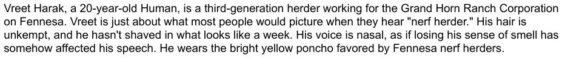
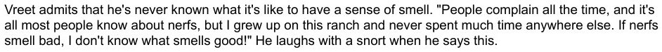
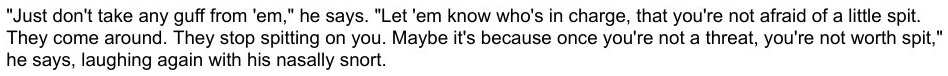
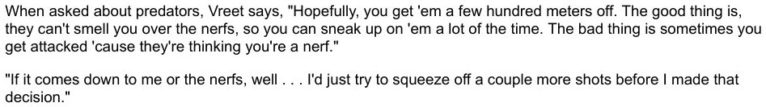
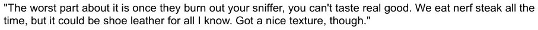

# Owner Material 037 — Star Wars D20 Drive folder (Core, Revised Core and Saga Edition): Creatures/Mountain Nerf.pdf [Star Wars Roleplaying Game Revised Core (d20, 2002)]

- **Source:** Wizards of the Coast Star Wars Roleplaying Game books, web enhancements, Living Force campaign modules and articles (2000–2010), from the owner's "Star Wars D20" Drive folder (only the three edition subfolders; "General" was not read, as instructed). Secondary source (licensed Legends reference). Scan OCR'd on the box; the scan stays box-only and is **not** published.
- **Method:** every scanned page was OCR'd and machine-screened sentence by sentence for power-relevant statements (fights, kills, defeats, Force feats, rankings, superweapons) that name a character on our roster; each kept sentence is quoted verbatim from the OCR text and has a crop of the printed passage directly under it. Pages with nothing power-relevant are still listed with what is on them.
- **Citation:** "*Mountain Nerf* (SWRPG d20 Revised Core), p.X" by printed page ("scan p.X" where no printed number applies). **Weight:** Licensed RPG material: a secondary source. Narrative text sums up Legends lore; game statistics are rules for players, not canon power levels, and rank lowest.

## scan p.1 (scan page 1)

Page contents: Nerfs (Alderaan origin), Fennesa mountain nerfs, herding, spittle, landslides; Vreet Harak intro (hand-read)

- **Vreet Harak** — entry/section: Vreet Harak: "Vreet Harak, a 20-year-old Human, is a third-generation herder working for the Grand Horn Ranch Corporation on Fennesa. Vreet is just about what most people would picture when they hear "nerf herder.” His hair is unkempt, and he hasn't shaved in what looks like a week. His voice is nasal, as if losing his sense of smell has somehow affected his speech. He wears the bright yellow poncho favored by Fennesa nerf herders." Source: *Mountain Nerf* (SWRPG d20 Revised Core), scan p.1
  

## scan p.2 (scan page 2)

Page contents: Vreet Harak quotes on smell, spit, predators, taste; Mountain Nerf stats (CC A); GM uses (rockslide 8d6); archive link (hand-read)

- **Vreet Harak** — entry/section: Vreet Harak on nerf smell: "Vreet admits that he's never known what it's like to have a sense of smell. "People complain all the time, and it's all most people know about nerfs, but I grew up on this ranch and never spent much time anywhere else. If nerfs smell bad, I don't know what smells good!" He laughs with a snort when he says this." Source: *Mountain Nerf* (SWRPG d20 Revised Core), scan p.2
  
- **Vreet Harak** — entry/section: Vreet Harak on nerf spit: ""Just don't take any guff from 'em," he says. "Let 'em know who's in charge, that you're not afraid of a little spit. They come around. They stop spitting on you. Maybe it's because once you're not a threat, you're not worth spit," he says, laughing again with his nasally snort." Source: *Mountain Nerf* (SWRPG d20 Revised Core), scan p.2
  
- **Vreet Harak** — entry/section: Vreet Harak on predators: "When asked about predators, Vreet says, "Hopefully, you get 'em a few hundred meters off. The good thing is, they can't smell you over the nerfs, so you can sneak up on 'em a lot of the time. The bad thing is sometimes you get attacked ‘cause they're thinking you're a nerf." "If it comes down to me or the nerfs, well . . . I'd just try to squeeze off a couple more shots before I made that decision."" Source: *Mountain Nerf* (SWRPG d20 Revised Core), scan p.2
  
- **Vreet Harak** — entry/section: Vreet Harak on taste: ""The worst part about it is once they burn out your sniffer, you can't taste real good. We eat nerf steak all the time, but it could be shoe leather for all I know. Got a nice texture, though."" Source: *Mountain Nerf* (SWRPG d20 Revised Core), scan p.2
  

### Stat block notes (game mechanics, not feats)

- mountain nerf (generic): Mountain Nerf: Mountain herd animal 1; Defense 13; VP/WP 6/14; head butt/kick 1d6, spittle; Challenge Code A (Source: *Mountain Nerf* (SWRPG d20 Revised Core), scan p.2)
