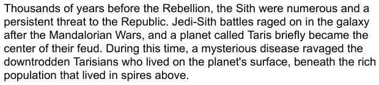
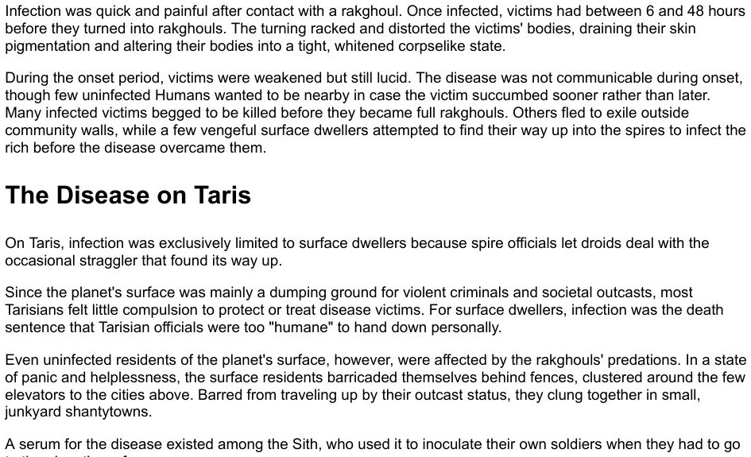

# Owner Material 037 — Star Wars D20 Drive folder (Core, Revised Core and Saga Edition): Creatures/Rakghoul.pdf [Star Wars Roleplaying Game Revised Core (d20, 2002)]

- **Source:** Wizards of the Coast Star Wars Roleplaying Game books, web enhancements, Living Force campaign modules and articles (2000–2010), from the owner's "Star Wars D20" Drive folder (only the three edition subfolders; "General" was not read, as instructed). Secondary source (licensed Legends reference). Scan OCR'd on the box; the scan stays box-only and is **not** published.
- **Method:** every scanned page was OCR'd and machine-screened sentence by sentence for power-relevant statements (fights, kills, defeats, Force feats, rankings, superweapons) that name a character on our roster; each kept sentence is quoted verbatim from the OCR text and has a crop of the printed passage directly under it. Pages with nothing power-relevant are still listed with what is on them.
- **Citation:** "*Rakghoul* (SWRPG d20 Revised Core), p.X" by printed page ("scan p.X" where no printed number applies). **Weight:** Licensed RPG material: a secondary source. Narrative text sums up Legends lore; game statistics are rules for players, not canon power levels, and rank lowest.

## scan p.1 (scan page 1)

Page contents: Rakghouls of Taris: disease origin speculation, packs led by fiends, infection 6-48 hours, surface dwellers, Sith serum (hand-read)

- **No single roster character (rules/setting/general)** — entry/section: Rakghoul disease on Taris: "Thousands of years before the Rebellion, the Sith were numerous and a persistent threat to the Republic. Jedi-Sith battles raged on in the galaxy after the Mandalorian Wars, and a planet called Taris briefly became the center of their feud. During this time, a mysterious disease ravaged the downtrodden Tarisians who lived on the planet's surface, beneath the rich population that lived in spires above." Source: *Rakghoul* (SWRPG d20 Revised Core), scan p.1
  
- **No single roster character (rules/setting/general)** — entry/section: Rakghoul infection: "Infection was quick and painful after contact with a rakghoul. Once infected, victims had between 6 and 48 hours before they turned into rakghouls. The turning racked and distorted the victims' bodies, draining their skin pigmentation and altering their bodies into a tight, whitened corpselike state.
During the onset period, victims were weakened but still lucid. The disease was not communicable during onset, though few uninfected Humans wanted to be nearby in case the victim succumbed sooner rather than later. Many infected victims begged to be killed before they became full rakghouls. Others fled to exile outside community walls, while a few vengeful surface dwellers attempted to find their way up into the spires to infect the rich before the disease overcame them." Source: *Rakghoul* (SWRPG d20 Revised Core), scan p.1
  
- **No single roster character (rules/setting/general)** — entry/section: The Sith serum: "A serum for the disease existed among the Sith, who used it to inoculate their own soldiers when they had to go to the planet's surface." Source: *Rakghoul* (SWRPG d20 Revised Core), scan p.1
  

## scan p.2 (scan page 2)

Page contents: Traits, disease rules, Rakghoul and Rakghoul Fiend stats, GM uses (hand-read)

### Stat block notes (game mechanics, not feats)

- rakghoul (generic): Rakghoul: Medium-size predator 2; Defense 18; VP/WP 9/17; claws 1d6+2; Challenge Code B (Source: *Rakghoul* (SWRPG d20 Revised Core), scan p.2)
- rakghoul fiend (generic): Rakghoul Fiend: Medium-size predator 2/soldier 5; Defense 25; VP/WP 41/20; claws, club, blaster pistol 3d6; Challenge Code D (Source: *Rakghoul* (SWRPG d20 Revised Core), scan p.2)

## scan p.3 (scan page 3)

Page contents: Copyright only (hand-read)

