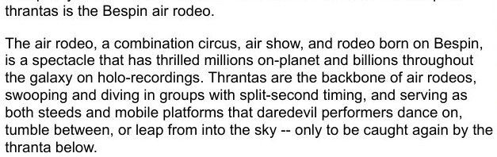

# Owner Material 037 — Star Wars D20 Drive folder (Core, Revised Core and Saga Edition): Creatures/Rodeo Thranta.pdf [Star Wars Roleplaying Game Revised Core (d20, 2002)]

- **Source:** Wizards of the Coast Star Wars Roleplaying Game books, web enhancements, Living Force campaign modules and articles (2000–2010), from the owner's "Star Wars D20" Drive folder (only the three edition subfolders; "General" was not read, as instructed). Secondary source (licensed Legends reference). Scan OCR'd on the box; the scan stays box-only and is **not** published.
- **Method:** every scanned page was OCR'd and machine-screened sentence by sentence for power-relevant statements (fights, kills, defeats, Force feats, rankings, superweapons) that name a character on our roster; each kept sentence is quoted verbatim from the OCR text and has a crop of the printed passage directly under it. Pages with nothing power-relevant are still listed with what is on them.
- **Citation:** "*Rodeo Thranta* (SWRPG d20 Revised Core), p.X" by printed page ("scan p.X" where no printed number applies). **Weight:** Licensed RPG material: a secondary source. Narrative text sums up Legends lore; game statistics are rules for players, not canon power levels, and rank lowest.

## scan p.1 (scan page 1)

Page contents: Bespin air rodeo, rodeo thrantas and trainers, beacon pens, retirement, rodeos on the road (hand-read)

- **No single roster character (rules/setting/general)** — entry/section: The Bespin air rodeo: "The air rodeo, a combination circus, air show, and rodeo born on Bespin, is a spectacle that has thrilled millions on-planet and billions throughout the galaxy on holo-recordings. Thrantas are the backbone of air rodeos, swooping and diving in groups with split-second timing, and serving as both steeds and mobile platforms that daredevil performers dance on, tumble between, or leap from into the sky -- only to be caught again by the thranta below." Source: *Rodeo Thranta* (SWRPG d20 Revised Core), scan p.1
  

## scan p.2 (scan page 2)

Page contents: Transport hardship, protestors; Trick-Riding Thranta stats (CC B); four adventure hooks (hand-read)

### Stat block notes (game mechanics, not feats)

- trick-riding thranta (generic): Trick-Riding Thranta: Airborne herd animal 5; Defense 16; fly 26 m; VP/WP 48/50; SZ H; Challenge Code B (Source: *Rodeo Thranta* (SWRPG d20 Revised Core), scan p.2)
