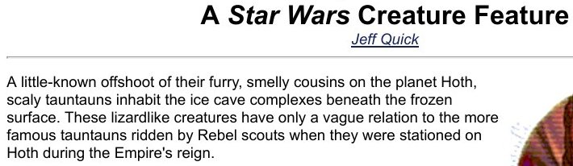

# Owner Material 037 — Star Wars D20 Drive folder (Core, Revised Core and Saga Edition): Creatures/Scaly Tauntaun.pdf [Star Wars Roleplaying Game Revised Core (d20, 2002)]

- **Source:** Wizards of the Coast Star Wars Roleplaying Game books, web enhancements, Living Force campaign modules and articles (2000–2010), from the owner's "Star Wars D20" Drive folder (only the three edition subfolders; "General" was not read, as instructed). Secondary source (licensed Legends reference). Scan OCR'd on the box; the scan stays box-only and is **not** published.
- **Method:** every scanned page was OCR'd and machine-screened sentence by sentence for power-relevant statements (fights, kills, defeats, Force feats, rankings, superweapons) that name a character on our roster; each kept sentence is quoted verbatim from the OCR text and has a crop of the printed passage directly under it. Pages with nothing power-relevant are still listed with what is on them.
- **Citation:** "*Scaly Tauntaun* (SWRPG d20 Revised Core), p.X" by printed page ("scan p.X" where no printed number applies). **Weight:** Licensed RPG material: a secondary source. Narrative text sums up Legends lore; game statistics are rules for players, not canon power levels, and rank lowest.

## scan p.1 (scan page 1)

Page contents: Scaly tauntauns: hairless Hoth cave offshoot, geothermal oases, herds, lichen diet, migration, wampas (hand-read)

- **No single roster character (rules/setting/general)** — entry/section: Scaly tauntauns: "A little-known offshoot of their furry, smelly cousins on the planet Hoth, scaly tauntauns inhabit the ice cave complexes beneath the frozen surface. These lizardlike creatures have only a vague relation to the more famous tauntauns ridden by Rebel scouts when they were stationed on Hoth during the Empire's reign." Source: *Scaly Tauntaun* (SWRPG d20 Revised Core), scan p.1
  

## scan p.2 (scan page 2)

Page contents: Wampa tactics, sacrifice behavior, sentients (criminals, scientists), stats, traits, GM dangers (hand-read)

### Stat block notes (game mechanics, not feats)

- scaly tauntaun (generic): Scaly Tauntaun: Large subterranean herd animal 3; Defense 18; VP/WP 11/16; claw/bite; Challenge Code B (Source: *Scaly Tauntaun* (SWRPG d20 Revised Core), scan p.2)

## scan p.3 (scan page 3)

Page contents: Heat/cold hazards, pirates with trained tauntauns; Jedi Counseling link (hand-read)

